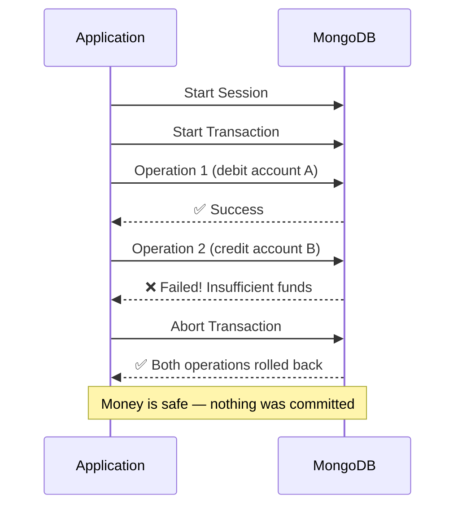

## Transactions

Transactions ensure **multiple operations either all succeed or all fail** (ACID compliance). Requires a **Replica Set** or **Sharded Cluster** (not standalone).

### Real-World Analogy

Think of **bank transfer**:

- **Without transaction:** You debit account A (✅ success). Then you credit account B (❌ fails). Money is lost!
- **With transaction:** Both happen together. If the credit fails, the debit is automatically **rolled back**.

### How Transactions Work



### Code Example

```js
const transferMoney = async (fromId, toId, amount) => {
  const session = await mongoose.startSession();

  try {
    // Start transaction
    session.startTransaction();

    // Find source account
    const fromAccount = await Account.findById(fromId).session(session);

    if (!fromAccount || fromAccount.balance < amount) {
      throw new Error('Insufficient funds');
    }

    // Debit source
    await Account.findByIdAndUpdate(
      fromId,
      { $inc: { balance: -amount } },
      { session }   // pass session to all operations!
    );

    // Credit destination
    await Account.findByIdAndUpdate(
      toId,
      { $inc: { balance: +amount } },
      { session }
    );

    // Create transaction record
    await Transaction.create([{
      from: fromId,
      to: toId,
      amount,
      status: 'success',
      timestamp: new Date()
    }], { session });

    // Commit if all succeeded
    await session.commitTransaction();
    console.log('✅ Transfer successful');

  } catch (error) {
    // Rollback everything on any error
    await session.abortTransaction();
    console.error('❌ Transfer failed, rolled back:', error.message);
    throw error;

  } finally {
    // Always end the session
    session.endSession();
  }
};
```

### Without vs With Transaction

```text
Without Transaction:
  debit account A  ✅
  credit account B ❌ FAILS
  → Money lost! Inconsistent
  
With Transaction:
  START TRANSACTION
  debit account A  ✅
  credit account B ❌ FAILS
  ROLLBACK → both undone ✅
  No money lost. Consistent.
```

### Key Rules

| Rule | Detail |
|------|--------|
| **Requires replica set** | Cannot use transactions on a standalone server |
| **Session required** | All operations must use the same session |
| **Time limit** | Default 60 seconds per transaction |
| **Document limit** | Max 1000 documents modified in a single transaction |
| **No DDL** | Cannot create/drop collections or indexes inside a transaction |

### When to Use Transactions

```mermaid
flowchart TB
    Q1{Are multiple documents<br/>involved in one<br/>business operation?}
    Q1 -->|No| NoTx[Don't need transaction<br/>Single operation is atomic]
    Q1 -->|Yes| Q2{Does failure of one<br/>operation leave data<br/>inconsistent?}
    
    Q2 -->|No| NoTx
    Q2 -->|Yes| Q3{Can you design around it<br/>with atomic operators<br/>($inc, $push)?}
    
    Q3 -->|Yes| Atomic[Use atomic operators<br/>instead — faster]
    Q3 -->|No| UseTx[Use Transaction ✅]
    
    style UseTx fill:#7c3aed,color:#fff
    style Atomic fill:#3b82f6,color:#fff
    style NoTx fill:#f59e0b,color:#fff
```

---

### In Simple Words

- **Transactions** let you run multiple operations as a single "all or nothing" unit
- If any operation fails, **everything is rolled back** — no partial updates
- You need a **replica set** to use transactions
- Most MongoDB apps don't need transactions — MongoDB's single-document operations are already atomic
- Use transactions when **money, inventory, or critical data consistency** is at stake

---

*Next: [Read & Write Concern →](/DSA-Notes-Problems/mongodb/operations/read-write-concern)*
