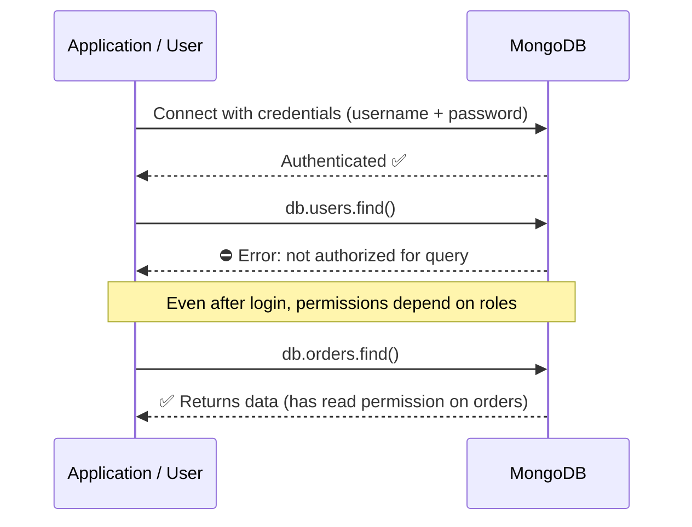
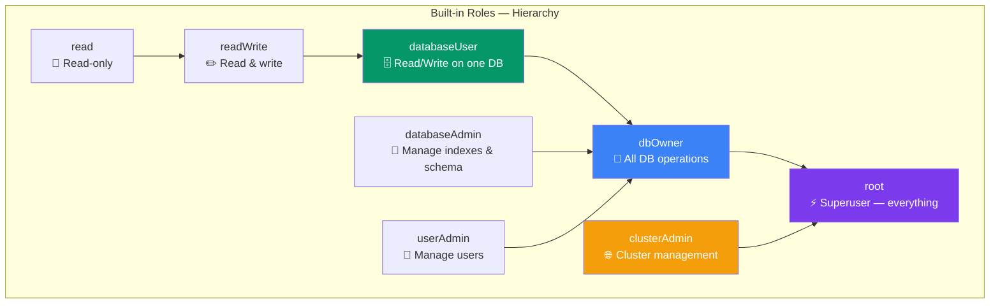

## Authentication & Authorization

MongoDB has two separate security concepts:

- **Authentication** — Who are you? (verifying identity)
- **Authorization** — What can you do? (permissions based on roles)

### Real-World Analogy

Think of an **office building**:

- **Authentication** = Showing your ID card at the entrance
- **Authorization** = Your access level determines which floors you can enter:
  - Employee can enter floors 1–3
  - Manager can enter floors 1–5
  - Admin can enter all floors including the server room

### Auth Flow



### Creating Users

```js
// Connect to admin database to create users
use admin

// Create a user with readWrite role on myapp database
db.createUser({
  user: "appuser",
  pwd: passwordPrompt(),  // or plain string (not recommended)
  roles: [
    { role: "readWrite", db: "myapp" }
  ]
})

// Create an admin user (full access)
db.createUser({
  user: "admin",
  pwd: passwordPrompt(),
  roles: [
    { role: "root", db: "admin" }
  ]
})

// Create a read-only user for reporting
db.createUser({
  user: "reporter",
  pwd: passwordPrompt(),
  roles: [
    { role: "read", db: "myapp" }
  ]
})

// Create user with multiple roles across databases
db.createUser({
  user: "developer",
  pwd: passwordPrompt(),
  roles: [
    { role: "readWrite", db: "myapp" },
    { role: "read", db: "analytics" },
    { role: "dbAdmin", db: "myapp" }
  ]
})
```

### Built-in Roles



| Role | Scope | Permissions |
|------|-------|-------------|
| `read` | Database | Read any collection |
| `readWrite` | Database | Read + write any collection |
| `dbAdmin` | Database | Manage indexes, schema, stats |
| `userAdmin` | Database | Create/manage users on this database |
| `dbOwner` | Database | All database operations (readWrite + dbAdmin + userAdmin) |
| `root` | Global | Superuser — everything |
| `clusterAdmin` | Cluster | Sharding, replication, cluster management |
| `backup` | Global | Backup data |
| `restore` | Global | Restore from backup |

### Custom Roles

```js
use myapp

// Create a custom role that can only read orders and manage users
db.createRole({
  role: "orderManager",
  privileges: [
    {
      resource: { db: "myapp", collection: "orders" },
      actions: ["find", "insert", "update"]
    },
    {
      resource: { db: "myapp", collection: "users" },
      actions: ["find", "update"]
    }
  ],
  roles: []  // can inherit from other roles
})

// Create user with custom role
db.createUser({
  user: "orderManager",
  pwd: passwordPrompt(),
  roles: [
    { role: "orderManager", db: "myapp" }
  ]
})
```

### Managing Users and Roles

```js
// List all users
db.getUsers()

// Show current user's privileges
db.runCommand({ usersInfo: "appuser", showPrivileges: true })

// Update user's roles
db.updateUser("appuser", {
  roles: [
    { role: "readWrite", db: "myapp" },
    { role: "read", db: "analytics" }
  ]
})

// Remove a user
db.dropUser("olduser")

// List all roles
db.getRoles({ showBuiltinRoles: true })
```

---

### In Simple Words

- **Authentication** checks who you are; **Authorization** controls what you can do
- **Built-in roles** range from `read` (basic) to `root` (superuser)
- Always create **application users with least privilege** — only grant what's needed
- Use **custom roles** when built-in roles don't give the exact permissions you need
- Store passwords securely, never hardcode them in your app

---

*Next: [Schema Validation →](/DSA-Notes-Problems/mongodb/security/schema-validation)*
