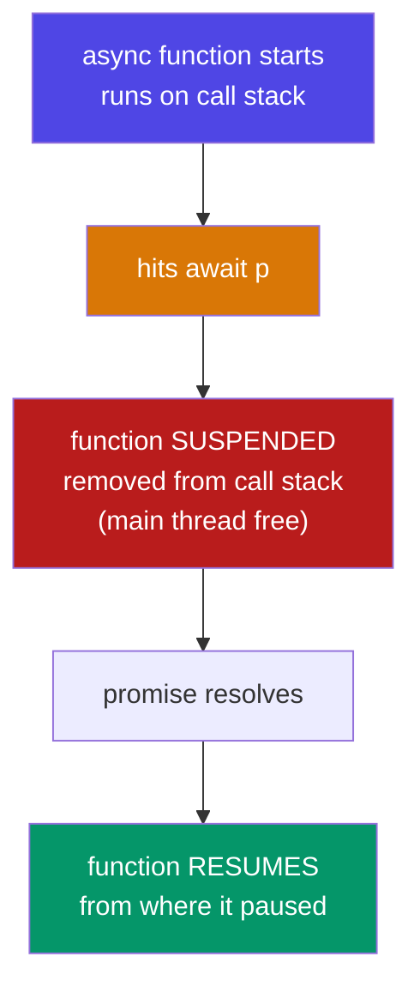

# Season 2 - Episode 5 : async / await

- `async`/`await` is a modern way to handle promises. It is **syntactic sugar over Promises** — cleaner to read, but Promises still run underneath.

> `async`/`await` was introduced in **ES2017 (ES8)**.


## What is `async`?

- `async` is a keyword placed before a function. **An async function always returns a Promise.**

  ```js
  async function getData() {
    return "Namaste JavaScript";
  }

  const result = getData();
  console.log(result); // Promise {<fulfilled>: "Namaste JavaScript"}

  result.then((data) => console.log(data)); // Namaste JavaScript
  ```

- Even though we returned a plain string, JS automatically **wraps it in a promise**. If you return a promise, it's returned as-is.

## What is `await`?

- `await` can **only be used inside an `async` function**. It pauses the function until the promise settles, then gives you the resolved value.

  ```js
  const p = new Promise((resolve) => {
    resolve("Promise resolved value!");
  });

  async function handlePromise() {
    const val = await p; // waits for p, then unwraps the value
    console.log(val);    // Promise resolved value!
  }

  handlePromise();
  ```

## `.then()` vs `await` — the difference

- Both consume promises, but they behave differently with timing.

  **Old way (`.then`):**

  ```js
  function handlePromise() {
    p.then((val) => console.log(val));
    console.log("Hello World");
  }
  // "Hello World" prints first, then the promise value
  ```

  **New way (`await`):**

  ```js
  async function handlePromise() {
    const val = await p;
    console.log(val);
    console.log("Hello World"); // runs AFTER the await resolves
  }
  ```

- With `.then`, the rest of the function keeps running and the callback fires later. With `await`, the code **looks** like it waits — it reads top-to-bottom, synchronously.

## How `await` actually works (important!)

- `await` does **not** block the main thread / call stack. This is the key misunderstanding.
- When JS hits `await`, the async function is **suspended** and removed from the call stack. The engine is free to do other work. When the awaited promise resolves, the function **resumes** from where it paused.



- Example showing it does not block:

  ```js
  const p1 = new Promise((res) => setTimeout(() => res("P1"), 5000));
  const p2 = new Promise((res) => setTimeout(() => res("P2"), 10000));

  async function handle() {
    console.log("Start");
    const v1 = await p1; // suspends ~5s, main thread free
    console.log(v1);
    const v2 = await p2; // p2 already resolving; total ~10s
    console.log(v2);
    console.log("End");
  }
  handle();
  ```

- Because both timers start at the same time, total time is ~10s (not 15s). `await` suspends; it does not freeze the browser.

## Real-world example with `fetch`

  ```js
  async function getGithubData() {
    const data = await fetch("https://api.github.com/users/akshaymarch7");
    const json = await data.json();
    console.log(json);
  }
  getGithubData();
  ```

- `fetch` returns a promise for a `Response`. `response.json()` also returns a promise — hence two `await`s.

## Error handling with `try...catch`

- With async/await we use a normal `try...catch` block instead of `.catch()`:

  ```js
  async function getData() {
    try {
      const data = await fetch("https://wrong-url");
      const json = await data.json();
      console.log(json);
    } catch (err) {
      console.log(err); // handles any rejection above
    }
  }
  getData();
  ```

- Alternatively, you can still attach `.catch()` to the async function call:

  ```js
  getData().catch((err) => console.log(err));
  ```

## async/await vs Promises — which to use?

- `async`/`await` is **syntactic sugar** over `.then()`/`.catch()`. Under the hood it's the same promises.
- Prefer `async`/`await` because:
  - cleaner, more readable (looks synchronous),
  - easier error handling with `try...catch`,
  - no `.then()` chaining / no forgetting to `return`.
- But you **must** understand Promises first — async/await is built on them.

## Summary

- `async` function always returns a promise.
- `await` pauses the async function until a promise settles, then unwraps the value.
- `await` **suspends** the function (does not block the main thread).
- Use `try...catch` for errors.
- It's sugar over Promises — same engine, nicer syntax.

<hr>

Watch Live On Youtube below:

<a href="https://www.youtube.com/watch?v=6nv3qy3oNkc&ab_channel=AkshaySaini" target="_blank"></a>

<br>

<hr>

<br>
