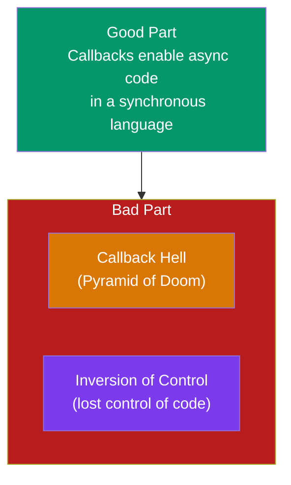

# Season 2 - Episode 1 : Callback Hell & Inversion of Control

- JavaScript is a **synchronous, single-threaded** language. It has one call stack and can do only one thing at a time.
- A **callback** is a function passed into another function as an argument, to be executed later. Callbacks are what let us do **async** things in JS.

> Two parts to callbacks: the **Good Part** (callbacks are essential for async) and the **Bad Part** (Callback Hell + Inversion of Control).




## The Good Part of Callbacks

- Callbacks let us handle async operations. Example with `setTimeout`:

  ```js
  console.log("Namaste");
  setTimeout(function () {
    console.log("JavaScript");
  }, 5000);
  console.log("Season 2");

  // Output:
  // Namaste
  // Season 2
  // JavaScript   (after 5 seconds)
  ```

- Here we passed a function into `setTimeout` and told JS: "run this **later**." That's the power of callbacks.

## The Bad Part of Callbacks

There are two big problems.

### 1. Callback Hell (Pyramid of Doom)

- Imagine an e-commerce app. To place an order we must do tasks **in sequence**, where each step depends on the previous one:

  1. Create the order
  2. Proceed to payment
  3. Show the order summary
  4. Update the wallet

- Because each step depends on the previous response, we nest callbacks inside callbacks:

  ```js
  const cart = ["shoes", "pants", "kurta"];

  api.createOrder(cart, function () {
    api.proceedToPayment(function () {
      api.showOrderSummary(function () {
        api.updateWallet(function () {
          console.log("Order complete!");
        });
      });
    });
  });
  ```

- This nesting grows **horizontally** instead of vertically. The code keeps drifting to the right. This is called **Callback Hell**, also known as the **Pyramid of Doom**.
- Such code is hard to read, hard to maintain, and hard to debug.

### 2. Inversion of Control

- This is the more serious, subtle problem. When we pass a callback to another function, we **lose control** of our code. We are trusting that `createOrder` will call our callback:

  - correctly,
  - exactly once,
  - and at the right time.

  ```js
  api.createOrder(cart, function () {
    api.proceedToPayment();
  });
  ```

- We handed our `proceedToPayment` logic to `createOrder`. We are blindly trusting it. What if `createOrder`:

  - never calls our callback? (payment never happens)
  - calls it twice? (user charged twice!)
  - has a bug and calls it 10 times?

- Our whole payment flow now depends on someone else's function. **That is Inversion of Control** — control of our program is inverted, handed over to another function we don't own.

> Callback Hell hurts **readability**. Inversion of Control hurts **trust / reliability**. Both are solved by **Promises** (next episode).

<hr>

Watch Live On Youtube below:

<a href="https://www.youtube.com/watch?v=yEKtJGha3yM&ab_channel=AkshaySaini" target="_blank"></a>

<br>

<hr>

<br>
