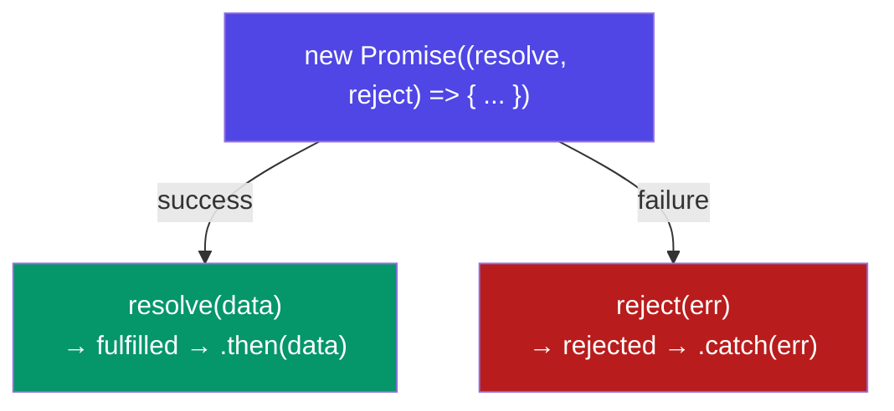

# Season 2 - Episode 3 : Creating a Promise, Chaining & Error Handling

- Previous episode: how to **consume** a promise. This episode: how to **create** one, **chain** them properly, and **handle errors**.


## Creating a Promise

- We create a promise with the `Promise` constructor. It takes an **executor function** with two arguments: `resolve` and `reject` (these are functions given to us by JavaScript).

  ```js
  function createOrder(cart) {
    const pr = new Promise(function (resolve, reject) {
      // validate the cart
      if (!validateCart(cart)) {
        const err = new Error("Cart is not valid");
        reject(err); // mark promise as rejected
        return;
      }

      const orderId = "12345";
      if (orderId) {
        setTimeout(function () {
          resolve(orderId); // mark promise as fulfilled, pass data
        }, 5000);
      }
    });
    return pr;
  }
  ```

- `resolve(value)` → moves the promise to **fulfilled** and passes `value` to `.then()`.
- `reject(error)` → moves the promise to **rejected** and passes `error` to `.catch()`.



## Consuming it

  ```js
  const cart = ["shoes", "pants", "kurta"];

  createOrder(cart)
    .then(function (orderId) {
      console.log(orderId); // 12345
    });
  ```

## Promise Chaining

- Real flows have dependent steps: create order → pay → summary. We chain `.then()` calls.
- **Golden rule:** to pass a value to the next `.then()`, you must **`return`** it. The returned value (or returned promise) becomes the input of the next `.then`.

  ```js
  createOrder(cart)
    .then(function (orderId) {
      console.log(orderId);
      return orderId; // pass to next then
    })
    .then(function (orderId) {
      return proceedToPayment(orderId); // return a promise
    })
    .then(function (paymentInfo) {
      console.log(paymentInfo);
    });
  ```

- When you `return` a **promise** from `.then()`, the next `.then()` waits for that promise to resolve before running. This is what makes chains run **in sequence**.

> Common bug: forgetting `return`. Without it, the next `.then` receives `undefined`.

- Use arrow functions to keep chains clean:

  ```js
  createOrder(cart)
    .then((orderId) => proceedToPayment(orderId))
    .then((paymentInfo) => showOrderSummary(paymentInfo))
    .then((balance) => updateWalletBalance(balance));
  ```

## Error Handling with `.catch()`

- Attach `.catch()` to handle a `reject` anywhere in the chain:

  ```js
  createOrder(cart)
    .then((orderId) => {
      console.log(orderId);
      return orderId;
    })
    .then((orderId) => proceedToPayment(orderId))
    .then((paymentInfo) => console.log(paymentInfo))
    .catch(function (err) {
      console.log(err.message); // handles any failure above
    });
  ```

- A single `.catch()` at the end catches errors from **any** step before it. When a promise rejects, JS skips all the `.then()` blocks until it finds a `.catch()`.

### Catch placement matters

- A `.catch()` only handles errors from the `.then()`s **above** it. `.then()`s placed **after** a `.catch()` will still run:

  ```js
  createOrder(cart)
    .then((orderId) => proceedToPayment(orderId))
    .catch(function (err) {
      console.log(err.message); // handles createOrder/payment failures
    })
    .then(function () {
      // this STILL runs even if there was an error above,
      // because .catch handled it and the chain continues
      console.log("No matter what happens, I will run");
    });
  ```

- This lets you recover from a failed step and continue the rest of the flow.

## Summary

- Create promises with `new Promise((resolve, reject) => {...})`.
- `resolve` → fulfilled, `reject` → rejected.
- Chain with `.then()`, and **always `return`** the value/promise for the next step.
- Returning a promise makes the chain wait — sequential async.
- `.catch()` handles rejections from everything above it; `.then()`s after it still run.

<hr>

Watch Live On Youtube below:

<a href="https://www.youtube.com/watch?v=U74BJcr8NeQ&ab_channel=AkshaySaini" target="_blank"></a>

<br>

<hr>

<br>
