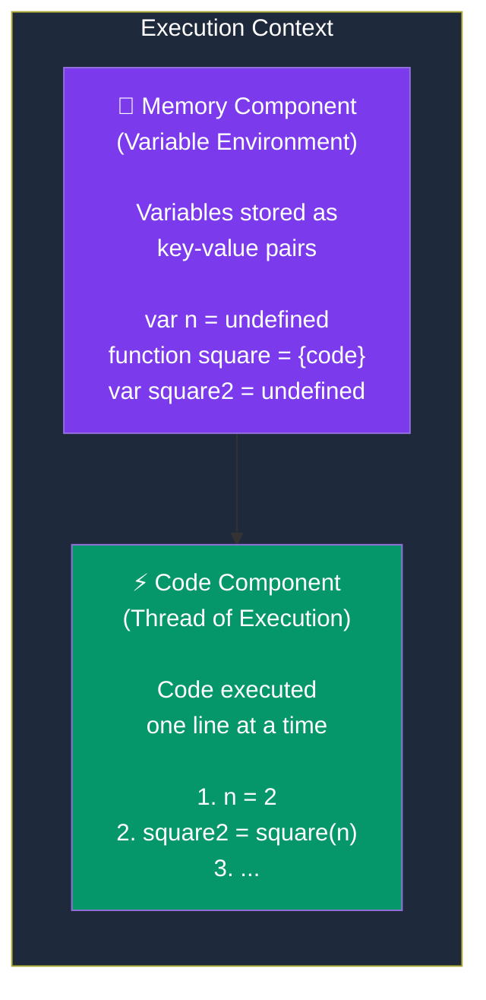

# Episode 1 : Execution Context

- Everything in JS happens inside the execution context. Imagine a sealed-off container inside which JS runs. It is an abstract concept that hold info about the env. within the current code is being executed.

  

- In the container the first component is **memory component** and the 2nd one is **code component**

- Memory component has all the variables and functions in key value pairs. It is also called **Variable environment**.

- Code component is the place where code is executed one line at a time. It is also called the **Thread of Execution**.

- JS is a **synchronous**, **single-threaded** language
  - Synchronous:- One command at a time.
  - Single-threaded:- In a specific synchronous order.

Watch Live On Youtube below:

 

 