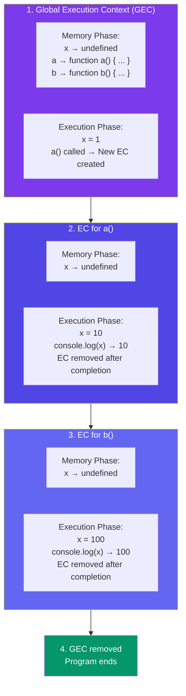

# Episode 4 : Functions and Variable Environments

```js
var x = 1;
a();
b(); // we are calling the functions before defining them. This will work properly, as seen in Hoisting.
console.log(x);

function a() {
  var x = 10; // local scope because of separate execution context
  console.log(x);
}

function b() {
  var x = 100;
  console.log(x);
}
```

Outputs:

> 10

> 100

> 1





## Code Flow in terms of Execution Context

- The Global Execution Context (GEC) is created (the big box with Memory and Code subparts). Also GEC is pushed into Call Stack

> Call Stack : GEC

- In first phase of GEC (memory phase), variable x:undefined and a and b have their entire function code as value initialized

- In second phase of GEC (execution phase), when the function is called, a new local Execution Context is created. After x = 1 assigned to GEC x, a() is called. So local EC for a is made inside code part of GEC.

> Call Stack: [GEC, a()]

- For local EC, a totally different x variable assigned undefined(x inside a()) in phase 1 , and in phase 2 it is assigned 10 and printed in console log. After printing, no more commands to run, so a() local EC is removed from both GEC and from Call stack

> Call Stack: GEC

- Cursor goes back to b() function call. Same steps repeat.

> Call Stack :[GEC, b()] -> GEC (after printing yet another totally different x value as 100 in console log)

- Finally GEC is deleted and also removed from call stack. Program ends.

- reference:


<hr>

Watch Live On Youtube below:

<a href="https://www.youtube.com/watch?v=gSDncyuGw0s&ab_channel=AkshaySaini" target="_blank"></a>

<br>

<hr>

<br>