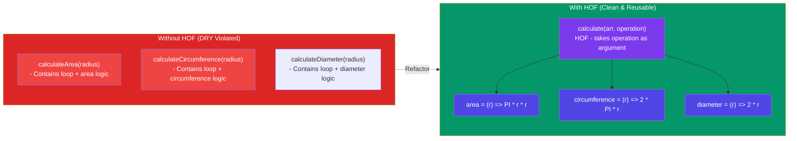

# Episode 18 : Higher-Order Functions ft. Functional Programming

### Q: What is Higher Order Function?

**Ans**: A Higher-order functions are regular functions that take other functions as arguments or return functions as their results. Eg:

```js
function x() {
    console.log("Hi)";
};
function y(x) {
    x();
};
y(); // Hi
// y is a higher order function
// x is a callback function
```





Let's try to understand how we should approach solution in interview.
I have an array of radius and I have to calculate area using these radius and store in an array.

First Approach:

```js
const radius = [1, 2, 3, 4];
const calculateArea = function (radius) {
  const output = [];
  for (let i = 0; i < radius.length; i++) {
    output.push(Math.PI * radius[i] * radius[i]);
  }
  return output;
};
console.log(calculateArea(radius));
```

The above solution works perfectly fine but what if we have now requirement to calculate array of circumference. Code now be like

```js
const radius = [1, 2, 3, 4];
const calculateCircumference = function (radius) {
  const output = [];
  for (let i = 0; i < radius.length; i++) {
    output.push(2 * Math.PI * radius[i]);
  }
  return output;
};
console.log(calculateCircumference(radius));
```

But over here we are violating some principle like DRY Principle, now lets observe the better approach.

```js
const radiusArr = [1, 2, 3, 4];

// logic to calculate area
const area = function (radius) {
    return Math.PI * radius * radius;
}

// logic to calculate circumference
const circumference = function (radius) {
    return 2 * Math.PI * radius;
}

const calculate = function(radiusArr, operation) {
    const output = [];
    for (let i = 0; i < radiusArr.length; i++) {
        output.push(operation(radiusArr[i]));
    }
    return output;
}
console.log(calculate(radiusArr, area));
console.log(calculate(radiusArr, circumference));
// Over here calculate is HOF
// Over here we have extracted logic into separate functions. This is the beauty of functional programming.

Polyfill of map
// Over here calculate is nothing but polyfill of map function
// console.log(radiusArr.map(area)) == console.log(calculate(radiusArr, area));

***************************************************
Lets convert above calculate function as map function and try to use. So,

Array.prototype.calculate = function(operation) {
    const output = [];
    for (let i = 0; i < this.length; i++) {
        output.push(operation(this[i]));
    }
    return output;
}
console.log(radiusArr.calculate(area))
```

<hr>

Watch Live On Youtube below:

<a href="https://www.youtube.com/watch?v=HkWxvB1RJq0&ab_channel=AkshaySaini" target="_blank"></a>

<br>

<hr>

<br>