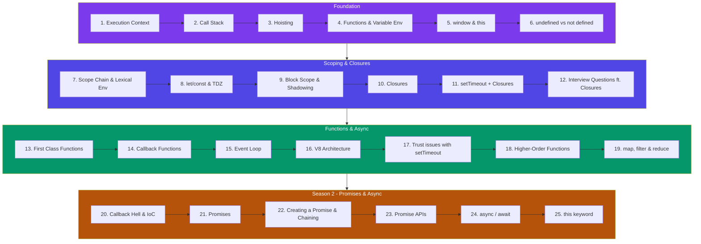

# Namaste JavaScript

Namaste JavaScript course notes covering execution context, hoisting, closures, and more.

## Sections

- [Execution Context](/DSA-Notes-Problems/namaste-js/season-1/execution-context)
- [How JS is executed & Call Stack](/DSA-Notes-Problems/namaste-js/season-1/how-js-is-executed-call-stack)
- [Hoisting in JavaScript (variables & functions)](/DSA-Notes-Problems/namaste-js/season-1/hoisting-in-javascript-variables-functions)
- [Functions and Variable Environments](/DSA-Notes-Problems/namaste-js/season-1/functions-and-variable-environments)
- [Shortest JS Program, window & this keyword](/DSA-Notes-Problems/namaste-js/season-1/shortest-js-program-window-this-keyword)
- [undefined vs not defined in JS](/DSA-Notes-Problems/namaste-js/season-1/undefined-vs-not-defined-in-js)
- [The Scope Chain, Scope & Lexical Environment](/DSA-Notes-Problems/namaste-js/season-1/the-scope-chain-scope-lexical-environment)
- [let & const in JS, Temporal Dead Zone](/DSA-Notes-Problems/namaste-js/season-1/let-const-in-js-temporal-dead-zone)
- [Block Scope & Shadowing in JS](/DSA-Notes-Problems/namaste-js/season-1/block-scope-shadowing-in-js)
- [Closures in JS](/DSA-Notes-Problems/namaste-js/season-1/closures-in-js)
- [setTimeout + Closures Interview Question](/DSA-Notes-Problems/namaste-js/season-1/settimeout-closures-interview-question)
- [Famous Interview Questions ft. Closures](/DSA-Notes-Problems/namaste-js/season-1/famous-interview-questions-ft-closures)
- [First Class Functions ft. Anonymous Functions](/DSA-Notes-Problems/namaste-js/season-1/first-class-functions-ft-anonymous-functions)
- [Callback Functions in JS ft. Event Listeners](/DSA-Notes-Problems/namaste-js/season-1/callback-functions-in-js-ft-event-listeners)
- [Asynchronous JavaScript & EVENT LOOP from scratch](/DSA-Notes-Problems/namaste-js/season-1/asynchronous-javascript-event-loop-from-scratch)
- [JS Engine Exposed, Google's V8 Architecture](/DSA-Notes-Problems/namaste-js/season-1/js-engine-exposed-googles-v8-architecture)
- [Trust issues with setTimeout()](/DSA-Notes-Problems/namaste-js/season-1/trust-issues-with-settimeout)
- [Higher-Order Functions ft. Functional Programming](/DSA-Notes-Problems/namaste-js/season-1/higher-order-functions-ft-functional-programming)
- [map, filter & reduce](/DSA-Notes-Problems/namaste-js/season-1/map-filter-reduce)

## Season 2 — Promises & Async

- [Callback Hell & Inversion of Control](/DSA-Notes-Problems/namaste-js/season-2/callback-hell-inversion-of-control)
- [Promises](/DSA-Notes-Problems/namaste-js/season-2/promises)
- [Creating a Promise, Chaining & Error Handling](/DSA-Notes-Problems/namaste-js/season-2/creating-a-promise-chaining-error-handling)
- [Promise APIs (all, allSettled, race, any)](/DSA-Notes-Problems/namaste-js/season-2/promise-apis-all-allsettled-race-any)
- [async / await](/DSA-Notes-Problems/namaste-js/season-2/async-await)
- [this keyword in JavaScript](/DSA-Notes-Problems/namaste-js/season-2/this-keyword-in-javascript)