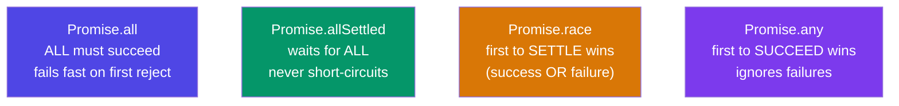

# Season 2 - Episode 4 : Promise APIs + Interview Questions

- Four important static Promise APIs handle **multiple promises at once**:
  - `Promise.all()`
  - `Promise.allSettled()`
  - `Promise.race()`
  - `Promise.any()`
- In real interviews and projects, you rarely deal with one promise. You usually fire several API calls in parallel and combine results. These APIs help.



> All four take an **iterable (array) of promises** and return a single promise.


## 1. `Promise.all([p1, p2, p3])`

- Waits for **all** promises to fulfill, then returns an array of all results (in input order).
- **Fail-fast:** if **any** promise rejects, `Promise.all` rejects **immediately** with that error — it does not wait for the others.

  ```js
  // Success case: all resolve
  Promise.all([p1, p2, p3])
    .then((results) => console.log(results)) // [v1, v2, v3]
    .catch((err) => console.error(err));
  ```

- Timing: if p1 takes 3s, p2 takes 1s, p3 takes 2s → result after **3s** (the slowest).
- If p2 rejects after 1s → `Promise.all` rejects after **1s**. The other promises still run in the background, but their results are thrown away.

> Use when you need **everything to succeed** (e.g., load user + cart + wishlist together).

## 2. `Promise.allSettled([p1, p2, p3])`

- Waits for **all** promises to settle (fulfill OR reject). **Never short-circuits.**
- Always resolves with an array of result objects describing each outcome:

  ```js
  Promise.allSettled([p1, p2, p3]).then((results) => console.log(results));

  // [
  //   { status: "fulfilled", value: v1 },
  //   { status: "rejected",  reason: err2 },
  //   { status: "fulfilled", value: v3 }
  // ]
  ```

- This is the **safest** API — you always get the full picture regardless of failures.

> Use when you want **all results no matter what**, success or failure.

## 3. `Promise.race([p1, p2, p3])`

- Returns the result of the **first promise to settle** — whether it fulfills **or** rejects. "Race" = first to finish wins.

  ```js
  // p1 = 3s, p2 = 1s, p3 = 2s
  Promise.race([p1, p2, p3]).then((res) => console.log(res));
  // logs p2's value after 1s (it finished first)
  ```

- If the fastest one **rejects**, the race rejects with that error.

> Use for timeouts: race an API call against a timer.

## 4. `Promise.any([p1, p2, p3])`

- Returns the result of the **first promise to fulfill (succeed)**. It **ignores rejections** and keeps waiting for a success.
- Only if **all** promises reject does it reject — with an **`AggregateError`** containing all the errors:

  ```js
  Promise.any([p1, p2, p3])
    .then((res) => console.log(res)) // first SUCCESS
    .catch((err) => {
      console.error(err);        // AggregateError
      console.error(err.errors); // array of all rejection reasons
    });
  ```

> `race` = first to **settle**. `any` = first to **succeed**.

## Quick comparison

| API | Resolves when | Rejects when |
| --- | --- | --- |
| `all` | all fulfill | any one rejects (fail-fast) |
| `allSettled` | all settle | never (always resolves) |
| `race` | first settles (success) | first settles (if it's a failure) |
| `any` | first fulfills | all reject (AggregateError) |

## Interview-style notes

- `Promise.all` rejects as soon as one fails, but the **other promises are not cancelled** — JS has no promise cancellation. They finish in the background; their results are simply ignored.
- `allSettled` is preferred when one failing call shouldn't break the whole batch.
- `race` settles on the first result of any kind; `any` waits specifically for the first **success**.

<hr>

Watch Live On Youtube below:

<a href="https://www.youtube.com/watch?v=DlTVt1rZjIo&ab_channel=AkshaySaini" target="_blank"></a>

<br>

<hr>

<br>
