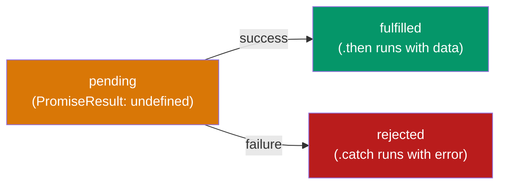

# Season 2 - Episode 2 : Promises

- **Promises are used to handle async operations in JavaScript.**
- A **Promise** is an object representing the eventual completion (or failure) of an asynchronous operation. Think of it as a **placeholder for a value that will be filled in later**.

> Before Promises we used callbacks, which caused **Callback Hell** and **Inversion of Control**. Promises fix both.


## The problem before Promises

- Using callbacks, we passed our function into `createOrder` and lost control:

  ```js
  const cart = ["shoes", "pants", "kurta"];

  createOrder(cart, function (orderId) {
    proceedToPayment(orderId);
  });
  ```

- Problem: we trust `createOrder` blindly to call our callback correctly. This is **Inversion of Control**.

## The Promise way

- Instead of passing a callback **into** `createOrder`, `createOrder` **returns a Promise**. We attach our callback to that promise using `.then()`:

  ```js
  const cart = ["shoes", "pants", "kurta"];

  const promiseRef = createOrder(cart); // returns a Promise

  promiseRef.then(function (orderId) {
    proceedToPayment(orderId);
  });
  ```

- The difference is subtle but powerful:
  - **Callback approach:** we give our function to `createOrder` and hope it calls it. (control inverted)
  - **Promise approach:** `createOrder` gives us a promise. **We** attach `.then()` to it. Control stays with us.
- A promise guarantees it will call our `.then` callback **only once** — either when it resolves or rejects. This solves Inversion of Control.

## A Promise object & its states

- A promise object has two important internal properties:
  - **PromiseState** — `pending`, `fulfilled`, or `rejected`
  - **PromiseResult** — the data (initially `undefined`)



- A promise starts in the **pending** state. Once the async work finishes, it moves to **fulfilled** (success) or **rejected** (failure).
- A promise is **immutable** — once settled (fulfilled/rejected), its state and result cannot change. So you can safely pass it around without worrying it'll be mutated.

## Real example with fetch

- `fetch` returns a promise. Let's inspect it:

  ```js
  const URL = "https://api.github.com/users/akshaymarch7";
  const user = fetch(URL); // returns a Promise

  console.log(user); // Promise {<pending>}

  user.then(function (data) {
    console.log(data); // Response object once resolved
  });
  ```

- When we first log `user`, it's `pending` because the data hasn't arrived. Once it arrives, `.then()` runs with the result.

## How Promises solve Callback Hell

- Callback hell nested functions horizontally (Pyramid of Doom). Promises let us **chain** instead, growing **vertically**:

  ```js
  createOrder(cart)
    .then(function (orderId) {
      return proceedToPayment(orderId);
    })
    .then(function (paymentInfo) {
      return showOrderSummary(paymentInfo);
    })
    .then(function (balance) {
      return updateWalletBalance(balance);
    });
  ```

> **Important:** always `return` inside `.then()` when the next step needs the value, otherwise chaining breaks. (Covered in detail next episode.)

- This flat, readable chain replaces the nested pyramid. Readability problem **solved**.

## Summary

- A Promise is an object that holds a future value (placeholder).
- States: `pending` → `fulfilled` / `rejected`. Immutable once settled.
- `.then()` attaches a callback that runs **once** when resolved.
- Promises solve **Callback Hell** (via chaining) and **Inversion of Control** (we keep control).

<hr>

Watch Live On Youtube below:

<a href="https://www.youtube.com/watch?v=ap-6PPAuK1Y&ab_channel=AkshaySaini" target="_blank"></a>

<br>

<hr>

<br>
