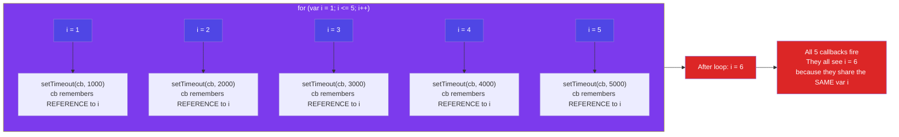

# Episode 11 : setTimeout + Closures Interview Question

> **Time, tide and Javascript wait for none.**

```js
function x() {
  var i = 1;
  setTimeout(function () {
    console.log(i);
  }, 3000);
  console.log("Namaste Javascript");
}
x();
// Output:
// Namaste Javascript
// 1 // after waiting 3 seconds
```

- We expect JS to wait 3 sec, print 1 and then go down and print the string. But JS prints string immediately, waits 3 sec and then prints 1.
- The function inside setTimeout forms a closure (remembers reference to i). So wherever function goes it carries this ref along with it.
- setTimeout takes this callback function & attaches timer of 3000ms and stores it. Goes to next line without waiting and prints string.
- After 3000ms runs out, JS takes function, puts it into call stack and runs it.





- Q: Print 1 after 1 sec, 2 after 2 sec till 5 : Tricky interview question

  We assume this has a simple approach as below

  ```js
  function x() {
    for (var i = 1; i <= 5; i++) {
      setTimeout(function () {
        console.log(i);
      }, i * 1000);
    }
    console.log("Namaste Javascript");
  }
  x();
  // Output:
  // Namaste Javascript
  // 6
  // 6
  // 6
  // 6
  // 6
  ```

  - Reason?

    - This happens because of closures. When setTimeout stores the function somewhere and attaches timer to it, the function remembers its reference to i, **not value of i**. All 5 copies of function point to same reference of i. JS stores these 5 functions, prints string and then comes back to the functions. By then the timer has run fully. And due to looping, the i value became 6. And when the callback fun runs the variable i = 6. So same 6 is printed in each log

    - To avoid this, we can use **let** instead of **var** as let has Block scope. For each iteration, the i is a new variable altogether(new copy of i). Everytime setTimeout is run, the inside function forms closure with new variable i

  - But what if interviewer ask us to implement using **var**?

    ```js
    function x() {
      for (var i = 1; i <= 5; i++) {
        function close(i) {
          setTimeout(function () {
            console.log(i);
          }, i * 1000);
          // put the setT function inside new function close()
        }
        close(i); // everytime you call close(i) it creates new copy of i. Only this time, it is with var itself!
      }
      console.log("Namaste Javascript");
    }
    x();
    ```

<hr>

Watch Live On Youtube below:

<a href="https://www.youtube.com/watch?v=eBTBG4nda2A&ab_channel=AkshaySaini" target="_blank"></a>

<br>

<hr>

<br>