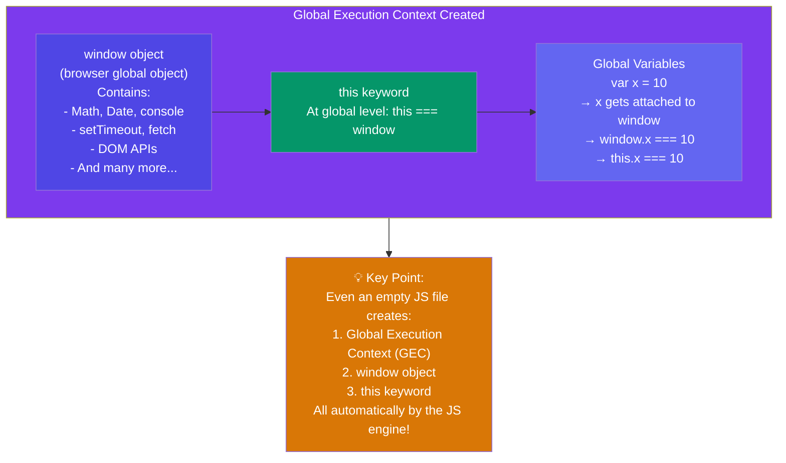

# Episode 5 : Shortest JS Program, window & this keyword

- The shortest JS program is empty file. Because even then, JS engine does a lot of things. As always, even in this case, it creates the GEC which has memory space and the execution context.





- JS engine creates something known as '**window**'. It is an object, which is created in the global space. It contains lots of functions and variables. These functions and variables can be accessed from anywhere in the program. JS engine also creates a **this** keyword, which points to the **window object** at the global level. So, in summary, along with GEC, a global object (window) and a this variable are created.

- In different engines, the name of global object changes. Window in browsers, but in nodeJS it is called something else. At global level, this === window

- If we create any variable in the global scope, then the variables get attached to the global object.

eg:

```js
var x = 10;
console.log(x); // 10
console.log(this.x); // 10
console.log(window.x); // 10
```

<hr>

Watch Live On Youtube below:

<a href="https://www.youtube.com/watch?v=QCRpVw2KXf8&ab_channel=AkshaySaini" target="_blank"></a>

<br>

<hr>

<br>