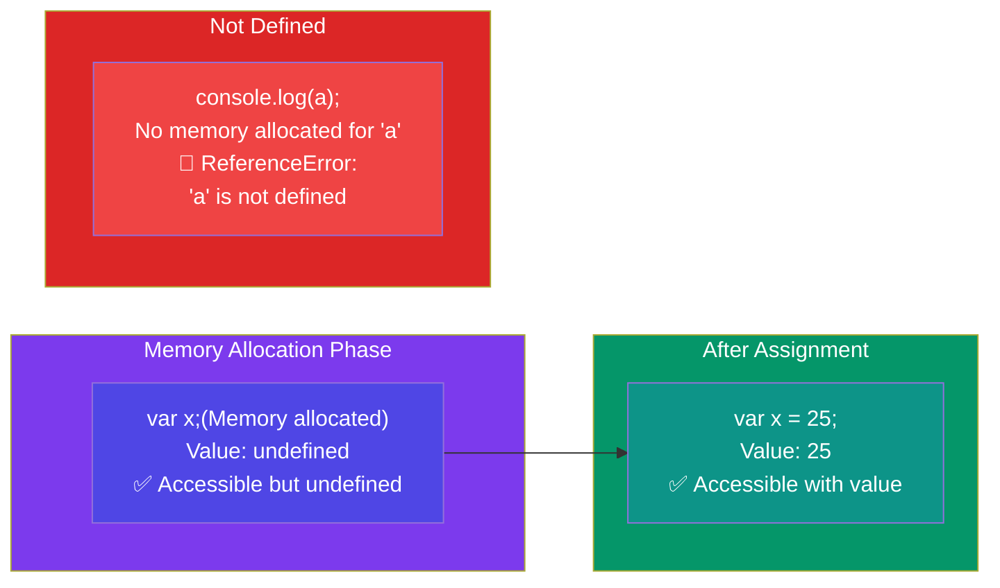

# Episode 6 : undefined vs not defined in JS

- In first phase (memory allocation) JS assigns each variable a placeholder called **undefined**.





- **undefined** is when memory is allocated for the variable, but no value is assigned yet.

- If an object/variable is not even declared/found in memory allocation phase, and tried to access it then it is **Not defined**

- Not Defined !== Undefined

> When variable is declared but not assigned value, its current value is **undefined**. But when the variable itself is not declared but called in code, then it is **not defined**.

```js
console.log(x); // undefined
var x = 25;
console.log(x); // 25
console.log(a); // Uncaught ReferenceError: a is not defined
```

- JS is a **loosely typed / weakly typed** language. It doesn't attach variables to any datatype. We can say _var a = 5_, and then change the value to boolean _a = true_ or string _a = 'hello'_ later on.
- **Never** assign _undefined_ to a variable manually. Let it happen on it's own accord.

<hr>

Watch Live On Youtube below:

<a href="https://www.youtube.com/watch?v=B7iF6G3EyIk&ab_channel=AkshaySaini" target="_blank"></a>

<br>

<hr>

<br>