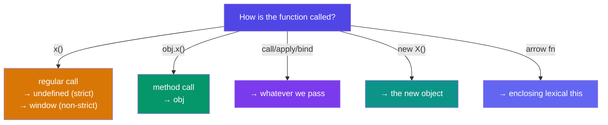

# Season 2 - Episode 6 : this keyword in JavaScript

- **The value of `this` depends on HOW a function is called**, not where it is defined. This is the single most important rule.


## 1. `this` in the global space

- In the global scope, `this` refers to the **global object**.
  - In a browser → `window`
  - In Node.js → `global` (or `globalThis`, which is standardized across environments)

  ```js
  console.log(this); // window (browser)
  ```

## 2. `this` inside a function

- The value depends on **strict vs non-strict mode**.

  ```js
  function x() {
    console.log(this);
  }
  x();
  ```

  - **Non-strict mode:** `this` is `undefined`, but due to **`this` substitution**, it becomes the global object (`window`). `this` substitution: if `this` is `undefined`/`null`, it is replaced by the global object (only in non-strict mode).
  - **Strict mode** (`"use strict";`): `this` stays `undefined`.

- Rule: `this` inside a regular function is `undefined` in strict mode; it falls back to the global object in non-strict mode.

## 3. `this` depends on how the function is called

  ```js
  "use strict";
  function x() {
    console.log(this);
  }

  x();        // undefined  (called without reference)
  window.x(); // window     (called as a method of window)
  ```

- Same function, different `this`, purely based on the **call site**.



## 4. `this` inside an object's method

- When a function is a property of an object (a **method**), `this` refers to **that object**.

  ```js
  const obj = {
    a: 10,
    x: function () {
      console.log(this.a);
    },
  };
  obj.x(); // 10  (this === obj)
  ```

## 5. `call`, `apply`, `bind` (sharing methods)

- These let us **explicitly set** what `this` should be — useful for borrowing methods between objects.

  ```js
  const student = {
    name: "Akshay",
    printName: function () {
      console.log(this.name);
    },
  };
  student.printName(); // Akshay

  const student2 = { name: "Deepika" };

  student.printName.call(student2); // Deepika — this is now student2
  ```

  - `call(thisArg, arg1, arg2)` — calls immediately, args passed individually.
  - `apply(thisArg, [args])` — calls immediately, args as an array.
  - `bind(thisArg)` — returns a **new function** with `this` bound, to call later.

## 6. `this` inside arrow functions

- **Arrow functions do NOT have their own `this`.** They take `this` from their **enclosing lexical context** (where they are defined).

  ```js
  const obj = {
    a: 10,
    x: () => {
      console.log(this); // window — arrow takes this from outside obj
    },
  };
  obj.x();
  ```

- Compare with a normal method nested arrow:

  ```js
  const obj2 = {
    a: 10,
    x: function () {
      const y = () => {
        console.log(this.a); // 10 — arrow takes this from x(), where this = obj2
      };
      y();
    },
  };
  obj2.x(); // 10
  ```

> This is why arrow functions are great for callbacks inside methods — they keep the surrounding `this`.

## 7. `this` inside the DOM

- In a DOM event handler, `this` refers to the **HTML element** that the handler is attached to.

  ```html
  <button onclick="alert(this)">Click</button>
  <!-- this → the button element (HTMLButtonElement) -->
  ```

## Summary

| Call type | `this` value |
| --- | --- |
| Global scope | global object (`window`) |
| Regular function | `undefined` (strict) / `window` (non-strict) |
| Object method `obj.fn()` | the object (`obj`) |
| `call`/`apply`/`bind` | whatever we pass |
| `new Fn()` | the newly created object |
| Arrow function | lexical (enclosing) `this` |
| DOM handler | the HTML element |

- The one rule to remember: **`this` is decided by HOW the function is called.** Arrow functions are the exception — they inherit `this` lexically.

<hr>

Watch Live On Youtube below:

<a href="https://www.youtube.com/watch?v=9T4z98JcHR0&ab_channel=AkshaySaini" target="_blank"></a>

<br>

<hr>

<br>
