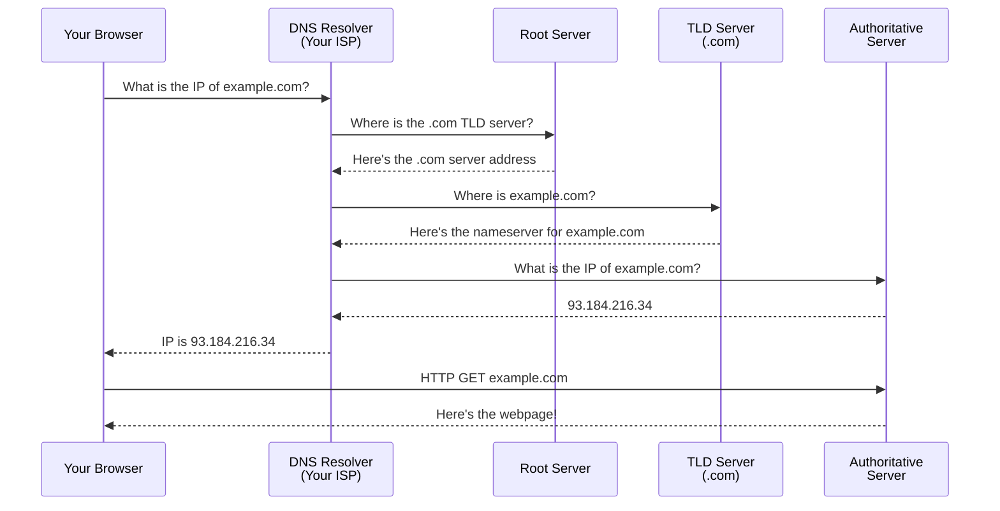

## DNS (Domain Name System)

### 🤔 What is DNS?

DNS (Domain Name System) is the **phonebook of the internet**. It translates human-readable domain names like `google.com` into computer-readable IP addresses like `142.250.190.78`.

Think of it like **contacts on your phone**:
- You search for "Mom" (domain name)
- Your phone looks up the number (IP address)
- It calls that number

Without DNS, you'd have to remember `142.250.190.78` instead of `google.com`.

---

### 🧩 DNS Records

```bash
A         → 142.250.190.78         # Maps domain to IPv4 address
AAAA      → 2001:db8::1            # Maps domain to IPv6 address
CNAME     → example.com            # Alias (one domain → another)
MX        → mail.example.com       # Mail server for the domain
NS        → ns1.example.com        # Name server for the domain
TXT       → "v=spf1 include:..."   # Text info (often for security)
```

**Example of common records for `example.com`:**
```
example.com.   A     93.184.216.34
example.com.   MX    mail.example.com
www.example.com. CNAME example.com
```

---

### 🔍 DNS Resolution Steps



**Step by step:**
1. Your browser asks the **DNS Resolver** (usually your ISP): "Where is example.com?"
2. The resolver asks a **Root Server**: "Where's the .com server?"
3. Root responds: "Ask the .com TLD server at X.X.X.X"
4. Resolver asks the **TLD Server** (.com): "Where is example.com?"
5. TLD responds: "Ask the authoritative nameserver at Y.Y.Y.Y"
6. Resolver asks the **Authoritative Server**: "What's example.com's IP?"
7. Authoritative responds: "It's 93.184.216.34"
8. Resolver tells the browser, and the browser connects

---

### ⚡ DNS Caching

DNS results are **cached** (saved temporarily) at every level to make future lookups faster:

```bash
# Browser cache: seconds to minutes
# OS cache: minutes
# Router cache: hours
# ISP resolver cache: hours to days
```

**Check your DNS cache (Windows):**
```bash
ipconfig /displaydns
```

**Check DNS resolution:**
```bash
nslookup google.com
# Server:  dns.google
# Address:  8.8.8.8
# Name:    google.com
# Address:  142.250.190.78

# Or use dig (Linux/Mac)
dig google.com
```

---

### 📝 Common DNS Commands

```bash
# Find IP of a domain
nslookup github.com

# Find mail servers
nslookup -type=MX gmail.com

# Trace the full resolution path
dig +trace example.com
```

---

### In Simple Words

- **DNS** translates domain names (`google.com`) to IP addresses (`142.250.190.78`)
- It's like a **phonebook** for the internet
- Resolution goes: Browser → Resolver → Root → TLD → Authoritative server
- **DNS records** include A (IPv4), AAAA (IPv6), CNAME (alias), MX (mail), TXT (text)
- **Caching** makes repeated lookups faster — at the browser, OS, router, and ISP levels
