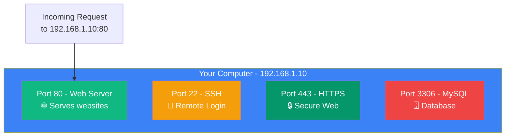
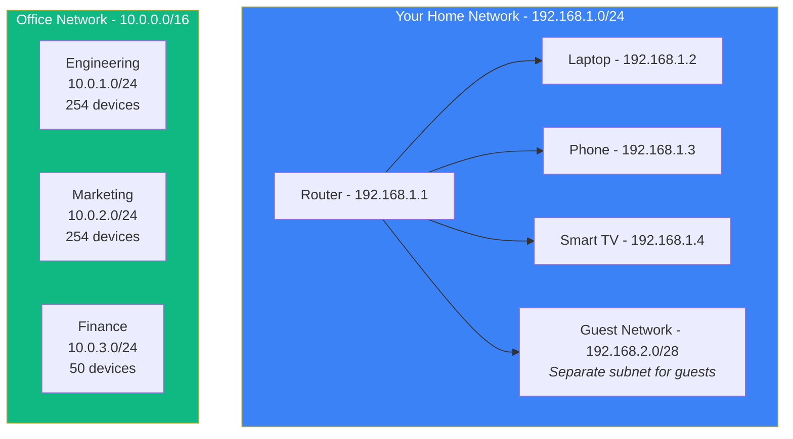
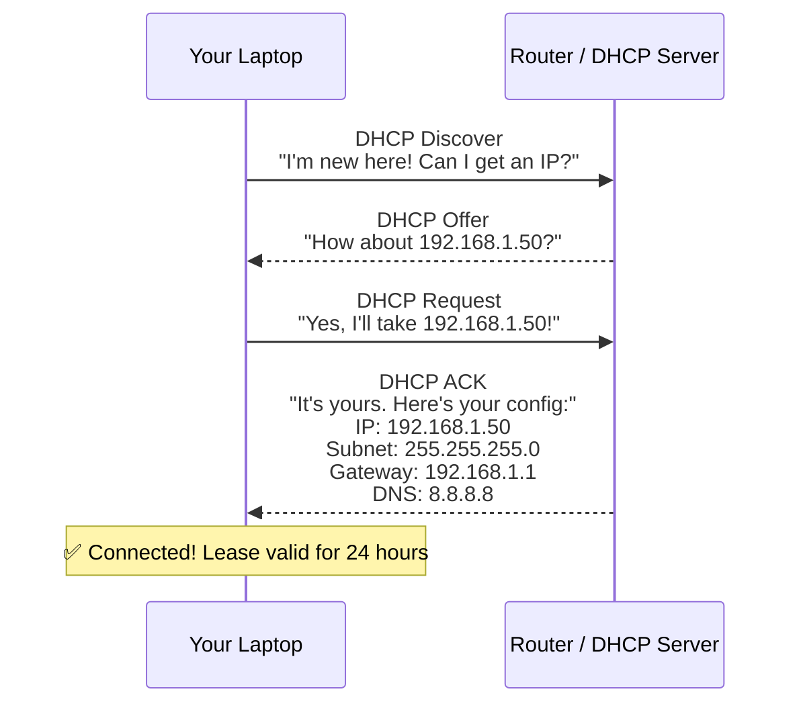

## IP Addresses & Ports

### 🤔 What is an IP Address?

An IP (Internet Protocol) address is a **unique identifier** for a device on a network.

Think of it like your **home address**:
- An IP address identifies a computer (like your street address identifies your house)
- Other computers use it to send data to you

**Two versions:**

```bash
IPv4:   192.168.1.1       # 4 numbers, 0-255
IPv6:   2001:db8::ff00:42:8329  # Longer, more addresses
```

**IPv4 is running out** — there are only ~4 billion addresses. IPv6 was created to solve this and has trillions of addresses.

---

### 🔢 Ports

If an IP address is like a **building address**, a port is the **apartment number** inside that building.

- IP: `192.168.1.10` → The building
- Port: `:80` → The web server apartment
- Port: `:22` → The SSH apartment



**Well-known ports:**

| Port | Protocol | Used by |
|------|----------|---------|
| 20, 21 | FTP | File transfer |
| 22 | SSH | Secure shell |
| 25 | SMTP | Email sending |
| 53 | DNS | Domain name resolution |
| 80 | HTTP | Websites |
| 443 | HTTPS | Secure websites |
| 3306 | MySQL | Database |
| 6379 | Redis | Cache |
| 27017 | MongoDB | Database |

---

### 🏠 Public vs Private IPs

**Private IPs** — used inside your home/work network:
```
192.168.x.x      # Most common (home routers)
10.x.x.x         # Large corporate networks
172.16.x.x       # Also private
```

**Public IPs** — used on the internet (unique globally):
```
Your router gets one public IP from your ISP
All devices in your home share it via NAT
```

**Check your IP:**
```bash
# Your public IP
curl ifconfig.me
# Output: 203.0.113.42

# Your private IP (Windows)
ipconfig
# Linux/Mac
ifconfig
```

---

### 🔄 NAT (Network Address Translation)

Your home router uses NAT to let multiple devices share one public IP:

```
Internet sees:  203.0.113.42:55001 (router's public IP + random port)
                      │
                   Router (NAT)
                      │
         ┌────────────┼────────────┐
Your laptop          Phone      Smart TV
192.168.1.2        192.168.1.3  192.168.1.4
```

> **Result:** All your devices share one public IP. The router remembers which device requested what and routes responses back correctly.

---

### 📐 Subnetting & CIDR Notation

Subnetting divides a network into smaller groups. **CIDR** (Classless Inter-Domain Routing) notation shows which part is the network and which is the device.

```bash
# CIDR notation: IP address + /prefix length
192.168.1.0/24
│           ││
│           │└── 24 bits = network part (192.168.1)
│           └──── Remaining 8 bits = host part (0-255)
└──────────────── IP address
```



**Common subnet masks:**
```bash
/8   = 255.0.0.0          → 16+ million IPs (huge networks)
/16  = 255.255.0.0        → 65,534 IPs (large companies)
/24  = 255.255.255.0      → 254 IPs (home/small office)
/28  = 255.255.255.240    → 14 IPs (tiny subnet)
/32  = 255.255.255.255    → 1 IP (single device)
```

---

### 🔌 DHCP — How Devices Get IPs Automatically

When you connect to WiFi, your device gets an IP address **automatically** via DHCP (Dynamic Host Configuration Protocol).



**Step by step:**
1. **Discover** — Laptop broadcasts: "I need an IP address!"
2. **Offer** — Router responds: "Here's one you can use"
3. **Request** — Laptop: "Yes, I'd like that one"
4. **Acknowledge** — Router: "It's yours. Here's your subnet mask, gateway, and DNS"

> **Result:** Your device automatically gets an IP, subnet mask, default gateway, and DNS server — no manual configuration needed!

---

### In Simple Words

- An **IP address** identifies a device on a network (like a home address)
- **IPv4** (192.168.1.1) is running out; **IPv6** (2001:db8::...) has more addresses
- A **port** identifies which application on a device (like an apartment number)
- Common ports: **80** (HTTP), **443** (HTTPS), **22** (SSH), **53** (DNS)
- **Private IPs** (192.168.x.x) work inside your home; **public IPs** work on the internet
- **NAT** lets many devices share one public IP address
