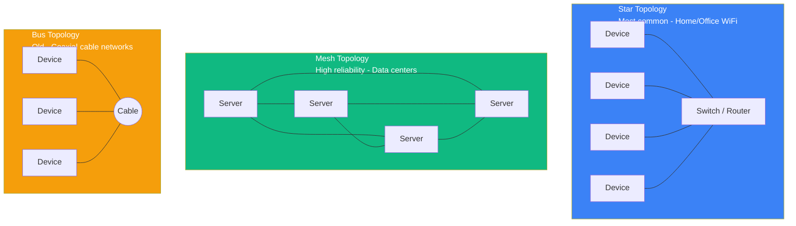
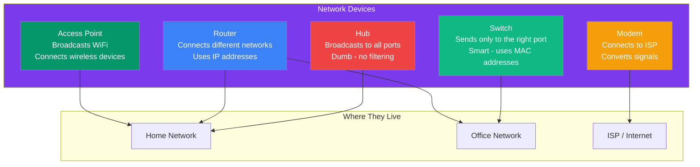
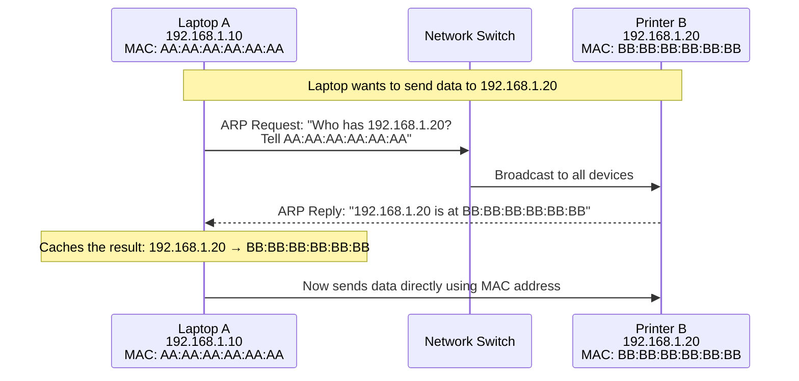
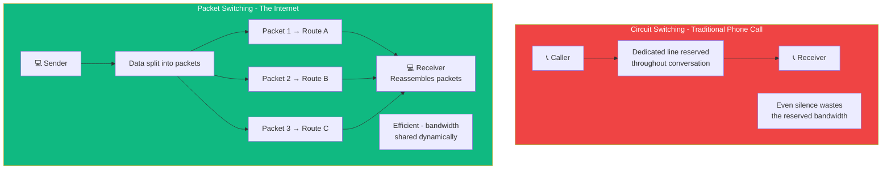

## Network Topologies & Devices

### 🤔 Network Topologies

A **topology** is the physical or logical arrangement of devices in a network. Think of it like **floor plans** for different buildings.



| Topology | How it works | Pros | Cons |
|----------|-------------|------|------|
| **Star** | All devices connect to a central switch/router | Easy to manage, one failure doesn't take down others | Switch fails → whole network down |
| **Mesh** | Every device connects to every other device | Extremely reliable, redundant paths | Expensive (lots of cabling) |
| **Bus** | All devices share a single cable | Cheap, simple | One break kills the whole network |
| **Ring** | Devices form a circle | Fair access to all | One break disrupts entire ring |

---

### 📡 Network Devices

Devices that make networks work:



| Device | Layer | What it does |
|--------|-------|-------------|
| **Hub** | Layer 1 (Physical) | Broadcasts every signal to every port — inefficient |
| **Switch** | Layer 2 (Data Link) | Sends data only to the correct device using MAC addresses |
| **Router** | Layer 3 (Network) | Routes data between different networks using IP addresses |
| **Modem** | Layer 1 | Converts digital signals to analog (for cable/DSL/fiber) |
| **Access Point** | Layer 2 | Bridges wired network to wireless devices |

---

### 🔢 MAC Addresses

Every network device has a **MAC (Media Access Control) address** — a **permanent, unique identifier** burned into the hardware.

Think of it like a **government-issued ID number** — unique to each device, never changes.

```bash
MAC Address Format: 00:1A:2B:3C:4D:5E   (6 pairs of hex digits)
                    00-1A-2B-3C-4D-5E
                    001A.2B3C.4D5E
```

**IP vs MAC:**
```
IP Address:  192.168.1.10  ← Like your mailing address (can change)
MAC Address: 00:1A:2B:3C:4D:5E  ← Like your fingerprint (permanent)
```

---

### 🔄 ARP (Address Resolution Protocol)

ARP **maps IP addresses to MAC addresses** so devices can talk on the local network.



**Step by step:**
1. Laptop knows the **IP address** (192.168.1.20) but not the **MAC address**
2. Laptop broadcasts an **ARP request**: "Who has this IP? Tell me your MAC!"
3. The device with that IP responds: "It's me! My MAC is BB:BB:BB:BB:BB:BB"
4. Laptop **caches** the mapping (so it doesn't ask again soon)
5. Now the laptop can send data directly using the MAC address

---

### 🌐 Packet Switching vs Circuit Switching

**Circuit switching** — A dedicated path is reserved for the entire conversation (old phone system).
**Packet switching** — Data is split into packets, each finds its own way (the internet).



---

### In Simple Words

- **Star** (home WiFi), **Mesh** (data centers), **Bus** (old networks) — different ways to connect devices
- **Hubs** broadcast to everyone; **Switches** send to the right device; **Routers** connect different networks
- **MAC addresses** are permanent hardware IDs; **IP addresses** are logical addresses that can change
- **ARP** translates IP → MAC addresses so local network communication works
- The internet uses **packet switching** — data is split into packets that find their own way
