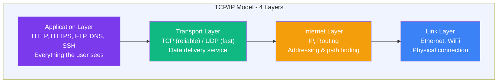

## OSI & TCP/IP Models

### 🤔 What Are These Models?

Network models are like **layers of an onion** — each layer has a specific job, and data passes through each layer when sending or receiving.

Think of it like **sending a package**:
- **Layer 7 (Application):** You write the letter (what data to send)
- **Layer 4 (Transport):** You choose the shipping method (express or regular)
- **Layer 3 (Network):** You write the destination address (IP address)
- **Layer 2 (Data Link):** You hand it to the courier within your neighborhood
- **Layer 1 (Physical):** The truck driving on the road

---

### 🧅 The 7-Layer OSI Model

```mermaid
flowchart TB
    subgraph OSIModel[OSI Model - 7 Layers]
        L7["7. Application<br/>HTTP, FTP, SMTP<br/>What the user interacts with"]
        L6["6. Presentation<br/>Encryption, compression<br/>SSL/TLS lives here"]
        L5["5. Session<br/>Manages connections<br/>Keeps sessions alive"]
        L4["4. Transport<br/>TCP / UDP<br/>Reliable or fast delivery"]
        L3["3. Network<br/>IP, Routing<br/>Finds the path across networks"]
        L2["2. Data Link<br/>MAC addresses, Ethernet<br/>Local delivery between devices"]
        L1["1. Physical<br/>Cables, radio waves<br/>Raw bits on the wire"]
    end
    
    L7 --> L6 --> L5 --> L4 --> L3 --> L2 --> L1
    
    style OSIModel fill:#f0f4ff,color:#333
    style L7 fill:#7c3aed,color:#fff
    style L6 fill:#7c3aed,color:#fff
    style L5 fill:#3b82f6,color:#fff
    style L4 fill:#10b981,color:#fff
    style L3 fill:#f59e0b,color:#fff
    style L2 fill:#ef4444,color:#fff
    style L1 fill:#ec4899,color:#fff
```



---

### 📊 OSI Layers at a Glance

| Layer | Name | What it does | Example |
|-------|------|-------------|---------|
| 7 | **Application** | The app you use | HTTP (browser), FTP, SMTP (email) |
| 6 | **Presentation** | Data format, encryption | SSL/TLS, JPEG encoding |
| 5 | **Session** | Manages the conversation | NetBIOS, RPC |
| 4 | **Transport** | Reliable or fast delivery | TCP (reliable), UDP (fast) |
| 3 | **Network** | Addressing & routing | IP (finding the path) |
| 2 | **Data Link** | Local delivery (same network) | Ethernet, WiFi, MAC addresses |
| 1 | **Physical** | Raw electrical signals | Cables, radio waves, fiber |

---

### 📦 The 4-Layer TCP/IP Model

The TCP/IP model is simpler — it's what the **actual internet** uses:



---

### 🔄 OSI vs TCP/IP

```
OSI (7 layers)          TCP/IP (4 layers)          Real World
─────────────────      ──────────────────         ──────────
7. Application     ─┐
6. Presentation    ─┤  Application Layer           HTTP, DNS, SSH
5. Session         ─┘
4. Transport          Transport Layer              TCP, UDP
3. Network            Internet Layer               IP
2. Data Link       ─┐
1. Physical        ─┘  Link Layer                 Ethernet, WiFi
```

| Fact | OSI | TCP/IP |
|------|-----|--------|
| Layers | 7 | 4 |
| When created | 1980s (theoretical) | 1970s (practical) |
| Used in practice? | Teaching / reference | **The actual internet** |
| Key protocols | None specific | TCP, IP, HTTP, DNS |

---

### 🎯 Why Learn This?

When you type a URL and press Enter:
1. **Application** — Your browser creates an HTTP request
2. **Transport** — TCP chops it into packets, adds port numbers
3. **Internet** — IP adds source/destination addresses
4. **Link** — Ethernet/WiFi sends the physical signals

The server does the reverse: Link → Internet → Transport → Application → response.

---

### 📦 Encapsulation & De-encapsulation

When data travels through the layers, **each layer adds its own header** (wrapper). This is called **encapsulation**.

Think of it like **packing a gift inside nested boxes**:
- You put the gift (data) in a small box
- You put that box inside a bigger box with padding
- You put that box in an even bigger box with labels
- You ship it

The receiver opens boxes in reverse order.

```mermaid
flowchart TB
    subgraph Sending[Data Encapsulation - Sending]
        S7["7. Application: HTTP Request<br/>GET /index.html"]
        S4["4. Transport: TCP Header + Data<br/>Source Port: 54321, Dest Port: 80"]
        S3["3. Network: IP Header + TCP + Data<br/>Source IP: 192.168.1.10, Dest IP: 93.184.216.34"]
        S2["2. Data Link: Ethernet Header + IP + TCP + Data<br/>Source MAC: AA:AA:AA, Dest MAC: BB:BB:BB"]
        S1["1. Physical: 01010101010101<br/>Raw bits on the wire"]
    end
    
    S7 --> S4 --> S3 --> S2 --> S1
    
    subgraph Receiving[Data De-encapsulation - Receiving]
        R1["1. Physical: Raw bits arrive"]
        R2["2. Data Link: Strip Ethernet header<br/>Check MAC address"]
        R3["3. Network: Strip IP header<br/>Check destination IP"]
        R4["4. Transport: Strip TCP header<br/>Check port number"]
        R7["7. Application: HTTP Response<br/>200 OK"]
    end
    
    R1 --> R2 --> R3 --> R4 --> R7
    
    style Sending fill:#3b82f6,color:#fff
    style Receiving fill:#10b981,color:#fff
```



**Analogy:** Each layer adds a sticky note (header) with instructions. The receiver reads and removes each note in order.

---

### In Simple Words

- The **OSI model** has 7 layers — a teaching tool for understanding networks
- The **TCP/IP model** has 4 layers — what the actual internet uses
- Data travels **down** the layers when sending and **up** when receiving
- Each layer adds its own **header** (wrapper) to the data
- You don't need to memorize all 7 OSI layers — just understand that networking is broken into manageable pieces
