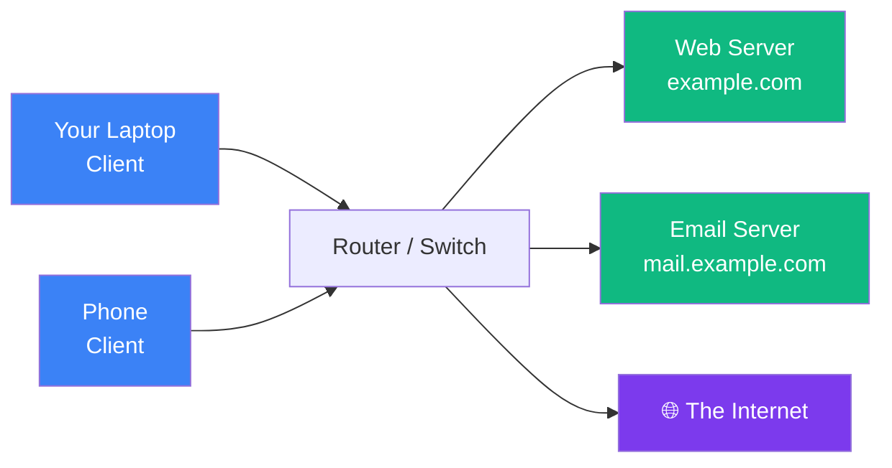
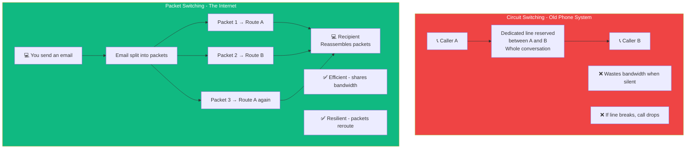

## What is a Network?

### 🤔 What is a Computer Network?

A computer network is **two or more devices connected together** so they can share information.

Think of it like the **postal system**:
- You (the client) write a letter and send it
- The postal service (the network) delivers it
- The recipient (the server) reads it and sends a reply



---

### 📡 Client vs Server

On the internet, devices usually play one of two roles:

| Client | Server |
|--------|--------|
| Asks for data (your laptop, phone) | Provides data (website, API) |
| Makes requests | Sends responses |
| Many clients, one server | One server serves many clients |
| Example: Your browser | Example: google.com's computer |

**Real example:** When you visit GitHub.com, your browser (client) sends a request to GitHub's computer (server), which sends back the webpage.

---

### 🌐 The Internet

The internet is a **network of networks** — millions of connected devices worldwide.

```
Your Home Network → ISP (Internet Service Provider) → Backbone → Other Networks
     │                                                        │
     ▼                                                        ▼
  laptop, phone                                          Google, YouTube, etc.
```

**Key players:**
- **ISP** — Your internet provider (Comcast, AT&T, Jio, Airtel)
- **Backbone** — Massive fiber-optic cables connecting countries
- **IXP** — Internet Exchange Points where networks connect

---

### 🏠 Types of Networks

| Type | Size | Example |
|------|------|---------|
| **LAN** (Local) | One building | Your home WiFi |
| **WAN** (Wide) | Cities / countries | The internet |
| **MAN** (Metropolitan) | A city | City-wide WiFi |
| **PAN** (Personal) | Around one person | Bluetooth headphones |

---

### 🌊 Packet Switching vs Circuit Switching

The internet uses **packet switching** — data is cut into small chunks called **packets** that travel independently. Old phone networks used **circuit switching** — a dedicated path was reserved.



---

### 🛠️ ICMP & Ping — Testing Connectivity

**ICMP** (Internet Control Message Protocol) is used for diagnostics. **Ping** sends an ICMP echo request and measures the response time.

Think of it like **knocking on a door** — you knock (send a ping), and if someone answers (responds), you know they're home.

```bash
ping google.com
# PING google.com (142.250.190.78): 56 data bytes
# 64 bytes from 142.250.190.78: icmp_seq=1 ttl=118 time=12.5ms
# 64 bytes from 142.250.190.78: icmp_seq=2 ttl=118 time=11.2ms
# 64 bytes from 142.250.190.78: icmp_seq=3 ttl=118 time=12.1ms
# 
# --- google.com ping statistics ---
# 3 packets transmitted, 3 received, 0% packet loss
# avg time: 11.9ms
```

| Diagnostic | Command | What it shows |
|------------|---------|--------------|
| **Ping** | `ping google.com` | Is the host reachable? How fast? |
| **Traceroute** | `tracert google.com` | Which path do packets take? |
| **nslookup** | `nslookup google.com` | What IP does a domain resolve to? |
| **netstat** | `netstat -an` | Which connections are open on my machine? |

---

### In Simple Words

- A **network** connects devices so they can talk to each other
- **Clients** ask for data; **servers** provide it
- The **internet** is the world's largest network — a network of networks
- The internet uses **packet switching** (data split into packets); old phones used **circuit switching** (dedicated line)
- **Ping** uses ICMP to test if a host is reachable and measure latency
