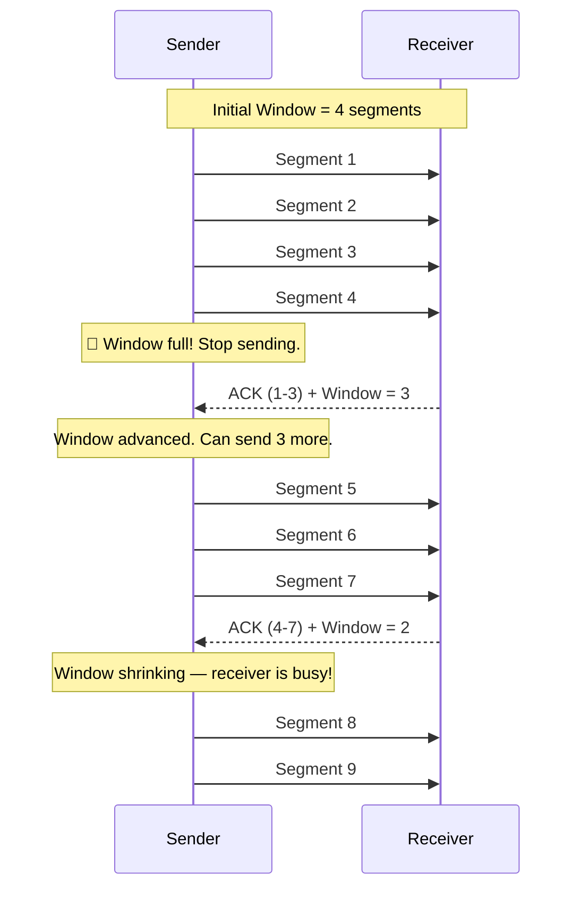
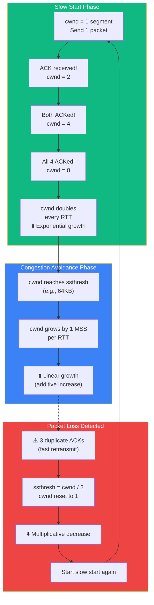

## TCP Flow Control & Congestion

### 🤔 Why Does TCP Need Control?

TCP is reliable, but it can't just blast data as fast as possible. Two problems can occur:

- **Flow control** — Don't overwhelm the **receiver** (it has limited buffer space)
- **Congestion control** — Don't overwhelm the **network** (routers have limited capacity)

Think of it like **water flowing through a pipe**:
- **Flow control** = The bucket at the other end has a certain size
- **Congestion control** = The pipe itself can only carry so much water

---

### 🪟 Flow Control (Sliding Window)

The **receiver** tells the sender how much data it can handle via the **window size** in TCP headers.



**How it works:**
1. Receiver advertises a **window size** (e.g., 64KB)
2. Sender can send up to that much data without waiting for ACKs
3. As ACKs arrive, the **window slides forward**
4. If receiver is overwhelmed, it advertises a **smaller window**
5. If window hits zero, sender **stops** until an ACK frees space

---

### 🐢 Congestion Control (Slow Start)

When a TCP connection starts, it doesn't know the network capacity. It uses **slow start** to probe.



**Phases:**
1. **Slow Start** — cwnd (congestion window) doubles every round trip (exponential)
2. **Congestion Avoidance** — cwnd increases linearly (additive)
3. **Packet Loss** — cwnd is halved (multiplicative decrease), restart slow start

This is called **AIMD** (Additive Increase, Multiplicative Decrease).

---

### 📦 TCP Segment Structure

Every TCP packet has a header (20-60 bytes) that carries control information:

```mermaid
flowchart LR
    subgraph Header[TCP Header - 20 bytes (minimum)]
        SP[Source Port<br/>16 bits]
        DP[Dest Port<br/>16 bits]
        SN[Sequence Number<br/>32 bits]
        AN[Ack Number<br/>32 bits]
        FL[Flags<br/>9 bits<br/>SYN, ACK, FIN, etc.]
        WS[Window Size<br/>16 bits]
        CH[Checksum<br/>16 bits]
        UR[Urgent Pointer<br/>16 bits]
    end
    
    subgraph Body[Payload]
        PAY[Application Data]
    end
    
    SP --> DP --> SN --> AN --> FL --> WS --> CH --> UR
    UR --> PAY
    
    style Header fill:#3b82f6,color:#fff
    style Body fill:#10b981,color:#fff
```

| Field | Size | What it does |
|-------|------|-------------|
| **Source Port** | 16 bits | Which app on the sender |
| **Dest Port** | 16 bits | Which app on the receiver |
| **Sequence Number** | 32 bits | Tracks byte order (reassembles data) |
| **Ack Number** | 32 bits | Confirms received bytes |
| **Flags** | 9 bits | SYN, ACK, FIN, RST, etc. |
| **Window Size** | 16 bits | How much more data the receiver can accept |
| **Checksum** | 16 bits | Error detection for the entire segment |

---

### 📊 UDP Datagram Header (for comparison)

```
UDP Header - just 8 bytes!
┌────────────────┬────────────────┐
│ Source Port    │ Dest Port      │
│   16 bits      │   16 bits      │
├────────────────┼────────────────┤
│ Length         │ Checksum       │
│   16 bits      │   16 bits      │
├────────────────┴────────────────┤
│          Payload                 │
│        Application Data          │
└──────────────────────────────────┘
```

**UDP is much simpler than TCP:**
- No sequence numbers (no ordering)
- No window (no flow control)
- No retransmission
- Just ports + length + optional checksum

---

### In Simple Words

- **Flow control** prevents the sender from overwhelming the receiver (sliding window)
- **Congestion control** prevents the sender from overwhelming the network (slow start)
- TCP uses **AIMD**: Additive Increase (probe slowly), Multiplicative Decrease (back off aggressively on loss)
- The **TCP header** has fields for sequence numbers, ports, window size, and flags
- **UDP header** is only 8 bytes — much simpler than TCP's 20+ bytes
