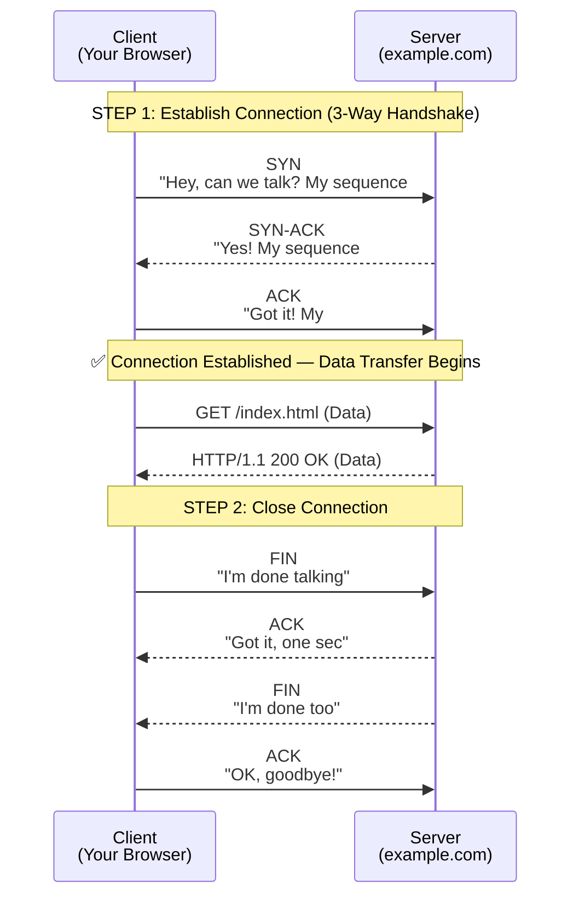

## TCP Handshake & Connection

### 🤔 What is a TCP Handshake?

Before two computers can exchange data over TCP, they must **agree to talk** — that's the 3-way handshake.

Think of it like **calling someone on the phone**:
1. You dial the number (SYN) — "Can you hear me?"
2. They answer (SYN-ACK) — "Yes, I hear you. Can you hear me?"
3. You confirm (ACK) — "Yes, I hear you too. Let's talk."

After the handshake, the conversation (data transfer) begins.

---

### 🔄 The 3-Way Handshake (SYN → SYN-ACK → ACK)

| Step | Packet | Direction | Meaning |
|------|--------|-----------|---------|
| 1 | **SYN** | Client → Server | "I want to connect. My sequence # = X" |
| 2 | **SYN-ACK** | Server → Client | "OK. My sequence # = Y, I acknowledge yours" |
| 3 | **ACK** | Client → Server | "Got it. Connection established!" |

**Sequence numbers** are random numbers that track the order of data. They ensure that:
- Data is reassembled in the correct order
- Lost packets can be detected
- Duplicate packets are ignored

---

### 👋 Connection Teardown (4-Way Handshake)

When the conversation ends, a 4-step goodbye:

1. **Client → Server:** FIN ("I'm done sending")
2. **Server → Client:** ACK ("Got it, let me finish")
3. **Server → Client:** FIN ("OK, I'm done too")
4. **Client → Server:** ACK ("Goodbye!")

---

### 📊 TCP Features (Why It's "Reliable")

| Feature | What it does |
|---------|-------------|
| **Ordered delivery** | Reassembles packets in the right order |
| **Retransmission** | Resends lost packets automatically |
| **Error checking** | Checksums verify data integrity |
| **Flow control** | Prevents sender from overwhelming receiver |
| **Congestion control** | Slows down when the network is busy |

---

### In Simple Words

- TCP uses a **3-way handshake** (SYN → SYN-ACK → ACK) to establish a connection
- Think of it like a **phone call** — both sides confirm they can hear each other
- **Sequence numbers** track packet order so data is reassembled correctly
- TCP is **reliable** — it resends lost packets and checks for errors
- Connection teardown uses **4 steps** (FIN → ACK → FIN → ACK)
