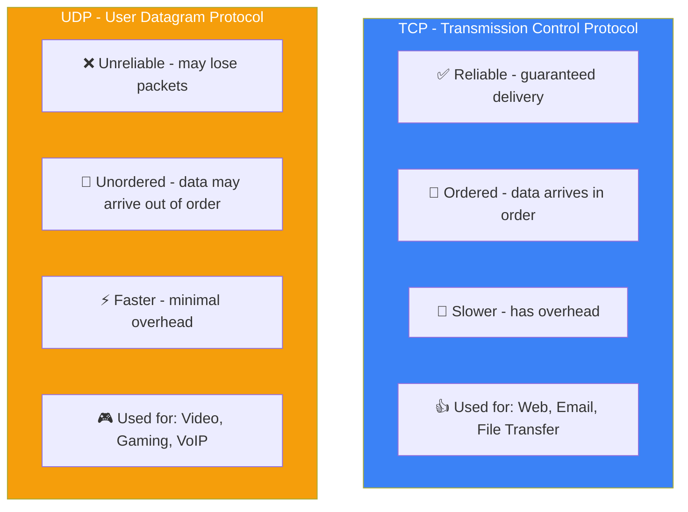
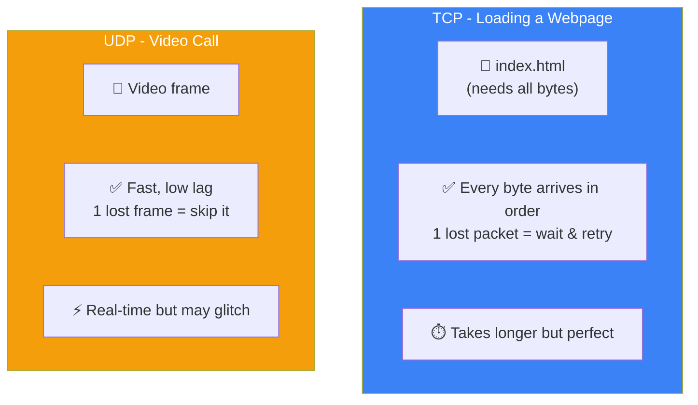

## TCP vs UDP

### 🤔 TCP vs UDP

TCP (Transmission Control Protocol) and UDP (User Datagram Protocol) are two ways to send data over a network. They sit at the **Transport Layer** of the TCP/IP model.

Think of it like sending a package:

- **TCP = Registered Mail** (signed delivery, tracking, guaranteed arrival)
- **UDP = Postcard** (cheap, fast, but might get lost)



---

### 📋 Comparison Table

| Feature | TCP | UDP |
|---------|-----|-----|
| **Reliability** | ✅ Guaranteed delivery | ❌ Best effort (may lose packets) |
| **Ordering** | ✅ Data arrives in order | ❌ No ordering |
| **Speed** | Slower (handshake + acks) | Faster (no handshake) |
| **Overhead** | Higher (20 byte header) | Lower (8 byte header) |
| **Connection** | Connection-oriented (handshake) | Connectionless (just send) |
| **Retransmission** | ✅ Resends lost packets | ❌ No retransmission |
| **Error checking** | ✅ Yes (checksum) | ✅ Yes (checksum, but no retry) |
| **Use cases** | Web pages, emails, file downloads | Video streaming, gaming, VoIP |

---

### 📦 TCP vs UDP Packet Structure

**TCP Header** — 20 bytes minimum (carries lots of control info):

```
+--------------------------------+--------------------------------+
| Source Port                    | Dest Port                      |
|   (16 bits)                    |   (16 bits)                    |
+--------------------------------+--------------------------------+
|                     Sequence Number (32 bits)                   |
|                   Tracks byte order for reassembly               |
+-----------------------------------------------------------------+
|                   Acknowledgment Number (32 bits)               |
|                   Confirms which bytes were received             |
+----------+---------------------+-------------------------------+
| Flags    | Window Size         | Checksum                      |
| (9 bits) | (16 bits)           | (16 bits)                     |
+----------+---------------------+-------------------------------+
| Options (if any, 0-40 bytes)                                   |
+-----------------------------------------------------------------+
|                   Payload (Application Data)                    |
+-----------------------------------------------------------------+
```

**UDP Header** — just 8 bytes (simple & lightweight):

```
+--------------------------------+--------------------------------+
| Source Port                    | Dest Port                      |
|   (16 bits)                    |   (16 bits)                    |
+--------------------------------+--------------------------------+
| Length                         | Checksum (optional)            |
|   (16 bits)                    |   (16 bits)                    |
+--------------------------------+--------------------------------+
|                   Payload (Application Data)                    |
+-----------------------------------------------------------------+
```

**Key difference:** TCP header is at least 20 bytes with sequence numbers, ACKs, window, and flags. UDP is only 8 bytes — just ports, length, and optional checksum.

---

### 🎯 Scenario Comparison



**Real-world application decisions:**
| Application | Protocol | Why |
|------------|----------|-----|
| **Web browsing** | TCP | Every byte of a page matters |
| **Email** | TCP | Can't lose parts of a message |
| **File download** | TCP | One wrong bit corrupts the file |
| **Video streaming** | UDP (often) | Lost frame? Skip it. Buffering is worse. |
| **Voice calls** | UDP | Delay is worse than a tiny glitch |
| **Online gaming** | UDP | Lag = death. Missing a frame is fine. |
| **DNS** | UDP (mostly) | One quick query, if lost just retry |

---

### 🧪 Real World Examples

```bash
# TCP in action (loading a website)
Browser → TCP → Server
  ↓ 3-way handshake
  ↓ Request webpage
  ↓ Server responds (all bytes guaranteed)
  ↓ Browser renders page

# UDP in action (video call)
Zoom/Meet → UDP → Server
  ↓ Just start sending data (no handshake!)
  ↓ Some frames may drop (it's OK)
  ↓ Continuous stream, low latency
```

---

### In Simple Words

- **TCP** = registered mail — reliable, ordered, but slower (web, email, files)
- **UDP** = postcard — fast, lightweight, but can lose data (video, gaming, calls)
- TCP has a **20+ byte header** with tracking; UDP has only an **8 byte header**
- TCP does a **handshake** before sending; UDP just **sends immediately**
- Choose TCP for **accuracy**, UDP for **speed**
