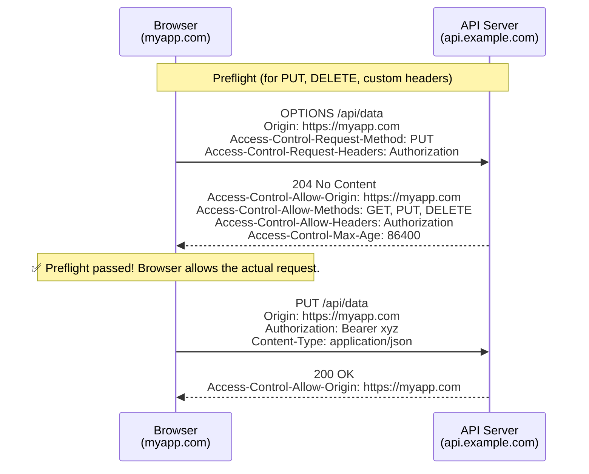
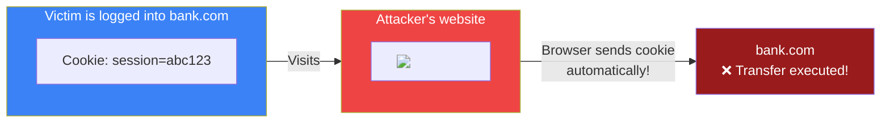

## Cookies, Sessions & CORS

### 🍪 Cookies

A **cookie** is a small piece of data stored by your browser. Think of it like a **sticky note** the website sticks on your browser.

```http
# Server tells browser to save a cookie
Set-Cookie: theme=dark; Max-Age=3600; Path=/

# Browser sends it back on every request
Cookie: theme=dark
```

**Common uses:**
- Remembering login state
- Saving preferences (language, theme)
- Tracking (shopping cart items)
- Analytics

**Cookie attributes:**
```http
Set-Cookie: session_id=abc123;
  Expires=Wed, 21 Oct 2025 07:28:00 GMT;   # When it expires
  Secure;                                     # Only sent over HTTPS
  HttpOnly;                                   # Cannot be read by JavaScript
  SameSite=Lax;                               # Protects against CSRF attacks
```

---

### 🔐 Sessions

Sessions let the server remember who you are between requests. HTTP is **stateless** — without sessions, every request looks like it's from a new visitor.

**How sessions work:**
```
1. You log in
2. Server creates a session (a record: { user: "Alice", role: "admin" })
3. Server sends a session ID cookie to your browser
4. On every request, browser sends the cookie
5. Server looks up the session → knows it's you
```

**Session vs Cookie:**
| | Cookie | Session |
|---|--------|---------|
| **Where data lives** | Browser | Server |
| **Size limit** | ~4KB | Unlimited |
| **Security** | Can be stolen (XSS) | More secure (only ID is sent) |
| **Persistence** | Survives browser close (if set) | Usually expires when browser closes |

---

### 🌐 CORS (Cross-Origin Resource Sharing)

CORS is a security feature that controls which websites can access your API.

**The problem:**
```
Your website           Malicious website
example.com            hacker.com
         │                  │
         │  fetch() API →───┘──→ steal-my-bank.com/api/transfer
         │                  │
         └── Browser blocks the request! ✅
```

One website should NOT be able to make requests to another website's API without permission.

**CORS Preflight Flow (for complex requests):**

Before certain cross-origin requests, the browser sends a **preflight** OPTIONS request to check permission.



**Simple requests** (GET, POST with standard content types) skip the preflight and go directly.

**How CORS works:**

The server tells the browser which origins are allowed via headers:
```http
# Server response header:
Access-Control-Allow-Origin: https://myapp.com
Access-Control-Allow-Methods: GET, POST, PUT
Access-Control-Allow-Headers: Content-Type, Authorization
```

**Common CORS errors:**
```bash
# If the header is missing, the browser blocks the request:
Access to fetch at 'https://api.other.com/data' from origin
'https://myapp.com' has been blocked by CORS policy
```

**Fixing CORS issues:**
- **If you control the server:** Add the `Access-Control-Allow-Origin` header
- **For development:** Use a proxy (`CRA's proxy`, `Vite's server.proxy`)
- **For third-party APIs:** They usually allow all origins (`*`) or need an API key

---

### 🛡️ CSRF (Cross-Site Request Forgery)

CSRF tricks a user into performing an action on another website while they're logged in.



**Prevention:**
- **SameSite cookies** (`SameSite=Lax` or `Strict`) — browser only sends cookies for same-site requests
- **CSRF tokens** — a random token embedded in forms, verified by the server
- **Custom headers** — `X-Requested-With: XMLHttpRequest` (not sent cross-origin automatically)

---

### In Simple Words

- **Cookies** are small files stored by your browser — websites use them to remember you
- **Sessions** store data on the server, identified by a session ID cookie
- HTTP is **stateless** — cookies and sessions make it stateful
- **CORS** is a browser security feature that restricts cross-origin requests
- The server must send `Access-Control-Allow-Origin` to allow access from other domains
- **CSRF** tricks logged-in users into unwanted actions — prevented by SameSite cookies and CSRF tokens
