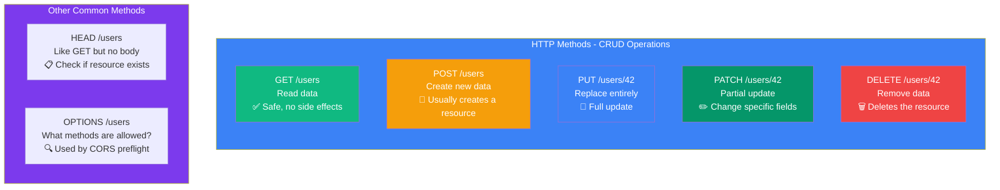
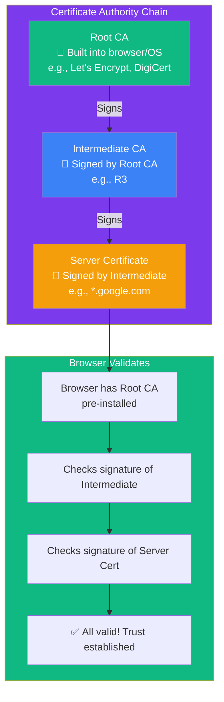

## HTTP & HTTPS

### 🤔 What is HTTP?

HTTP (HyperText Transfer Protocol) is the language your browser uses to talk to web servers.

Think of it like **ordering food at a restaurant**:
- You (the client) place an order (the request)
- The kitchen (the server) prepares the food
- The waiter brings it to you (the response)

```mermaid
sequenceDiagram
    participant Browser as Your Browser
    participant DNS as DNS Server
    participant Server as Web Server
    
    Browser->>DNS: 1. What is the IP of example.com?
    DNS-->>Browser: 2. It's 93.184.216.34
    
    Note over Browser,Server: 3-Way TCP Handshake
    Browser->>Server: SYN
    Server-->>Browser: SYN-ACK
    Browser->>Server: ACK
    
    Note over Browser,Server: TLS Handshake (HTTPS)
    Browser->>Server: 3. ClientHello — supported ciphers
    Server-->>Browser: 4. ServerHello + Certificate
    Browser->>Server: 5. Session key established 🔑
    
    Note over Browser,Server: Encrypted HTTP Request & Response
    Browser->>Server: 6. GET /index.html HTTP/1.1 (encrypted)<br/>Host: example.com<br/>Accept: text/html
    Server-->>Browser: 7. HTTP/1.1 200 OK (encrypted)<br/>Content-Type: text/html<br/><br/>&lt;html&gt;...&lt;/html&gt;
    
    Note over Browser: 8. Browser renders the page
```

---

### 📝 HTTP Methods

Every HTTP request has a **method** that tells the server what to do:



**Idempotence matters:**
| Method | Idempotent? | Same request multiple times = |
|--------|------------|------------------------------|
| GET | ✅ Yes | Same result every time |
| PUT | ✅ Yes | Same result every time |
| DELETE | ✅ Yes | First time deletes, rest are no-op |
| POST | ❌ No | Creates a new resource each time |
| PATCH | ❌ No | Depends on what you patch |

---

### 📋 HTTP Headers

Headers are **metadata** sent with requests and responses:

**Request headers (browser → server):**
```http
GET /index.html HTTP/1.1
Host: example.com                    # Which website
User-Agent: Chrome/120.0             # What browser
Accept: text/html                    # What content types I accept
Authorization: Bearer abc123          # Authentication token
Cookie: session_id=xyz               # Session data
```

**Response headers (server → browser):**
```http
HTTP/1.1 200 OK
Content-Type: text/html              # Type of content
Content-Length: 1234                 # Size in bytes
Cache-Control: max-age=3600          # Cache for 1 hour
Set-Cookie: theme=dark               # Set a cookie
```

---

### 🔒 HTTPS — The Secure Version

HTTPS = HTTP + **TLS (Transport Layer Security)**. It encrypts everything between your browser and the server.

**Without HTTPS (insecure):**
```
You type password → [HACKER!] → Server reads it
All data is sent as plain text — anyone on the same WiFi can see it
```

**With HTTPS (secure):**
```
You type password → 🔒 encrypted → Server decrypts
Even if someone intercepts it, they see only gibberish
```

**How TLS works (simplified):**
1. Browser asks server for its **SSL certificate**
2. Server sends certificate (contains its **public key**)
3. Browser verifies the certificate (signed by a trusted authority)
4. Browser and server create a **shared secret** (symmetric key) for the session
5. All data is now **encrypted** between them

**Certificate Authority (CA) Chain:**



**How to spot HTTPS:**
- URL starts with `https://`
- 🔒 padlock icon in the address bar
- No padlock = data is sent in plain text (never enter passwords!)

---

### In Simple Words

- **HTTP** is the protocol for loading websites — a request/response cycle
- **Methods** like GET (read), POST (create), PUT (update), DELETE (remove)
- **Headers** carry metadata (auth tokens, content type, cookies)
- **HTTPS** = HTTP + TLS encryption — protects data from eavesdroppers
- **Certificates** chain from Root CA → Intermediate CA → Your Server, verified by your browser
- Look for the 🔒 padlock to know a connection is secure
