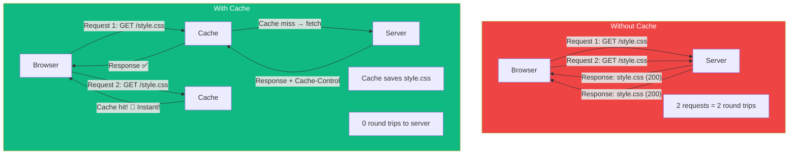
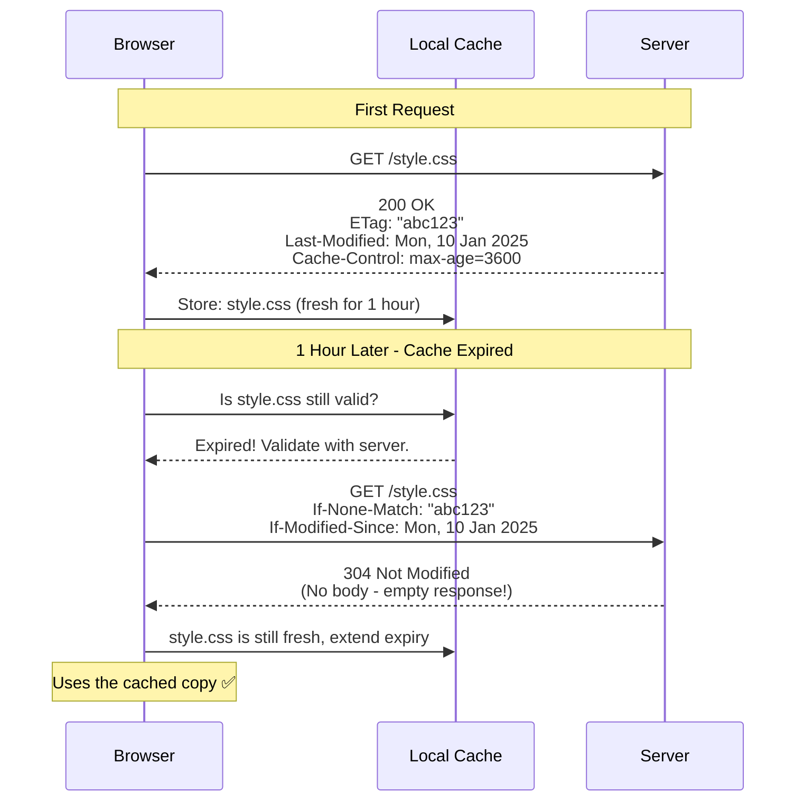
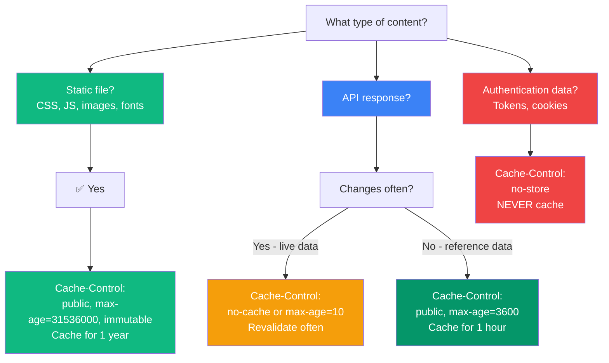

## HTTP Caching

### 🤔 What is HTTP Caching?

HTTP caching stores a copy of a server response so future requests can be served faster — without hitting the server again.

Think of it like **storing leftovers in the fridge**:
- First time: Cook a meal (fetch from server) — takes time
- Subsequent times: Reheat leftovers (serve from cache) — instant



---

### ⏱️ Cache-Control Directives

The `Cache-Control` header is the primary way to control caching:

```http
# Fresh for 1 hour (max-age in seconds)
Cache-Control: public, max-age=3600

# Never cache (always go to server)
Cache-Control: no-cache, no-store, must-revalidate

# Cache but check with server before using
Cache-Control: no-cache

# Cache for 1 year - for versioned static files
Cache-Control: public, max-age=31536000, immutable

# Private - only cache in browser (not CDN/proxy)
Cache-Control: private, max-age=3600
```

| Directive | Meaning |
|-----------|---------|
| `public` | Anyone can cache (browser, CDN, proxies) |
| `private` | Only the browser can cache |
| `no-cache` | Must check with server every time before using cache |
| `no-store` | Never store a copy at all |
| `max-age=N` | Response is fresh for N seconds |
| `immutable` | The content will never change (for versioned files) |
| `must-revalidate` | Must obey freshness info, no stale responses |

---

### ✅ Validation (ETag & If-Modified-Since)

When a cached resource expires, the browser can **validate** if it changed — without re-downloading the whole thing.



**Validation headers:**

| Request Header | Server checks | Response |
|---------------|---------------|----------|
| `If-None-Match: "abc123"` | Does the ETag match? | 304 (not changed) or 200 (new content) |
| `If-Modified-Since: date` | Has the file changed since this date? | 304 (not changed) or 200 (new content) |

> **Result:** A 304 response has **no body** — just headers. This saves bandwidth!

---

### 🧪 Cache Strategy Decision Flow



**Recommended strategy by content type:**
| Content | Cache-Control | Why |
|---------|--------------|-----|
| Versioned CSS/JS | `max-age=31536000, immutable` | Never changes (filename changes on update) |
| Images | `max-age=86400` (1 day) | Seldom changes |
| API (reference) | `max-age=60` (1 min) | Fresh enough, reduces server load |
| API (live) | `no-cache` + ETag | Always fresh, ETag saves bandwidth |
| Auth/Personal | `no-store` | Never cache sensitive data |

---

### In Simple Words

- **Caching** stores server responses so future requests are faster
- **Cache-Control: max-age=N** sets how long the cache is fresh
- **ETag** / **If-Modified-Since** let the browser ask "Has this changed?" without re-downloading
- A **304 Not Modified** response means "Use your cached copy" — no body, fast!
- **Static files** (CSS, JS, images) should be cached aggressively; **auth data** should never be cached
