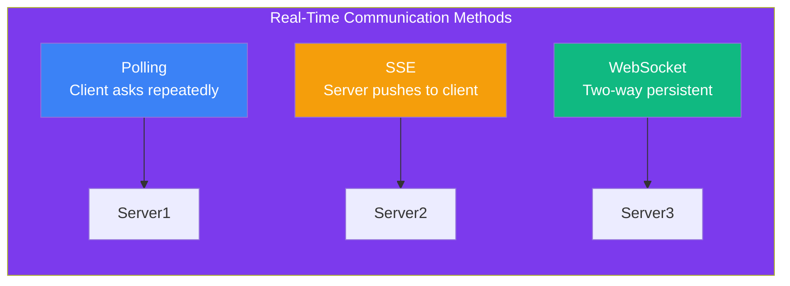

## REST vs WebSocket

### 🤔 The Difference

**REST** (representational state transfer): You ask, the server answers. Like email.
**WebSocket**: You open a connection and both sides can send messages anytime. Like a phone call.

```mermaid
flowchart TB
    subgraph REST[REST - Request/Response]
        direction TB
        R1["Browser: GET /api/data"]
        R2["Server: Here's the data"]
        R3["Browser: POST /api/update"]
        R4["Server: OK, updated"]
    end
    
    subgraph WebSocket[WebSocket - Persistent Connection]
        direction TB
        W1["Browser opens connection to server"]
        W2["⬆ Browser sends: New message"]
        W3["⬇ Server sends: Live update"]
        W4["⬇ Server sends: Another update"]
        W5["⬆ Browser sends: Typing..."]
    end
    
    style REST fill:#3b82f6,color:#fff
    style WebSocket fill:#10b981,color:#fff
```



---

### 📋 Comparison

| Feature | REST (HTTP) | WebSocket |
|---------|------------|-----------|
| **Model** | Request → Response | Persistent connection, two-way |
| **Connection** | Opens and closes per request | Stays open |
| **Latency** | Higher (new connection each time) | Lower (instant push) |
| **Real-time** | ❌ Polling needed | ✅ Instant |
| **Use cases** | CRUD APIs, websites | Chat, games, live updates |

---

### 🔄 How REST Works

```http
→ GET /api/weather
← 200 OK { "temp": 22, "city": "Mumbai" }

→ POST /api/weather/city
← 201 Created

→ GET /api/weather
← 200 OK { "temp": 23, "city": "Mumbai" }
```

**Each request is independent.** The server doesn't remember you between requests (stateless). To get updates, the client has to ask repeatedly.

---

### 🔗 How WebSocket Works

```javascript
// Client side (JavaScript)
const ws = new WebSocket('wss://chat.example.com');

// Connection opens
ws.onopen = () => {
  ws.send('Hello!');  // Send message
};

// Receive messages anytime
ws.onmessage = (event) => {
  console.log('Got:', event.data);  // "New message: Hey!"
};
```

**One connection. Both sides can send messages anytime.**

---

### 🗺️ Alternatives: Polling & SSE

| Technique | How it works | Best for |
|-----------|-------------|----------|
| **Polling** | Client asks every few seconds | Simple, quick to implement |
| **Long polling** | Server holds the request until data is ready | When updates are infrequent |
| **SSE (Server-Sent Events)** | Server pushes to client (one-way) | Notifications, news feeds |
| **WebSocket** | Full two-way communication | Chat, gaming, collaborative editing |



---

### 🎯 When to Use What

| Use **REST** for... | Use **WebSocket** for... |
|--------------------|--------------------------|
| CRUD APIs | Chat applications |
| Loading page data | Live sports scores |
| Form submissions | Stock price tickers |
| Simple queries | Multiplayer games |
| Mobile app backends | Collaborative editing (Google Docs) |

---

### In Simple Words

- **REST** = ask → receive (like HTTP). Each request is separate. Good for standard APIs.
- **WebSocket** = open connection → both sides talk freely. Good for real-time apps.
- REST is **stateless**; WebSocket maintains a **persistent stateful connection**
- **Polling** fakes real-time by repeatedly asking the server; WebSocket is truly real-time
- **SSE** is one-way (server → client); WebSocket is two-way
