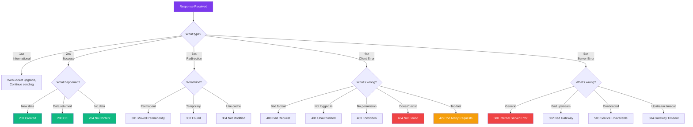

## HTTP Status Codes

### 🤔 What Are Status Codes?

Every HTTP response comes with a **3-digit status code** that tells the client what happened.

Think of it like **order statuses** at a restaurant:
- **1xx** — "We're looking at your order" (informational)
- **2xx** — "Here's your food!" (success)
- **3xx** — "Your table moved, go over there" (redirection)
- **4xx** — "That item isn't on the menu" (client error)
- **5xx** — "The kitchen is on fire" (server error)

---

### 🧭 Status Code Decision Flow



---

### ✅ 2xx — Success

| Code | Name | What it means |
|------|------|-------------|
| **200** | OK | Everything worked! The response contains the data |
| **201** | Created | A new resource was created (POST request) |
| **202** | Accepted | Request accepted but processing is not complete |
| **204** | No Content | Success, but no data to return (DELETE request) |

```http
HTTP/1.1 200 OK
Content-Type: application/json
{"user": "Alice", "email": "alice@example.com"}
```

---

### 🔀 3xx — Redirection

| Code | Name | What it means |
|------|------|-------------|
| **301** | Moved Permanently | The resource has a new URL (bookmark the new one) |
| **302** | Found (temporary) | Temporarily at a different URL |
| **304** | Not Modified | Use your cached version (no need to re-download) |

```http
HTTP/1.1 301 Moved Permanently
Location: https://www.example.com/new-page
```

> **Result:** The browser automatically follows the redirect to the new URL.

---

### ❌ 4xx — Client Error (Your Fault)

| Code | Name | What it means |
|------|------|-------------|
| **400** | Bad Request | The server couldn't understand your request (malformed) |
| **401** | Unauthorized | You need to log in first |
| **403** | Forbidden | You're logged in but don't have permission |
| **404** | Not Found | The resource doesn't exist (most famous one!) |
| **405** | Method Not Allowed | Wrong HTTP method (e.g., POST when only GET is allowed) |
| **408** | Request Timeout | The server gave up waiting for your request |
| **409** | Conflict | Conflict with current state (e.g., duplicate entry) |
| **422** | Unprocessable Entity | Request is valid but semantically wrong (validation error) |
| **429** | Too Many Requests | You're being rate-limited — slow down! |

```http
HTTP/1.1 404 Not Found
Content-Type: text/html

<h1>Page not found</h1>
```

---

### 💥 5xx — Server Error (Not Your Fault)

| Code | Name | What it means |
|------|------|-------------|
| **500** | Internal Server Error | Something went wrong on the server (generic) |
| **502** | Bad Gateway | Server got an invalid response from an upstream server |
| **503** | Service Unavailable | Server is overloaded or under maintenance |
| **504** | Gateway Timeout | Upstream server didn't respond in time |

```http
HTTP/1.1 500 Internal Server Error
Content-Type: application/json
{"error": "Something went wrong"}
```

---

### 🎯 Quick Reference

| Code | Meaning | What to do |
|------|---------|-----------|
| 200 | ✅ OK | Everything's fine |
| 201 | ✅ Created | Resource was created |
| 301 | 🔀 Moved permanently | Update your bookmarks |
| 400 | ❌ Bad request | Fix your request format |
| 401 | ❌ Unauthorized | Log in or provide credentials |
| 403 | ❌ Forbidden | You don't have access |
| 404 | ❌ Not found | The URL is wrong |
| 429 | ❌ Too many requests | Wait before retrying |
| 500 | 💥 Server error | Server issue — try again later |
| 503 | 💥 Service unavailable | Server is down |

---

### In Simple Words

- **2xx** = Success (200 OK, 201 Created)
- **3xx** = Redirect (301 moved, 304 use cache)
- **4xx** = Client error — you did something wrong (404 Not Found)
- **5xx** = Server error — server has a problem (500 Internal Server Error)
- **404** is the most famous — the page doesn't exist
- Always check the status code when debugging API calls
