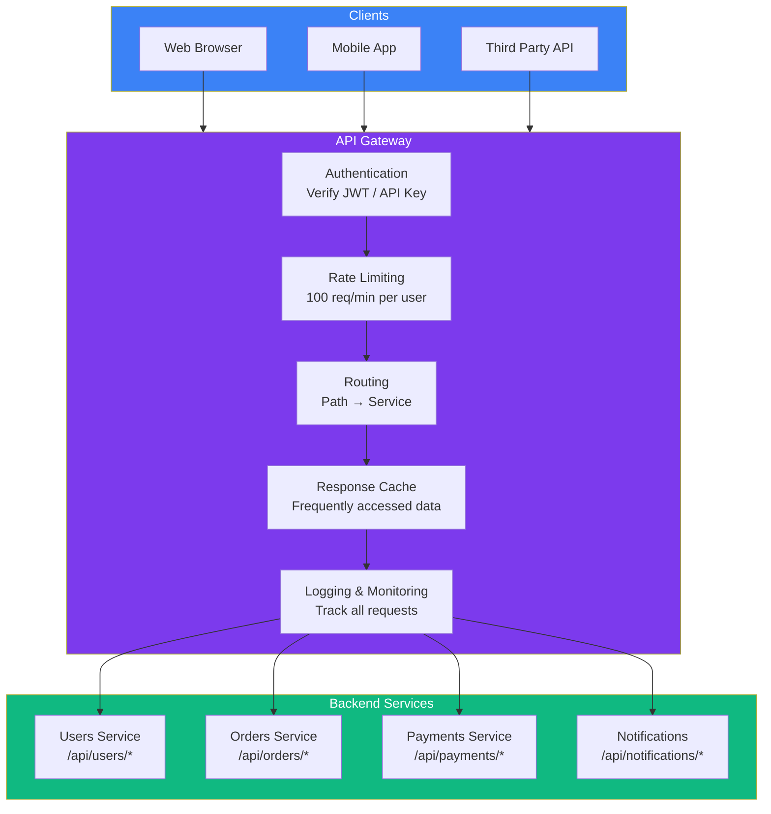
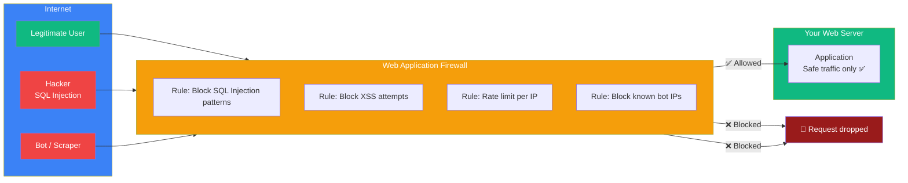

## API Gateways & WAF

### 🤔 What is an API Gateway?

An **API Gateway** is a single entry point for all client requests. Think of it like a **reception desk at a company**:

- All visitors (clients) first go to the reception desk
- The receptionist (gateway) checks who they are, directs them to the right office (service)
- Some requests are handled right at the desk (authentication, rate limiting)

---

### 📋 What an API Gateway Does

| Feature | What it does | Why it matters |
|---------|-------------|----------------|
| **Routing** | Directs requests to the right backend service | Clients only need one URL |
| **Authentication** | Verifies API keys, JWT tokens | Centralized security |
| **Rate Limiting** | Limits requests per user/IP | Prevents abuse and DDoS |
| **Caching** | Caches frequent responses | Reduces backend load |
| **SSL Termination** | Handles HTTPS encryption | Less work for backend servers |
| **Request/Response Transform** | Modifies headers, formats data | Clients and services don't need to match exactly |
| **Monitoring** | Logs all API traffic | Debugging, analytics, billing |

---

### 🛡️ Web Application Firewall (WAF)

A WAF sits **in front of your web application** and filters malicious traffic:

**Common WAF rules:**
- Block **SQL injection** patterns (`' OR 1=1 --`)
- Block **XSS** attempts (``)
- Block **path traversal** (`../../../etc/passwd`)
- **Rate limit** — max 1000 requests/minute per IP
- **Geo-blocking** — block traffic from unexpected countries
- **IP blacklisting** — block known malicious IPs

---

### 🔄 API Gateway vs Load Balancer

| Feature | Load Balancer | API Gateway |
|---------|--------------|-------------|
| **Layer** | L4/L7 (Transport/Application) | L7 (Application) |
| **Routing** | By IP + port | By URL path + headers |
| **Auth** | ❌ No | ✅ Yes |
| **Rate Limiting** | Limited | ✅ Deep (per user, per endpoint) |
| **Caching** | ❌ No | ✅ Yes |
| **Protocol translation** | ❌ No | ✅ REST → gRPC, etc. |
| **Example** | HAProxy, Nginx | Kong, AWS API Gateway, Apigee |

Many modern setups use **both**: Load balancer → API Gateway → Services.

---

### 🚀 Popular API Gateways

| Tool | Description |
|------|-------------|
| **Kong** | Open-source, plugin-based (auth, rate limiting, logging) |
| **AWS API Gateway** | Serverless, integrates with Lambda |
| **Apigee** | Enterprise, analytics, monetization |
| **Traefik** | Cloud-native, auto-discovers services |
| **Nginx + Lua** | Custom gateway logic using Nginx |

---

### In Simple Words

- An **API Gateway** is a single entry point that routes, authenticates, rate-limits, and caches API requests
- A **WAF** filters malicious traffic (SQL injection, XSS) before it reaches your server
- **API Gateways** understand HTTP (URL paths, headers); **Load Balancers** work at lower levels (IP, port)
- Gateways simplify clients — they only need one URL instead of many service URLs
- Popular gateways: Kong, AWS API Gateway, Traefik
