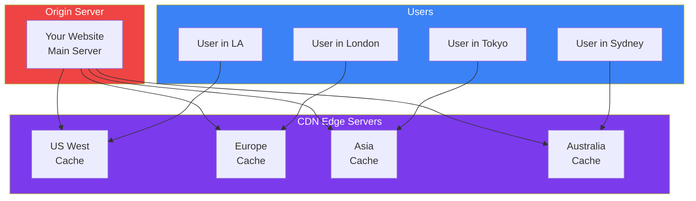

## CDN & Caching

### 🤔 What is a CDN?

A CDN (Content Delivery Network) is a network of servers spread across the world that **cache your content** and serve it from the **nearest server** to the user.

Think of it like **pizza delivery**:
- Without CDN: Every pizza is made in one central kitchen (slow for far-away customers)
- With CDN: There are local kitchens in every neighborhood (fast for everyone)



---

### 📋 CDN Benefits

| Benefit | Without CDN | With CDN |
|---------|-------------|----------|
| **Latency** | 200ms (far away) | 20ms (nearby) |
| **Server load** | All requests hit your server | Most requests hit the CDN |
| **Bandwidth cost** | You pay for all traffic | CDN absorbs most traffic |
| **DDoS protection** | Your server gets attacked | CDN absorbs the attack |
| **Availability** | Single point of failure | Distributed across the globe |

**Popular CDNs:** Cloudflare, Akamai, Fastly, AWS CloudFront, Google Cloud CDN

---

### 🗺️ How a CDN Serves Content

```bash
1. User in Tokyo requests your website
2. DNS resolves to the nearest CDN edge server (Tokyo)
3. If the edge has the content cached → serve immediately
4. If not → edge fetches from origin, caches it, serves it
5. Next user in Tokyo gets the cached version (fast!)
```

**Cache hit:** User gets content from nearby edge (fast — ~20ms)
**Cache miss:** Edge fetches from origin server (slower — ~200ms)

---

### ⏱️ HTTP Caching Headers

Servers tell browsers and CDNs how long to cache content:

```http
# Cache for 1 hour
Cache-Control: public, max-age=3600

# Don't cache
Cache-Control: no-cache, no-store, must-revalidate

# Cache but revalidate before using
Cache-Control: no-cache
ETag: "abc123"     # Version identifier

# Cache for 1 year (for static files like images)
Cache-Control: public, max-age=31536000, immutable
```

**What to cache:**
```bash
✅ Cache aggressively:     Images, CSS, JS, fonts (static files)
✅ Cache briefly:          API responses (a few seconds/minutes)
❌ Never cache:            Personal data, bank balances
```

---

### 🔍 CDN Cache Flow

```
User Request → CDN Edge
                │
                ├── Has the content? → Serve from cache (fast!)
                │
                └── Missing? → Fetch from origin → Store in cache → Serve
                                    │
                              Origin Server
```

**Cache invalidation** (removing cached content):
- **TTL expiry** — content automatically expires after `max-age`
- **Manual purge** — force remove from CDN (e.g., after updating a file with the same name)
- **Versioning** — `style.v2.css` instead of overwriting `style.css`

---

### In Simple Words

- A **CDN** is a network of servers worldwide that cache and serve your content
- Users get data from the **nearest edge server** — much faster than a single origin server
- **Cache-Control: max-age** tells browsers and CDNs how long to cache content
- **Cache hit** = fast; **cache miss** = fetch from origin (slower)
- CDNs also provide **DDoS protection** and reduce your server load
