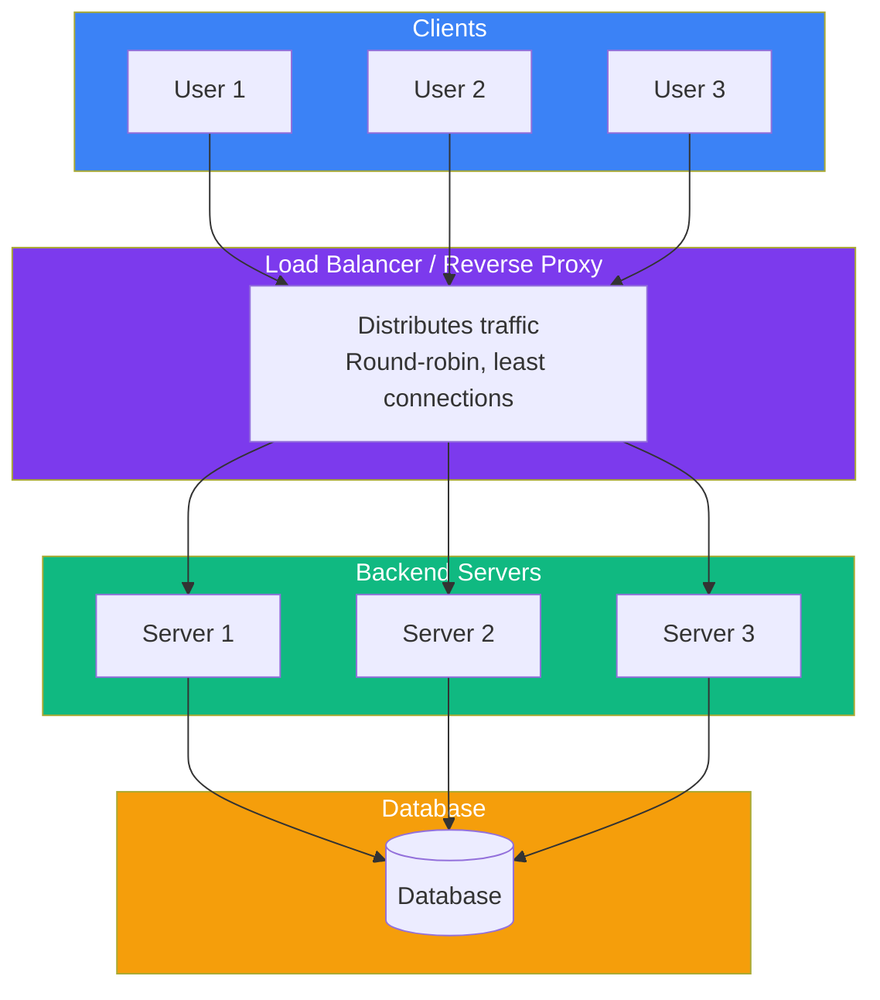

## Load Balancers & Proxies

### 🤔 What Are They?

- **Load Balancer** — Distributes incoming traffic across multiple servers
- **Forward Proxy** — Sits in front of clients (hides the client from the server)
- **Reverse Proxy** — Sits in front of servers (hides servers from the client)



---

### ⚖️ Load Balancers

A load balancer distributes incoming requests across multiple servers so no single server gets overwhelmed.

**Load balancing algorithms:**
```bash
Round Robin       → Request 1 → Server A, Request 2 → Server B, Request 3 → Server C...
Least Connections → Send to server with fewest active connections
IP Hash           → Same user always goes to the same server (session persistence)
Weighted          → More powerful servers get more traffic
```

**Why use a load balancer?**
- **Scalability** — add more servers as traffic grows
- **High availability** — if one server fails, traffic goes to the others
- **SSL termination** — decrypt HTTPS at the load balancer (less work for servers)

---

### 🔄 Forward Proxy

A forward proxy sits **between the client and the internet**:

```
Client → Forward Proxy → Internet → Server
```

**Used for:**
- **Anonymity** — hides the client's IP from the server
- **Bypassing restrictions** — access blocked websites
- **Content filtering** — schools/corporations block certain sites
- **Caching** — serve frequently accessed content faster

---

### 🔄 Reverse Proxy

A reverse proxy sits **between the internet and your servers**:

```
Internet → Reverse Proxy → Server
```

**Used for:**
- **Load balancing** — distribute traffic
- **Caching** — cache responses to reduce server load
- **SSL termination** — handle HTTPS at the proxy
- **Security** — hide internal server details
- **Rate limiting** — prevent abuse

**Common tools:**
| Tool | What it does |
|------|-------------|
| **Nginx** | Web server + reverse proxy + load balancer |
| **HAProxy** | High-performance load balancer |
| **Cloudflare** | CDN + reverse proxy + DDoS protection |
| **Traefik** | Modern reverse proxy (great for containers) |

---

### 📊 Forward vs Reverse Proxy

| | Forward Proxy | Reverse Proxy |
|---|--------------|--------------|
| **Hides** | The client (you) | The server |
| **Knows** | Who the client is | Who the server is |
| **Used by** | Clients (users) | Server owners |
| **Example** | VPN, corporate proxy | Nginx, Cloudflare |

---

### In Simple Words

- A **load balancer** spreads traffic across multiple servers for scalability and reliability
- A **forward proxy** sits in front of clients (hides the user — like a VPN)
- A **reverse proxy** sits in front of servers (hides the server — like Cloudflare)
- Load balancers use algorithms like **round-robin** and **least connections**
- Common tools: **Nginx** (reverse proxy), **HAProxy** (load balancer), **Cloudflare** (CDN + proxy)
