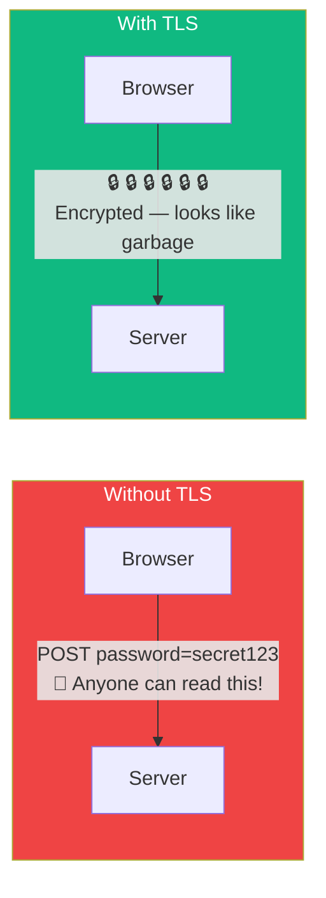
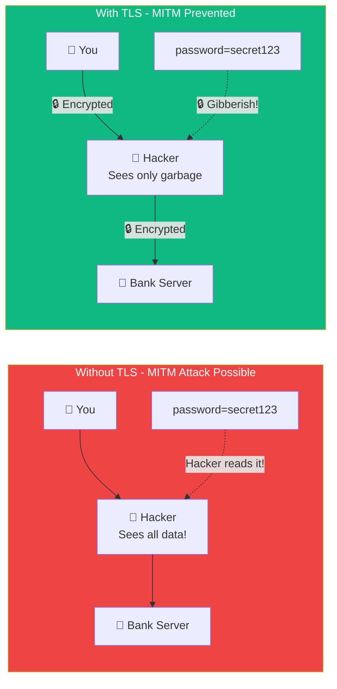
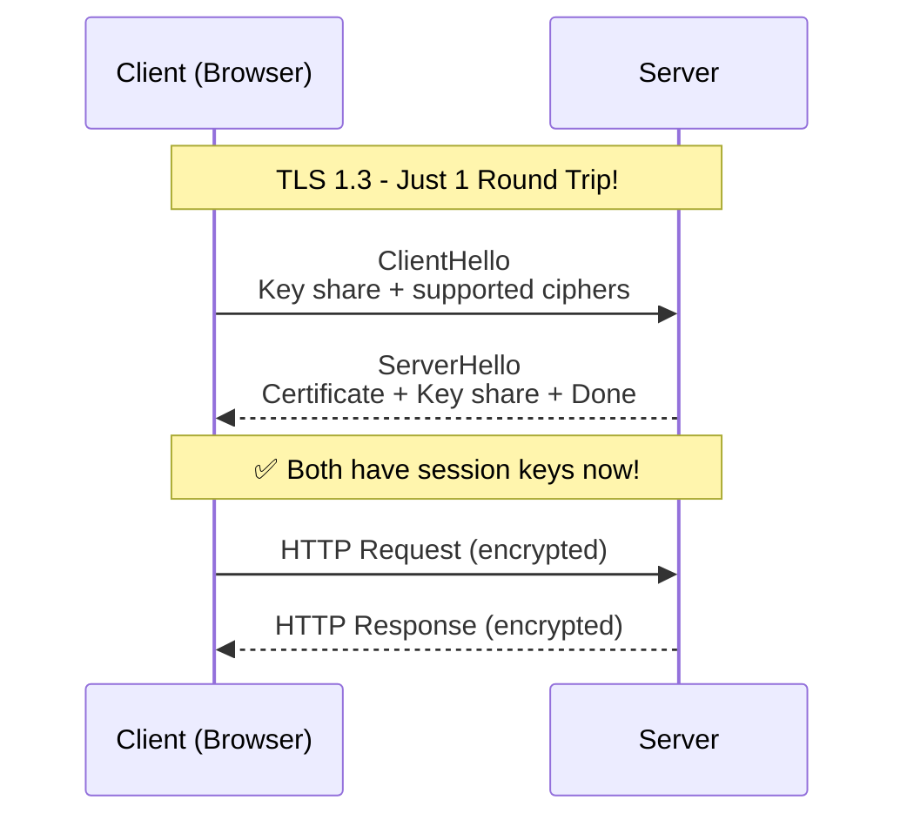
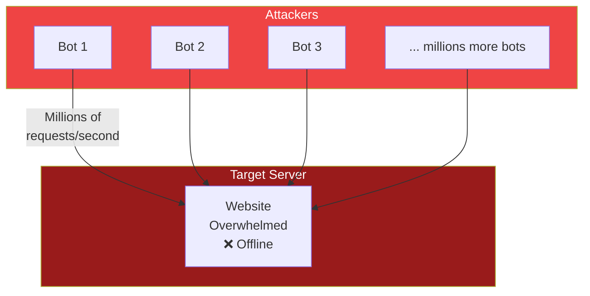

## Network Security Basics

### 🔒 TLS / SSL — Encryption in Transit

TLS (Transport Layer Security) encrypts data between the client and server. It's what makes HTTPS secure.

Think of it like a **tunnel with a locked door**:
- Without TLS: Your data is sent on an open road (anyone can see it)
- With TLS: Your data goes through an encrypted tunnel (nobody can see inside)



**TLS checklist:**
- 🔒 Padlock in browser bar = TLS is active
- 🔑 Uses certificates issued by Certificate Authorities (CAs)
- 🛡️ Protects against eavesdropping, tampering, and impersonation

---

### ⚔️ Man-in-the-Middle (MITM) Attack

Without TLS, an attacker between you and the server can **intercept, read, and modify** your data.



**TLS 1.3 Handshake (faster, only 1 round trip):**



**TLS 1.3 vs 1.2:**
| Feature | TLS 1.2 | TLS 1.3 |
|---------|---------|---------|
| Handshake round trips | 2 | **1** |
| Supported ciphers | Many (some weak) | Few (strong only) |
| Zero-RTT resumption | ❌ | ✅ (1-RTT for returning users) |
| Deprecated algorithms | ❌ | ✅ (removed RSA key exchange, RC4, etc.) |

---

### 🧱 Firewalls

A firewall is a **security guard** that decides which network traffic is allowed in and out.

**Types of firewalls:**
| Type | What it does |
|------|-------------|
| **Packet filter** | Blocks traffic by IP + port (simple) |
| **Stateful** | Tracks connections (remembers who asked for data) |
| **Application layer** | Inspects the actual data (e.g., SQL injection detection) |

```bash
# Example firewall rules
Allow incoming SSH (port 22) from office IP only
Allow incoming HTTP (port 80) and HTTPS (port 443) from everywhere
Block all other incoming traffic
Allow all outgoing traffic
```

---

### 🕵️ VPN (Virtual Private Network)

A VPN creates an **encrypted tunnel** between your device and a server, hiding your internet activity.

```
Without VPN:
Your ISP → 🌐 → Website (ISP sees every site you visit)

With VPN:
Your ISP → 🔒 VPN Server → 🌐 → Website (ISP only sees "connected to VPN")
```

**What a VPN does:**
- **Hides your IP address** — websites see the VPN's IP, not yours
- **Encrypts traffic** — your ISP can't see what you do
- **Bypasses geo-restrictions** — appear to be in a different country

**When to use a VPN:**
- On public WiFi (airport, coffee shop)
- Accessing region-locked content
- Privacy from your ISP
- Remote work (connecting to company network)

---

### 💥 DDoS Attacks

DDoS (Distributed Denial of Service) floods a server with so much traffic that it becomes unavailable.



**DDoS mitigation:**
- **Rate limiting** — limit requests per IP
- **CDN / Cloudflare** — absorb traffic across many edge servers
- **Scaling** — add more servers to handle the load
- **Web Application Firewall (WAF)** — filter malicious traffic

---

### 📋 Security Checklist

```bash
✅ Use HTTPS everywhere (TLS 1.3 or 1.2)
✅ Keep certificates up to date
✅ Use a firewall to block unwanted traffic
✅ Rate limit API endpoints
✅ Use a CDN for DDoS protection
✅ Validate and sanitize all user input
✅ Never trust client data
✅ Use VPNs for sensitive connections
```

---

### In Simple Words

- **TLS/SSL** encrypts data between you and the server (HTTPS) — look for the 🔒
- **MITM attacks** are prevented by TLS — even if intercepted, data is encrypted
- **TLS 1.3** is faster (1 round trip) and more secure than TLS 1.2
- **Firewalls** filter network traffic — they decide what's allowed in and out
- **VPNs** create an encrypted tunnel to hide your activity from your ISP
- **DDoS** attacks flood a server with traffic to take it down
