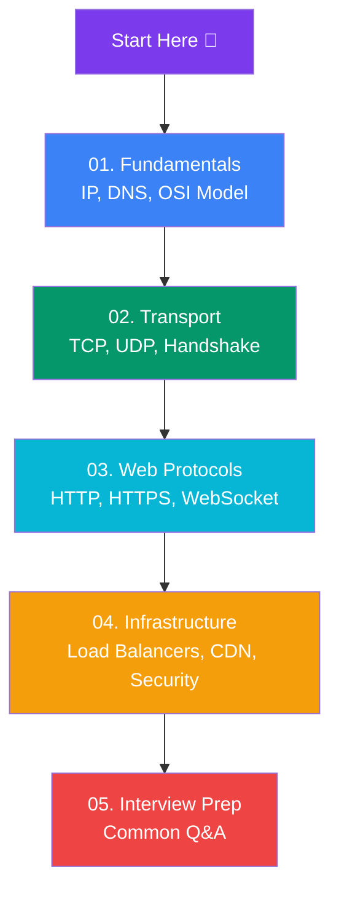

# Computer Networks

Complete beginner-friendly guide to computer networks — from IP addresses and DNS to HTTP, TLS, CDNs, and interview prep.

## Learning Path

## Sections

### 🌐 01. Fundamentals
- [What is a Network?](/DSA-Notes-Problems/networks/01-fundamentals/what-is-a-network) — Client/server, internet basics
- [OSI & TCP/IP Models](/DSA-Notes-Problems/networks/01-fundamentals/osi-and-tcp-ip-models) — The layers in simple words
- [IP Addresses & Ports](/DSA-Notes-Problems/networks/01-fundamentals/ip-addresses-and-ports) — IPv4/IPv6, ports, NAT, DHCP
- [DNS](/DSA-Notes-Problems/networks/01-fundamentals/dns) — Name to IP resolution
- [Network Topologies & Devices](/DSA-Notes-Problems/networks/01-fundamentals/network-topologies-and-devices) — Star/mesh/bus, hubs, switches, routers, ARP

### 📦 02. Transport
- [TCP vs UDP](/DSA-Notes-Problems/networks/02-transport/tcp-vs-udp) — Reliable vs fast, packet structure
- [TCP Handshake & Connection](/DSA-Notes-Problems/networks/02-transport/tcp-handshake-and-connection) — 3-way handshake, teardown
- [TCP Flow Control & Congestion](/DSA-Notes-Problems/networks/02-transport/tcp-flow-and-congestion) — Sliding window, slow start, AIMD

### 🌍 03. Web Protocols
- [HTTP & HTTPS](/DSA-Notes-Problems/networks/03-web-protocols/http-and-https) — Request/response, methods, TLS
- [HTTP Versions](/DSA-Notes-Problems/networks/03-web-protocols/http-versions) — HTTP/1.1 vs HTTP/2 vs HTTP/3
- [Status Codes](/DSA-Notes-Problems/networks/03-web-protocols/status-codes) — 1xx–5xx grouped with decision flow
- [REST vs WebSocket](/DSA-Notes-Problems/networks/03-web-protocols/rest-vs-websocket) — Request/response vs persistent two-way
- [Cookies, Sessions & CORS](/DSA-Notes-Problems/networks/03-web-protocols/cookies-sessions-cors) — State, cross-origin, CSRF
- [HTTP Caching](/DSA-Notes-Problems/networks/03-web-protocols/http-caching) — Cache-Control, ETag, validation

### ⚙️ 04. Infrastructure
- [Load Balancers & Proxies](/DSA-Notes-Problems/networks/04-infrastructure/load-balancers-and-proxies) — Forward/reverse proxy, LB algorithms
- [CDN & Caching](/DSA-Notes-Problems/networks/04-infrastructure/cdn-and-caching) — Edge caching, HTTP cache headers
- [Network Security Basics](/DSA-Notes-Problems/networks/04-infrastructure/network-security-basics) — TLS, firewalls, VPN, DDoS, MITM
- [API Gateways & WAF](/DSA-Notes-Problems/networks/04-infrastructure/api-gateways) — API gateways, Web Application Firewalls

### 💬 05. Interview
- [Interview Questions](/DSA-Notes-Problems/networks/05-interview/interview-questions) — Common networking Q&A
