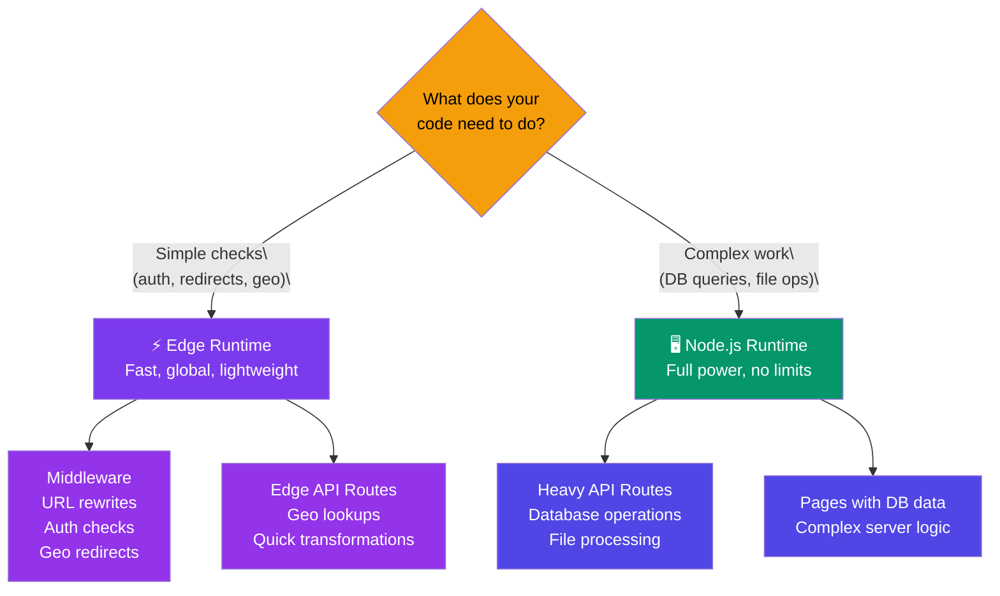

# Edge & Node.js Runtimes

## Simple Analogy 🏪

Think of two types of shops:
- **Edge Runtime** = A vending machine. Small, fast, everywhere — but only does simple tasks (take money, give product).
- **Node.js Runtime** = A full supermarket. Big, slower, located further away — but can do everything (fresh produce, deli counter, bakery).

---

## What is the Edge Runtime?

The **Edge Runtime** runs your code at CDN edge nodes — hundreds of locations worldwide, very close to users. It uses a lightweight V8 isolate (not full Node.js).

```tsx
// app/api/geo/route.ts
export const runtime = "edge"; // 👈 Run at the edge

export async function GET(request: Request) {
  const { geo } = request as any;

  return Response.json({
    country: geo?.country ?? "Unknown",
    city: geo?.city ?? "Unknown",
    latency: "sub-10ms",
  });
}
```

### What Runs on Edge?

- **Middleware** (always runs on Edge)
- Route handlers with `export const runtime = "edge"`
- Some page rendering (limited)

---

## Edge vs Node.js Comparison

| Feature | Edge Runtime | Node.js Runtime |
|---------|-------------|-----------------|
| **Location** | CDN edge nodes globally | Single server region |
| **Cold start** | ~0ms (always warm) | 100ms–500ms |
| **Latency** | Sub-10ms globally | 50–200ms |
| **Memory limit** | 128MB | No practical limit |
| **Node.js APIs** | ❌ Not available | ✅ Full access |
| **File system** | ❌ No `fs` access | ✅ Full access |
| **npm packages** | Limited (no native bindings) | All packages |
| **Database direct** | ❌ Use HTTP clients | ✅ Direct connections |
| **Best for** | Auth, redirects, A/B tests | Complex logic, DB access |

---

## When to Use Edge vs Node.js



---

## Edge Runtime Limitations

You **cannot** use these in Edge Runtime:

| ❌ Not Available | ✅ Alternative |
|---|---|
| `fs` (file system) | Fetch from an API instead |
| `path` module | Use string methods / URL API |
| `crypto` (Node.js) | Use Web Crypto API (`crypto.subtle`) |
| `bcrypt` | Hash in API routes, not middleware |
| Prisma / DB connections | Use cached tokens or HTTP client |
| Most Node.js-specific npm packages | Use Edge-compatible alternatives |

### Bundle Size Limit

Middleware bundles must be **under 1MB**. Heavy libraries will fail the build.

---

## ⚠️ Common Mistakes

| Mistake | Fix |
|---------|-----|
| Using `fs` in Edge Runtime | Move file operations to Node.js route handler |
| Database calls in middleware | Use JWT verification (fast, no DB) instead |
| Importing heavy packages in middleware | Keep middleware lean — it runs on every request |
| Setting `runtime: "edge"` on a page with DB access | Pages with DB queries need Node.js runtime |

---

## 🧠 In Simple Words

- **Edge Runtime** = fast, runs on CDN nodes worldwide, but limited capabilities (no file system, no DB)
- **Node.js Runtime** = full server capabilities, runs in one region, but more powerful
- **Middleware always runs on Edge** — keep it fast and lightweight
- Use **Edge** for auth checks, redirects, geo-detection; use **Node.js** for DB queries, file operations, heavy computations
- If you're not sure, **start with Node.js** — it can do everything Edge can, just slower globally
