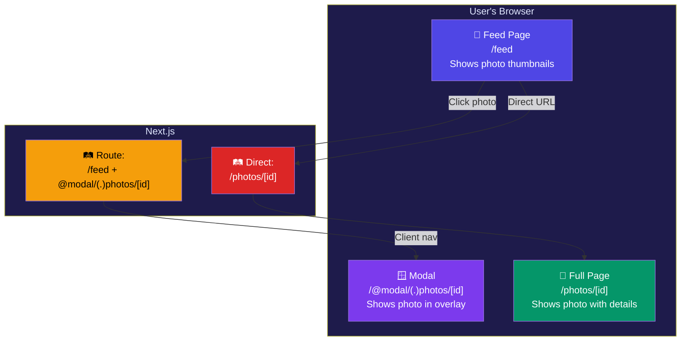

# Parallel & Intercepting Routes

## Simple Analogy 🏢

**Parallel Routes** = Different departments in an office receiving their own mail simultaneously. Marketing gets brochures, Engineering gets code reviews — all at the same time, in the same building.

**Intercepting Routes** = A receptionist who intercepts a package meant for the CEO, opens it in a meeting room (modal), but if you visit the CEO directly, you get the full package.

---

## Parallel Routes

Parallel routes let you render **multiple pages simultaneously in the same layout**. Use `@folder` naming:

```txt
app/
  @analytics/
    page.tsx           ← /analytics (in the analytics slot)
  @notifications/
    page.tsx           ← /notifications (in the notifications slot)
  layout.tsx           ← Receives analytics + notifications as props
  page.tsx
```

```tsx
// app/layout.tsx
interface Props {
  children: React.ReactNode;
  analytics: React.ReactNode;     // @analytics slot
  notifications: React.ReactNode; // @notifications slot
}

export default function DashboardLayout({
  children,
  analytics,
  notifications,
}: Props) {
  return (
    <div className="dashboard">
      <main>{children}</main>
      <aside>
        {analytics}
        {notifications}
      </aside>
    </div>
  );
}
```

Each slot fetches its own data **independently** — no waterfall, no shared dependencies.

### Why Use Parallel Routes?

| Benefit | Example |
|---------|---------|
| **Independent loading** | Each slot has its own `loading.tsx` |
| **Independent errors** | Each slot has its own `error.tsx` |
| **Different layouts** | Each slot can have its own layout |
| **Better performance** | Slots don't block each other |

### default.tsx — The Fallback

Each parallel route slot needs a `default.tsx` for when no matching page exists (e.g., on direct navigation to a sub-route):

```tsx
// app/@analytics/default.tsx
export default function DefaultAnalytics() {
  return <div>Select a section to see analytics</div>;
}
```

---

## Intercepting Routes

Intercepting routes **intercept** a URL pattern and show content in a different context (like a modal), while keeping the original URL accessible for direct navigation.

```txt
app/
  feed/
    page.tsx
  photos/
    [id]/
      page.tsx         ← Full photo page (direct URL access)
  @modal/
    (.)photos/
      [id]/
        page.tsx       ← Photo shown in modal (intercepted)
```

### Interception Conventions

| Convention | What it intercepts | Example |
|------------|-------------------|---------|
| `(.)` | Same level | `/feed` → `/photos/1` shown as modal in feed |
| `(..)` | One level up | `/blog/post` → `/author` shown as overlay |
| `(..)(..)` | Two levels up | Any deeper interception |
| `(...)` | From root `app/` | Root-level interception |

### Example: Photo Modal

```tsx
// app/@modal/(.)photos/[id]/page.tsx — Modal version
import { Modal } from "@/components/Modal";

export default function PhotoModal({ params }: { params: Promise<{ id: string }> }) {
  return (
    <Modal>
      
    </Modal>
  );
}
```

```tsx
// app/photos/[id]/page.tsx — Full page version
export default async function PhotoPage({ params }: { params: Promise<{ id: string }> }) {
  const { id } = await params;
  return (
    <div className="full-page-photo">
      
      <p>Full photo page with details...</p>
    </div>
  );
}
```

**Behavior:**
- User clicks a photo on `/feed` → modal opens (URL changes to `/photos/1`)
- User navigates directly to `/photos/1` → full page renders
- User refreshes the page → full page renders (interception only works client-side)

---

## Parallel + Intercepting: The Modal Pattern

Together, they create the **classic modal pattern** — click to show a modal, direct URL to show a full page:



---

## ⚠️ Common Mistakes

| Mistake | Fix |
|---------|-----|
| Forgetting `default.tsx` for slots | Add `default.tsx` to every parallel route slot |
| Interception not working on refresh | Interception only works on client navigation — direct URL shows full page |
| Trying to use parallel routes without layout | The parent layout must accept slot props |
| Not using `default.tsx` causes 404 | Always provide a fallback for each slot |

---

## 🧠 In Simple Words

- **Parallel Routes** (`@folder`) = render different pages side-by-side in the same layout, each with independent data loading
- **Intercepting Routes** (`(.)folder`) = show a page in a different context (modal/overlay) when navigated from a specific parent
- Combined, they create the **modal pattern**: click → modal, direct URL → full page
- Every parallel slot needs a **`default.tsx`** for direct navigation fallback
- Interception only works on **client-side navigation** — refresh shows the full page
