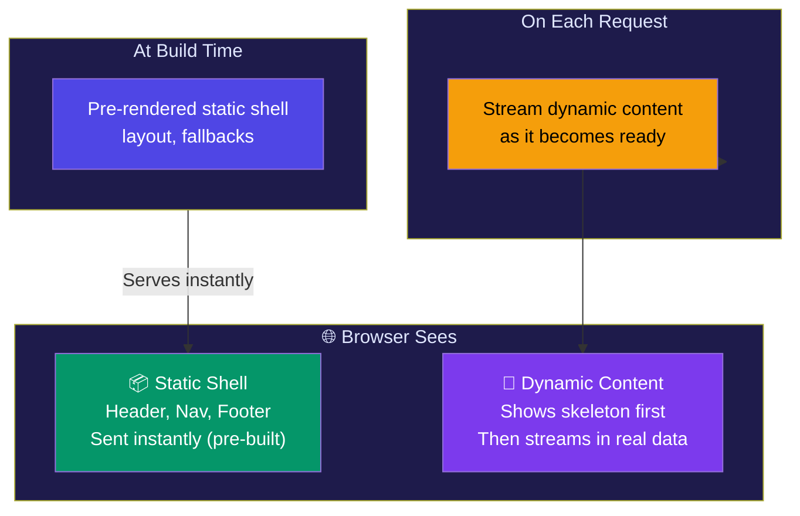

# Partial Prerendering (PPR)

## Simple Analogy 🏠

Imagine a restaurant menu. The **menu itself** (header, nav, footer) is a printed card — same for everyone, pre-made (static). But the **daily specials** are written on a whiteboard — they change based on what's fresh today (dynamic).

**PPR** lets you combine both in one page: the static parts are pre-built, and the dynamic parts update on each visit.

---

## What is PPR?

**Partial Prerendering (PPR)** is a Next.js feature that lets you have a **static shell** (pre-rendered at build time) with **dynamic holes** that stream in during the request.



---

## How PPR Works

```tsx
// This page has a PPR pattern — static shell + dynamic content

async function ProductPage() {
  return (
    <div>
      {/* Static — pre-rendered at build time */}
      <Header />
      <Navigation />
      <Footer />

      {/* Dynamic — streams in on each request */}
      <Suspense fallback={<PriceSkeleton />}>
        <LivePrice />
      </Suspense>

      {/* Static — but with ISR revalidation */}
      <ProductDescription />
    </div>
  );
}
```

With PPR enabled, the **static shell** (Header, Nav, Footer) is served from CDN instantly, while **dynamic parts** (LivePrice) stream in independently.

---

## PPR vs Other Approaches

| Approach | Static Parts | Dynamic Parts | First Load |
|----------|-------------|---------------|------------|
| **SSG** | Everything static | ❌ Not possible | ⚡ Instant |
| **SSR** | Nothing pre-built | Everything dynamic | 🐢 Wait for all data |
| **ISR** | Pre-built, refreshes periodically | Same as static | ⚡ Instant (may be stale) |
| **PPR** | Static shell pre-built | Dynamic holes streamed | ⚡ Shell instant + content streams |

---

## When to Use PPR

PPR is ideal for pages that have:
1. A **consistent layout** (same for all users)
2. Some **real-time or user-specific data** mixed in
3. Need **fast initial load** with **fresh content**

### ✅ Good for PPR
- E-commerce product pages (static description + live price/inventory)
- Blog posts (static content + live comments/views)
- Dashboard shells (static nav + user-specific data)

### ❌ Not needed for
- Fully static pages (just use SSG)
- Fully dynamic pages (just use SSR)
- Apps where there's no static shell (everything is user-specific)

---

## ⚠️ Common Mistakes

| Mistake | Why | Fix |
|---------|-----|------|
| Expecting PPR to make everything instant | Only the static shell is pre-built | Design your page with a clear static shell + dynamic holes |
| Using PPR for fully dynamic pages | If every part changes per user, there's no benefit | Use SSR instead |
| Not using Suspense boundaries | PPR needs Suspense to know what to stream | Wrap dynamic parts in `<Suspense>` |

---

## 🧠 In Simple Words

- **PPR** = static shell (pre-built) + dynamic holes (streamed on request)
- The **shell** (header, nav, layout) loads instantly from CDN
- **Dynamic content** streams in as it becomes ready
- Best for pages with **mixed content** — some static, some real-time
- Think of it as **SSG + SSR on the same page**
