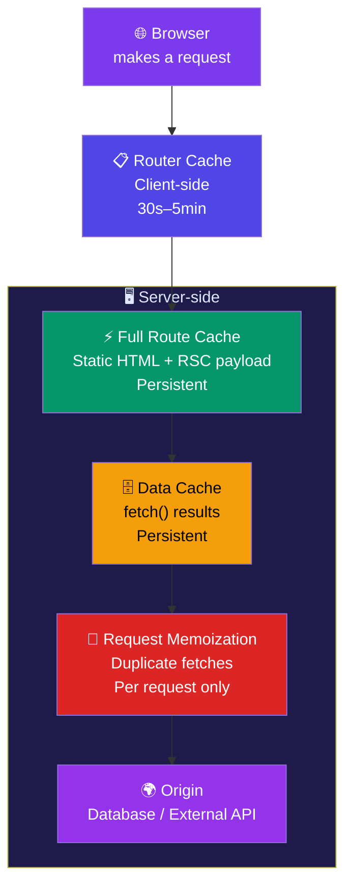
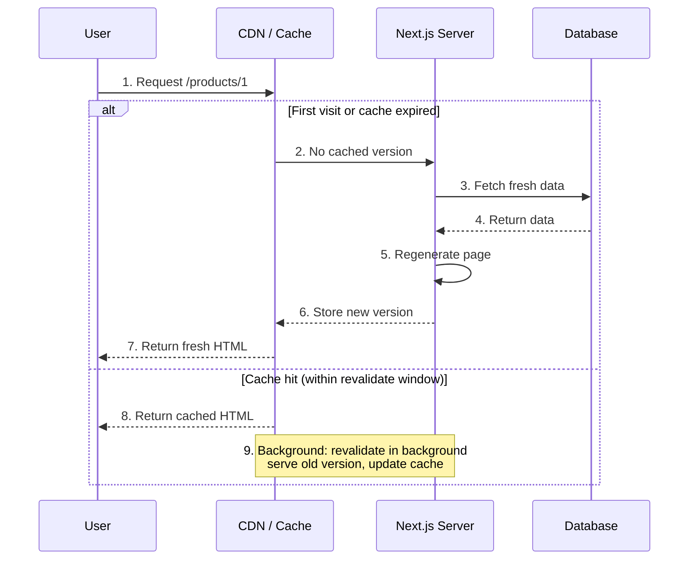

# Caching & Revalidation

## Simple Analogy 📦

Imagine a library:
- **Request Memoization** = Two people ask for the same book at the same time — the librarian hands it to both without walking back to the shelf.
- **Data Cache** = The librarian keeps a copy of popular books at the front desk so they don't have to fetch them from the back every time.
- **Full Route Cache** = The library has pre-printed pamphlets for common topics — grab one instantly.
- **Router Cache** = You keep a few recently-read pages in your backpack so you don't need to revisit the library.

---

## The 4 Caching Layers



---

### 1. Request Memoization (Per-Request)

**What:** Deduplicates the same `fetch()` call within one render pass.

```tsx
// In one Server Component render:
async function getProduct(id: string) {
  const res = await fetch(`https://api.example.com/products/${id}`);
  return res.json();
}

// These two calls happen in different components
// BUT only ONE fetch actually happens — the second one reuses the result!
const product = await getProduct("1");
const sameProduct = await getProduct("1"); // Memoized — no extra fetch
```

**Duration:** Per request only. Cleared when the render finishes.

### 2. Data Cache (Cross-Request)

**What:** Persists `fetch()` results across different requests and even deployments.

```tsx
// Cached forever (default behavior)
const data = await fetch("https://api.example.com/products");

// Time-based revalidation
const freshData = await fetch("https://api.example.com/products", {
  next: { revalidate: 3600 }, // Re-fetch after 1 hour
});

// No cache — always fetch fresh
const liveData = await fetch("https://api.example.com/live", {
  cache: "no-store",
});
```

**Duration:** Persistent (survives deployments).

### 3. Full Route Cache (HTML + RSC Payload)

**What:** Caches the rendered HTML and RSC payload at build time for static routes.

- Static routes (no dynamic data) → cached at build time
- Dynamic routes → not cached
- Revalidated when Data Cache is invalidated

**Duration:** Persistent (survives deployments).

### 4. Router Cache (Client-Side)

**What:** Caches route segments in the user's browser for instant back/forward navigation.

- Lasts 30 seconds for fresh data, 5 minutes for stale data
- Used by `<Link>` prefetching
- Cleared on full page reload

---

## ISR Flow — Incremental Static Regeneration



```tsx
// app/products/[id]/page.tsx

// ISR: regenerate this page every 60 seconds
export const revalidate = 60;

async function ProductPage({ params }: { params: Promise<{ id: string }> }) {
  const { id } = await params;
  const product = await fetch(`https://api.example.com/products/${id}`)
    .then((r) => r.json());

  return (
    <div>
      <h1>{product.name}</h1>
      <p>Price: ₹{product.price}</p>
    </div>
  );
}
```

---

## Revalidation Strategies

### 1. Time-Based Revalidation

```tsx
// Revalidate at most every 1 hour
export const revalidate = 3600;

// Or per-fetch:
const data = await fetch("https://api.example.com/data", {
  next: { revalidate: 3600 },
});
```

### 2. On-Demand Revalidation

```tsx
"use server";
import { revalidatePath, revalidateTag } from "next/cache";

// After creating a post:
export async function createPost(formData: FormData) {
  await saveToDb(formData);

  // Revalidate a specific path
  revalidatePath("/blog");

  // Or revalidate by tag (more precise)
  revalidateTag("posts");
}
```

```tsx
// Tag your fetches for precise revalidation:
const posts = await fetch("https://api.example.com/posts", {
  next: { tags: ["posts"] },
});
```

### 3. Cache Busting

```tsx
const data = await fetch("https://api.example.com/data", {
  cache: "no-store",            // Never cache
  // or
  headers: { "Cache-Control": "no-cache" },
});
```

---

## Cache Configuration Cheatsheet

| Strategy | Config | When to Use |
|----------|--------|-------------|
| Static (cached forever) | (default) | Blogs, docs, marketing pages |
| Time-based ISR | `next: { revalidate: 60 }` | Product pages, news, pricing |
| Tag-based revalidation | `next: { tags: ['posts'] }` | CMS content, user-generated content |
| No cache (dynamic) | `cache: 'no-store'` | User dashboards, real-time data |

---

## ⚠️ Common Mistakes

| Mistake | Why | Fix |
|---------|-----|-----|
| Using `cache: 'no-store'` everywhere | Kills performance | Only for truly dynamic data |
| Forgetting to revalidate after mutation | Users see stale data | Always call `revalidatePath` or `revalidateTag` |
| Not tagging fetches | Can only revalidate by path, not by content type | Use `next: { tags: ['...'] }` |
| Expecting instant updates with ISR | ISR serves stale + updates in background | Set appropriate revalidate time |

---

## 🧠 In Simple Words

- **Request Memoization** — duplicates of the same `fetch` in one render only hit the network once
- **Data Cache** — `fetch()` results persist across requests and deployments
- **Full Route Cache** — pre-built HTML pages served instantly from CDN
- **Router Cache** — browser stores recent pages for instant back/forward nav
- **ISR** serves stale page + updates in background, then shows fresh version next time
- **revalidatePath** clears cache for a URL; **revalidateTag** clears all fetches with that tag
- Use **`cache: 'no-store'`** only for data that MUST be real-time (dashboards, live scores)
