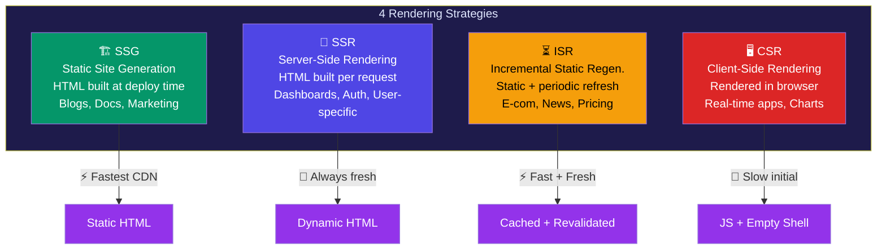

# Section 9: Rendering Methods

## 9.1 The Four Rendering Strategies

Next.js offers four main rendering strategies. Choosing the right one impacts **performance**, **SEO**, and **user experience** significantly.

| Strategy | Acronym | When HTML is Generated |
|----------|---------|----------------------|
| Static Site Generation | SSG | At **build time** |
| Server-Side Rendering | SSR | At **request time** |
| Incremental Static Regeneration | ISR | Build time + **periodic refresh** |
| Client-Side Rendering | CSR | In the **browser** |

---

### Rendering Strategies Comparison



## 9.2 Static Site Generation (SSG)

**SSG** pre-renders pages at build time. All pages become static HTML files — blazing fast.

```tsx
// app/blog/[slug]/page.tsx

// Tell Next.js all possible blog post slugs at build time
export async function generateStaticParams() {
  const posts = await fetch("https://api.example.com/posts").then((r) =>
    r.json()
  );

  return posts.map((post: { slug: string }) => ({
    slug: post.slug,
  }));
}

// This page is statically generated for each slug
async function BlogPost({ params }: { params: { slug: string } }) {
  const post = await fetch(`https://api.example.com/posts/${params.slug}`, {
    cache: "force-cache", // Cache this forever (SSG behavior)
  }).then((r) => r.json());

  return (
    <article>
      <h1>{post.title}</h1>
      <div dangerouslySetInnerHTML={{ __html: post.content }} />
    </article>
  );
}

export default BlogPost;
```


---

## 9.3 Server-Side Rendering (SSR)

**SSR** generates HTML **on every request**. Always fresh, always current.

```tsx
// app/dashboard/page.tsx

// Force dynamic rendering (SSR behavior)
export const dynamic = "force-dynamic";

async function DashboardPage() {
  // This runs on EVERY request — always fresh data
  const userData = await fetch("https://api.example.com/user/me", {
    cache: "no-store",
    headers: {
      Authorization: `Bearer ${process.env.API_TOKEN}`,
    },
  }).then((r) => r.json());

  return (
    <div>
      <h1>Welcome back, {userData.name}</h1>
      <p>Last login: {userData.lastLogin}</p>
    </div>
  );
}

export default DashboardPage;
```


---

## 9.4 Incremental Static Regeneration (ISR)

**ISR** is the best of both worlds — pages are static but **automatically refreshed** on a schedule.

```tsx
// app/shop/[id]/page.tsx

// ISR: regenerate this page every 10 minutes
export const revalidate = 600; // seconds

async function ProductPage({ params }: { params: { id: string } }) {
  const product = await fetch(`https://api.example.com/products/${params.id}`)
    .then((r) => r.json());

  return (
    <div>
      <h1>{product.name}</h1>
      <p>Price: ₹{product.price}</p>
      {/* Last updated shown to user */}
      <small>Updated: {new Date().toLocaleString()}</small>
    </div>
  );
}

export default ProductPage;
```


---

## 9.5 Client-Side Rendering (CSR)

**CSR** renders entirely in the browser. The server sends minimal HTML; React builds the UI.

```tsx
// components/LiveChart.tsx
"use client";

import { useEffect, useState } from "react";

interface DataPoint {
  time: string;
  value: number;
}

// Pure CSR — browser fetches and renders all data
export function LiveChart({ dataUrl }: { dataUrl: string }) {
  const [data, setData] = useState<DataPoint[]>([]);
  const [loading, setLoading] = useState(true);

  useEffect(() => {
    const fetchData = async () => {
      const res = await fetch(dataUrl);
      const json = await res.json();
      setData(json);
      setLoading(false);
    };

    fetchData();

    // Poll every 5 seconds for live updates
    const interval = setInterval(fetchData, 5000);
    return () => clearInterval(interval);
  }, [dataUrl]);

  if (loading) return <div className="animate-pulse h-40 bg-gray-200 rounded" />;

  return (
    <div>
      {/* Render chart with data */}
      {data.map((point, i) => (
        <div key={i}>{point.time}: {point.value}</div>
      ))}
    </div>
  );
}
```

---

## 9.6 Rendering Methods Comparison

### SSR vs SSG vs ISR vs CSR

| Feature | SSR | SSG | ISR | CSR |
|---------|-----|-----|-----|-----|
| HTML generated | Per request | At build | Build + refresh | In browser |
| Performance | Medium | 🏆 Fastest | Fast | Slow initial |
| SEO | ✅ Excellent | ✅ Excellent | ✅ Excellent | ❌ Poor |
| Data freshness | 🏆 Always fresh | Stale | Periodic | Controlled |
| Server load | High | None (CDN) | Low | None |
| Personalized | ✅ Yes | ❌ No | ❌ No | ✅ Yes |
| Build time | Fast | Slow (all pages) | Fast | Fast |
| Use cases | Dashboards, auth | Blogs, docs | E-commerce | Real-time apps |

### SEO Comparison

| Method | SEO Score | Reason |
|--------|-----------|--------|
| SSG | ⭐⭐⭐⭐⭐ | Static HTML on CDN, fastest crawl |
| ISR | ⭐⭐⭐⭐⭐ | Same as SSG + auto-refresh |
| SSR | ⭐⭐⭐⭐ | HTML rendered per request, great for bots |
| CSR | ⭐⭐ | Bots may not run JavaScript |

---

## 9.7 Hydration Deep Dive

**Partial Hydration** — Next.js only hydrates Client Components, not Server Components. This makes apps faster.

**Streaming Rendering** — With Suspense, parts of the page stream to the browser as they're ready. No need to wait for all data.

```tsx
// This page streams content progressively
import { Suspense } from "react";

export default function Page() {
  return (
    <>
      {/* Immediately sent — no waiting */}
      <Header />

      {/* Streams when ready */}
      <Suspense fallback={<Skeleton />}>
        <SlowDataComponent />
      </Suspense>

      {/* Also streams independently */}
      <Suspense fallback={<Skeleton />}>
        <AnotherSlowComponent />
      </Suspense>
    </>
  );
}
```

---

## 9.8 Edge Rendering

Next.js can run pages at **CDN edge locations** for ultra-low latency worldwide.

```tsx
// app/api/geo/route.ts
export const runtime = "edge"; // Run at CDN edge

export async function GET(request: Request) {
  // Runs at the nearest edge location to the user
  return new Response("Hello from the edge!", {
    headers: { "Content-Type": "text/plain" },
  });
}
```

---

## 9.9 Choosing the Right Rendering Method

```
Is content the same for all users?
  ├── YES → Does it change frequently?
  │         ├── NO → SSG (blogs, docs, marketing)
  │         └── YES → ISR (news, product pages, pricing)
  └── NO → Is SEO important?
            ├── YES → SSR (user-specific but SEO-critical)
            └── NO → CSR (dashboards, real-time, auth-only)
```

---

## 9.10 Interview Questions — Rendering Methods

1. **What is the difference between SSG and SSR?**
2. **When would you choose ISR over SSG?**
3. **What does `export const dynamic = "force-dynamic"` do?**
4. **What is `generateStaticParams` and when is it used?**
5. **What is partial hydration? How does it help performance?**
6. **What is streaming rendering in Next.js?**
7. **Can you mix SSG and SSR on the same site?**
8. **What happens when a user requests a page that hasn't been statically generated yet (ISR)?**
9. **What is edge rendering? What are its benefits?**
10. **How does CSR affect SEO? How do you mitigate this?**

---
