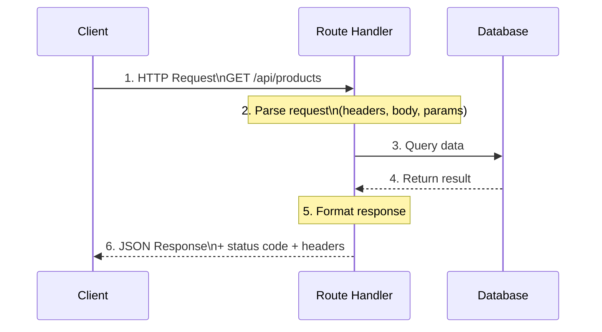

# Route Handlers

## Simple Analogy 📮

Think of a post office. When you send a letter:
- **GET** = "I want to read this document" (lookup)
- **POST** = "Here's a new document to file" (create)
- **PUT** = "Replace this entire document" (full update)
- **PATCH** = "Fix one page in this document" (partial update)
- **DELETE** = "Shred this document" (remove)

Route handlers are the **post office workers** who process these requests and return responses.

---

## What is a Route Handler?

A **Route Handler** is a function that handles HTTP requests at a specific API endpoint. They live in `app/api/.../route.ts` files.

```tsx
// app/api/hello/route.ts
import { NextRequest, NextResponse } from "next/server";

export async function GET(request: NextRequest) {
  return NextResponse.json({
    message: "Hello from Next.js API!",
    timestamp: new Date().toISOString(),
  });
}

export async function POST(request: NextRequest) {
  const body = await request.json();
  return NextResponse.json({ received: body }, { status: 201 });
}
```

---

## Request → Response Flow



---

## All HTTP Methods

```tsx
// app/api/products/[id]/route.ts
import { NextRequest, NextResponse } from "next/server";

// GET — Read
export async function GET(
  request: NextRequest,
  { params }: { params: Promise<{ id: string }> }
) {
  const { id } = await params;
  const product = await getProduct(id);

  if (!product) {
    return NextResponse.json({ error: "Not found" }, { status: 404 });
  }

  return NextResponse.json(product);
}

// POST — Create
export async function POST(request: NextRequest) {
  const body = await request.json();
  const newProduct = await createProduct(body);
  return NextResponse.json(newProduct, { status: 201 });
}

// PUT — Full Replace
export async function PUT(
  request: NextRequest,
  { params }: { params: Promise<{ id: string }> }
) {
  const { id } = await params;
  const body = await request.json();
  const updated = await replaceProduct(id, body);
  return NextResponse.json(updated);
}

// PATCH — Partial Update
export async function PATCH(
  request: NextRequest,
  { params }: { params: Promise<{ id: string }> }
) {
  const { id } = await params;
  const body = await request.json();
  const updated = await updateProduct(id, body);
  return NextResponse.json(updated);
}

// DELETE — Remove
export async function DELETE(
  request: NextRequest,
  { params }: { params: Promise<{ id: string }> }
) {
  const { id } = await params;
  await deleteProduct(id);
  return NextResponse.json({ deleted: true });
}
```

---

## Route Handler Patterns

### Reading Query Parameters

```tsx
// GET /api/products?search=laptop&page=1&limit=10
export async function GET(request: NextRequest) {
  const { searchParams } = new URL(request.url);
  const search = searchParams.get("search");
  const page = Number(searchParams.get("page")) || 1;
  const limit = Number(searchParams.get("limit")) || 10;

  const products = await searchProducts({ search, page, limit });
  return NextResponse.json({ products, page, limit, total: products.length });
}
```

### Setting Cookies

```tsx
export async function POST(request: NextRequest) {
  const response = NextResponse.json({ success: true });

  response.cookies.set("session_id", "abc123", {
    httpOnly: true,       // JS can't read this — prevents XSS
    secure: true,         // HTTPS only in production
    sameSite: "lax",      // CSRF protection
    maxAge: 60 * 60 * 24, // 1 day
  });

  return response;
}
```

### Reading Cookies

```tsx
export async function GET(request: NextRequest) {
  const token = request.cookies.get("auth_token")?.value;
  // Use token for authentication...
}
```

---

## Route Handler vs API Route (Pages Router)

| Feature | App Router (`route.ts`) | Pages Router (`pages/api`) |
|---------|------------------------|---------------------------|
| Location | `app/api/.../route.ts` | `pages/api/.../ts` |
| Export | Named exports (GET, POST) | Default export function |
| Request object | `NextRequest` (Web API based) | `NextApiRequest` (Node.js based) |
| Response | `NextResponse.json()` | `res.status().json()` |
| Dynamic data | `await params` | `req.query` |
| Edge runtime | Supported | Limited |

---

## ⚠️ Common Mistakes

| Mistake | Fix |
|---------|-----|
| Not validating input | Use Zod to validate `request.json()` |
| Returning passwords in response | Never include sensitive fields in response |
| No error handling | Wrap in try/catch, return proper status codes |
| Using GET for mutations | GET = read only; POST/PUT/DELETE = write |
| Forgetting `await params` | `params` is a Promise in Next.js 15+ |
| Returning 200 for errors | Use correct codes: 400, 401, 403, 404, 500 |

---

## 🧠 In Simple Words

- **Route Handlers** = API endpoints inside `app/api/.../route.ts`
- Each HTTP method gets its own **named export** (`GET`, `POST`, `PUT`, `PATCH`, `DELETE`)
- Use **`NextResponse.json()`** to send JSON responses with proper status codes
- Read query params from `request.nextUrl.searchParams`
- Always **validate input** and **handle errors** with proper status codes
- Route handlers are the App Router replacement for `pages/api`
