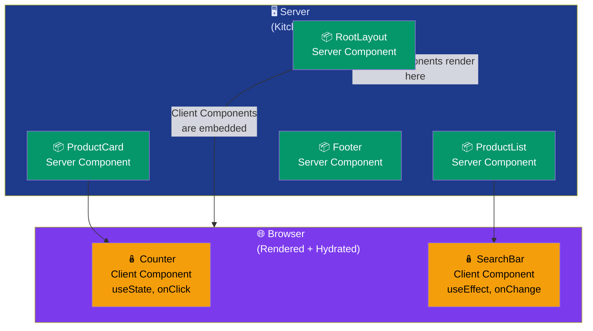

# Server & Client Components

## Simple Analogy 🍽️

Think of a restaurant:
- **Server Component** = The kitchen. All the heavy work happens there — fetching ingredients (data), preparing the meal (rendering), and sending out the finished plate (HTML). You never see the kitchen.
- **Client Component** = The waiter. They interact with you, take your order, respond to your requests — anything interactive.

---

## Server Components (Default)

In the App Router, **every component is a Server Component by default**. They run **only on the server** and never send JavaScript to the browser.

```tsx
// No "use client" needed — this is a Server Component
async function ProductList() {
  const products = await fetch("https://api.example.com/products")
    .then((r) => r.json());

  return (
    <ul>
      {products.map((p) => (
        <li key={p.id}>{p.name} — ${p.price}</li>
      ))}
    </ul>
  );
}
```

### ✅ What Server Components CAN do
- Fetch data directly (database, APIs, file system)
- Access environment variables securely (never exposed to browser)
- Use `async/await` at the component level
- Render faster — zero client JS

### ❌ What Server Components CANNOT do
- Use `useState`, `useEffect`, or any hooks
- Handle events (`onClick`, `onChange`, etc.)
- Access browser APIs (`window`, `document`, `localStorage`)
- Use React Context

---

## Client Components

Add `"use client"` at the top to make a component run in the **browser**. They have full interactivity.

```tsx
"use client";  // 👈 This directive makes it a Client Component

import { useState } from "react";

function Counter() {
  const [count, setCount] = useState(0);

  return (
    <div>
      <p>Count: {count}</p>
      <button onClick={() => setCount(count + 1)}>+</button>
      <button onClick={() => setCount(count - 1)}>-</button>
    </div>
  );
}
```

### ✅ What Client Components CAN do
- Use all React hooks (`useState`, `useEffect`, `useContext`, etc.)
- Handle user events (`onClick`, `onSubmit`, `onChange`)
- Access browser APIs (`window`, `document`, `localStorage`)
- Use React Context
- Add interactivity

### ❌ Client Component downsides
- Adds JavaScript to the bundle (more to download)
- Needs hydration (takes time to become interactive)
- Cannot directly access databases or server-side secrets

---

## The Server/Client Boundary 🚧



---

## How They Nest

### Server Component can render a Client Component ✅
```tsx
// Server Component (default)
function ProductPage() {
  return (
    <div>
      <ProductInfo />   {/* Server Component */}
      <AddToCart />     {/* Client Component — this is fine! */}
    </div>
  );
}
```

### Client Component can render a Server Component ❌
```tsx
"use client";

function Parent() {
  return (
    <div>
      <Child />  {/* ❌ If Child is a Server Component, this breaks! */}
    </div>
  );
}
```

✅ **Fix:** Pass Server Components as **children** (props) to Client Components:

```tsx
// Server Component
function Page() {
  return (
    <ClientWrapper>
      {/* Server Component passed as children prop */}
      <ServerContent />
    </ClientWrapper>
  );
}

// Client Component
"use client";
function ClientWrapper({ children }: { children: React.ReactNode }) {
  return <div className="card">{children}</div>;
}
```

---

## Quick Comparison

| Feature | Server Component | Client Component |
|---------|-----------------|-----------------|
| **Default in App Router?** | ✅ Yes | ❌ Needs `"use client"` |
| **Runs on** | Server only | Browser (+ SSR first) |
| **Async/await** | ✅ Yes | ❌ Not directly |
| **Hooks** | ❌ No | ✅ Yes |
| **Event handlers** | ❌ No | ✅ Yes |
| **Database access** | ✅ Direct | ❌ Via API routes |
| **Bundle size** | ✅ Zero JS sent | ❌ Adds to JS bundle |
| **SEO** | ✅ Excellent | ⚠️ Needs hydration |

---

## When to Use What

```mermaid
flowchart LR
    Q{"Does this component\nneed interactivity?"}
    Q -->|"No — just\nshows data"| SC["✅ Use Server Component\nBetter performance\nZero JS sent"]
    Q -->|"Yes — needs\nstate or events"| CC["✅ Use Client Component\nAdd \"use client\"\nat the top"]

    SC --> SC2["Fetch data directly"]
    SC --> SC3["Access env secrets"]
    SC --> SC4["Render static content"]

    CC --> CC2["useState/useEffect"]
    CC --> CC3["onClick/onChange"]
    CC --> CC4["Browser APIs"]

    style Q fill:#f59e0b,color:#000
    style SC fill:#059669,color:#fff
    style CC fill:#7c3aed,color:#fff
    style SC2 fill:#9333ea,color:#fff
    style SC3 fill:#9333ea,color:#fff
    style SC4 fill:#9333ea,color:#fff
    style CC2 fill:#4f46e5,color:#fff
    style CC3 fill:#4f46e5,color:#fff
    style CC4 fill:#4f46e5,color:#fff
```

---

## ⚠️ Common Mistakes

| ❌ Mistake | ✅ Fix |
|-----------|--------|
| Adding `"use client"` to every component | Only add it when you need interactivity |
| Using hooks in a Server Component | Move to Client Component or add `"use client"` |
| Fetching in a Client Component when you could fetch on the server | Move data fetching to Server Component |
| Putting `"use client"` at the layout level | Makes entire layout tree client-side — keep it low |
| Client component trying to import a Server component directly | Pass Server Component as `children` instead |

---

## 🧠 In Simple Words

- **Server Components** = run on the server, fetch data directly, send zero JS to the browser (default in App Router)
- **Client Components** = run in the browser, use hooks and events, add `"use client"` at the top
- **Rule of thumb:** Start with Server Components, only add `"use client"` when you need interactivity
- Server Components can **wrap** Client Components, but Client Components **cannot import** Server Components directly — pass them as `children` instead
- **Don't** make your entire layout a Client Component — only mark the interactive parts
