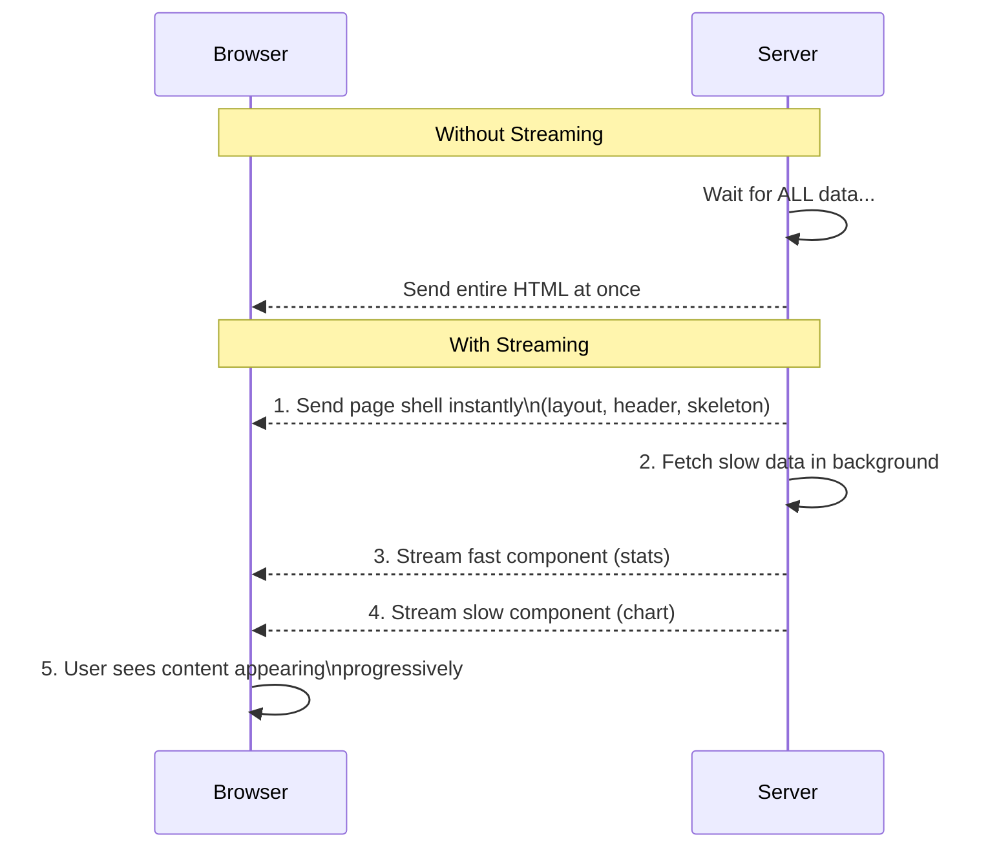
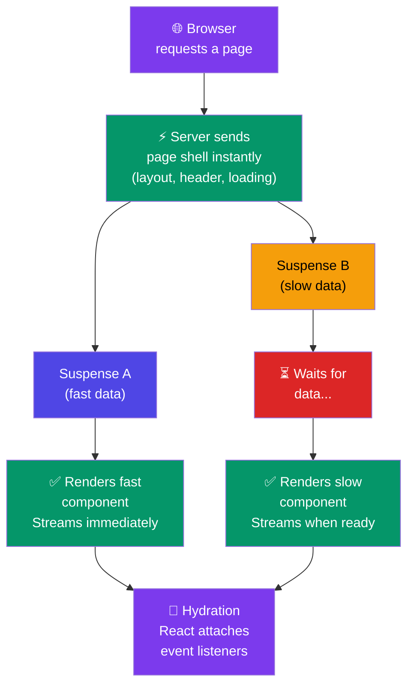

# Streaming & Suspense

## Simple Analogy 🚰

Imagine ordering a multi-course meal at a restaurant. Without streaming, the chef waits until ALL courses are ready before serving anything. You sit hungry for 30 minutes. **With streaming**, the chef brings each dish as it's ready — appetizer first, then main course, then dessert. You start eating immediately.

---

## What is Streaming?

**Streaming** sends HTML to the browser **progressively** — as each piece of content becomes available, it gets sent immediately. The user sees content appear piece by piece rather than waiting for everything.



---

## How Suspense Enables Streaming

`<Suspense>` acts as a **loading boundary**. Content inside it can load asynchronously while the rest of the page renders immediately.

```tsx
import { Suspense } from "react";

// Each component fetches its OWN data independently
export default function DashboardPage() {
  return (
    <div>
      <h1>Dashboard</h1>

      {/* Shows skeleton while StatsSection loads */}
      <Suspense fallback={<div className="skeleton h-32" />}>
        <StatsSection />  {/* Fetches /api/stats — fast */}
      </Suspense>

      {/* Shows skeleton while Chart loads */}
      <Suspense fallback={<div className="skeleton h-64" />}>
        <RevenueChart />  {/* Fetches /api/revenue — slow */}
      </Suspense>
    </div>
  );
}
```

### The `loading.tsx` Shortcut

Every route segment can have a `loading.tsx` — it's automatically wrapped in Suspense:

```tsx
// app/dashboard/loading.tsx
export default function DashboardLoading() {
  return (
    <div className="animate-pulse space-y-4">
      <div className="h-8 bg-gray-200 rounded w-1/4" />
      <div className="grid grid-cols-3 gap-4">
        {[1, 2, 3].map((i) => (
          <div key={i} className="h-24 bg-gray-200 rounded" />
        ))}
      </div>
    </div>
  );
}
```

---

## Streaming: Request → Render → Stream → Hydrate



---

## Multiple Independent Suspense Boundaries

Each `<Suspense>` boundary loads **independently** — they don't block each other:

```tsx
export default function DashboardPage() {
  return (
    <div>
      <h1>Dashboard</h1>
      <div className="grid grid-cols-2 gap-6">
        <Suspense fallback={<WidgetSkeleton />}>
          <RecentOrders />    {/* Fetches /api/orders — 200ms */}
        </Suspense>
        <Suspense fallback={<WidgetSkeleton />}>
          <UserActivity />    {/* Fetches /api/activity — 800ms */}
        </Suspense>
      </div>
    </div>
  );
}
```

- The header renders instantly
- RecentOrders streams in after 200ms
- UserActivity streams in after 800ms (doesn't block anything else)

---

## Streaming + Server Actions

Streaming also works with Server Actions. After a form submission, the UI updates immediately:

```tsx
"use client";

import { useActionState } from "react";
import { submitForm } from "@/app/actions/form";

export default function ContactForm() {
  const [state, formAction, isPending] = useActionState(submitForm, null);

  return (
    <form action={formAction}>
      <input name="email" type="email" required />
      <button type="submit" disabled={isPending}>
        {isPending ? "Sending..." : "Submit"}
      </button>
      {state?.message && <p>{state.message}</p>}
    </form>
  );
}
```

---

## Benefits of Streaming

| Without Streaming | With Streaming |
|-----------------|----------------|
| Page loads → blank screen → wait → everything appears at once | Page loads → shell appears → content streams in gradually |
| Time to First Byte (TTFB) = time for ALL data | TTFB = time for just the shell (much faster) |
| Users see nothing until everything is ready | Users see progress and start reading immediately |
| One slow API call blocks the entire page | Only that component is delayed — rest of page loads fine |

---

## ⚠️ Common Mistakes

| Mistake | Fix |
|---------|-----|
| Wrapping everything in one Suspense | Use multiple Suspense boundaries — one per independent section |
| No loading.tsx at route level | Add at least a minimal loading.tsx for instant feedback |
| Putting slow queries inside the parent component | Move data fetching into separate async Server Components |
| Forgetting Suspense for streaming | Without Suspense, the page waits for everything |

---

## 🧠 In Simple Words

- **Streaming** = sending HTML piece by piece as it becomes ready (not all at once)
- **Suspense** = a boundary that shows a fallback (skeleton) while content loads
- Each `<Suspense>` boundary loads **independently** — they don't block each other
- **`loading.tsx`** = automatic Suspense boundary for the whole route segment
- Streaming improves **perceived performance** — users see content sooner
- One slow API call only delays **its own Suspense boundary**, not the whole page
