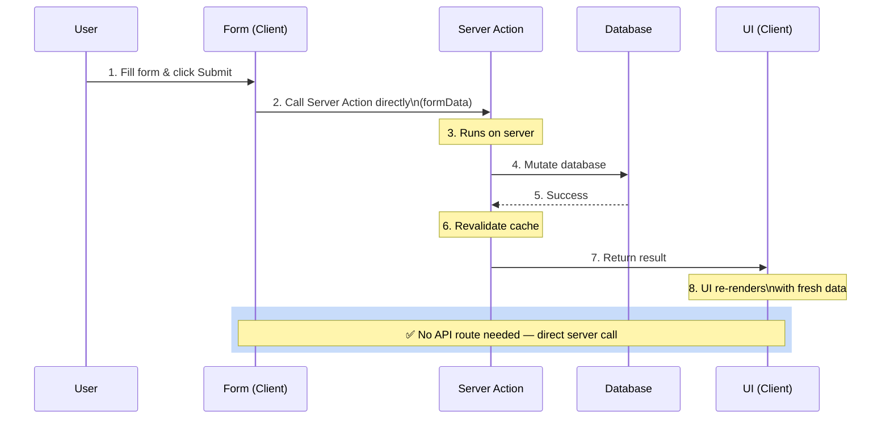

# Server Actions

## Simple Analogy 🏢

Imagine you're in a big office building. Instead of writing a memo, walking to the mailroom, and waiting for it to be delivered to the filing department (API route), you just press a button on your desk that **directly updates the central filing cabinet**. That's a Server Action.

---

## What is a Server Action?

A **Server Action** is an `async` function that runs on the server but can be called **directly from a Client Component** — no `fetch()` to an API route needed.

```tsx
// app/actions.ts
"use server";       // 👈 Makes everything in this file a Server Action

import { revalidatePath } from "next/cache";

export async function createPost(formData: FormData) {
  const title = formData.get("title");
  const content = formData.get("content");

  // This runs on the SERVER — safe to access DB directly
  await db.posts.create({ title, content });

  // Revalidate the posts page so it shows the new post
  revalidatePath("/posts");
}
```

**Using it in a form:**

```tsx
"use client";

export default function NewPostPage() {
  return (
    <form action={createPost}>  {/* 👈 Direct function call, not fetch! */}
      <input name="title" placeholder="Title" required />
      <textarea name="content" placeholder="Content" required />
      <button type="submit">Create Post</button>
    </form>
  );
}
```

---

## Server Action: Form Submit → Server Mutation → Revalidate → UI Update



---

## Progressive Enhancement

Server Actions work **even without JavaScript** — the form degrades gracefully to a standard HTML form submission.

```tsx
// This form works even if JS fails to load!
export default function NewsletterForm() {
  return (
    <form action={subscribeNewsletter}>
      <input type="email" name="email" required />
      <button type="submit">Subscribe</button>
    </form>
  );
}
```

---

## useActionState + useFormStatus — Better UX

### `useActionState` — Access the return value

```tsx
"use client";

import { useActionState } from "react";
import { submitContact } from "@/app/actions";

const initialState = { message: "", errors: {} };

export default function ContactForm() {
  const [state, formAction, isPending] = useActionState(
    submitContact,
    initialState
  );

  return (
    <form action={formAction}>
      <input name="email" type="email" required />
      {state.errors?.email && <p className="error">{state.errors.email}</p>}
      <button type="submit" disabled={isPending}>
        {isPending ? "Sending..." : "Submit"}
      </button>
      {state.message && <p className={state.success ? "success" : "error"}>{state.message}</p>}
    </form>
  );
}
```

### `useFormStatus` — Access form state from inside a child

```tsx
"use client";
import { useFormStatus } from "react-dom";

function SubmitButton() {
  const { pending } = useFormStatus();

  return (
    <button type="submit" disabled={pending}>
      {pending ? "Saving..." : "Save Changes"}
    </button>
  );
}
```

---

## Server Actions vs API Routes

| Feature | Server Actions | API Routes |
|---------|---------------|------------|
| **Call from client** | Direct function call | `fetch('/api/...')` |
| **Form integration** | Native `<form action={fn}>` | Manual `onSubmit` + fetch |
| **End-to-end types** | ✅ Full TypeScript types | ⚠️ Manual type casting |
| **Revalidation** | Built-in (`revalidatePath`) | Manual |
| **External access** | ❌ Not callable externally | ✅ Public HTTP endpoint |
| **Best for** | Form mutations, internal data | Public APIs, webhooks |

---

## Validation with Server Actions

```tsx
"use server";

import { z } from "zod";
import { revalidatePath } from "next/cache";

const emailSchema = z.object({
  email: z.string().email("Please enter a valid email"),
  message: z.string().min(10, "Message must be at least 10 characters"),
});

export async function submitContact(prevState: unknown, formData: FormData) {
  const raw = {
    email: formData.get("email"),
    message: formData.get("message"),
  };

  const result = emailSchema.safeParse(raw);
  if (!result.success) {
    return {
      success: false,
      errors: result.error.flatten().fieldErrors,
    };
  }

  await saveToDatabase(result.data);
  revalidatePath("/contact");
  return { success: true, message: "Message sent!" };
}
```

---

## ⚠️ Common Mistakes

| Mistake | Fix |
|---------|-----|
| Putting `"use client"` on Server Action file | Server Actions must be `"use server"` |
| Not revalidating after mutation | Always call `revalidatePath()` or `revalidateTag()` |
| Not validating input | Always validate on the server (Zod) — client bypass is easy |
| Using Server Actions for public APIs | Server Actions can't be called externally — use API routes instead |
| Forgetting `useFormStatus` for submit button | Users won't see loading state; may double-submit |

---

## 🧠 In Simple Words

- **Server Actions** = server functions you call directly from client forms — no API routes needed
- They support **progressive enhancement** — forms work even without JavaScript
- Use **`useActionState`** to access the return value and show success/error messages
- Use **`useFormStatus`** in submit buttons to show pending/spinner state
- Always **validate** input on the server and **revalidate** the cache after mutations
- For **public APIs** (webhooks, third-party), use Route Handlers instead
