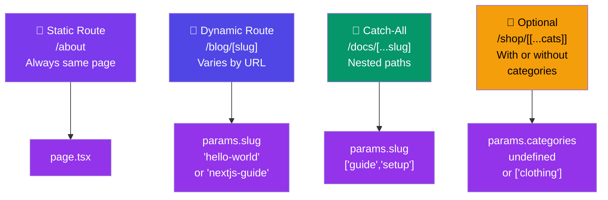

# Dynamic Routes

## Simple Analogy 📫

Think of a post office. Some mail goes to a specific address (static route: `/about`), and some goes to a person's mailbox by their unique ID (dynamic route: `/users/123`). You don't know every user's ID at build time — the route needs to be **dynamic**.

---

## Basic Dynamic Route: `[slug]`

Use square brackets to create routes that match **one dynamic segment**:

```tsx
// app/blog/[slug]/page.tsx
interface Props {
  params: Promise<{ slug: string }>;
}

export default async function BlogPost({ params }: Props) {
  const { slug } = await params;
  const post = await getPost(slug);

  return (
    <article>
      <h1>{post.title}</h1>
      <p>{post.content}</p>
    </article>
  );
}
```

| URL | `params.slug` |
|-----|---------------|
| `/blog/hello-world` | `"hello-world"` |
| `/blog/nextjs-guide` | `"nextjs-guide"` |

---

## Catch-All Route: `[...slug]`

Captures **all remaining segments** into an array. Think of a docs section with nested pages:

```tsx
// app/docs/[...slug]/page.tsx
interface Props {
  params: Promise<{ slug: string[] }>;
}

export default async function DocsPage({ params }: Props) {
  const { slug } = await params;       // e.g., ['guide', 'getting-started']
  const path = slug.join("/");          // "guide/getting-started"

  return <div>Showing: {path}</div>;
}
```

| URL | `params.slug` |
|-----|---------------|
| `/docs/intro` | `['intro']` |
| `/docs/guide/setup` | `['guide', 'setup']` |
| `/docs/a/b/c/d` | `['a', 'b', 'c', 'd']` |

---

## Optional Catch-All: `[[...slug]]`

Same as catch-all, but also matches the **base path** (no segments):

```tsx
// app/shop/[[...categories]]/page.tsx
interface Props {
  params: Promise<{ categories?: string[] }>;
}

export default async function ShopPage({ params }: Props) {
  const { categories } = await params;

  if (!categories) {
    return <h1>All Products</h1>;         // /shop
  }

  const category = categories[0];
  return <h1>Products in: {category}</h1>; // /shop/electronics
}
```

| URL | `params.categories` |
|-----|---------------------|
| `/shop` | `undefined` |
| `/shop/clothing` | `['clothing']` |
| `/shop/clothing/shirts` | `['clothing', 'shirts']` |

---

## `generateStaticParams` — Pre-building Dynamic Pages

Tells Next.js **which dynamic routes to build at build time**. Perfect for SSG + ISR with dynamic pages.

```tsx
// app/products/[id]/page.tsx

// Fetch all product IDs at build time
export async function generateStaticParams() {
  const products = await fetch("https://api.example.com/products")
    .then((r) => r.json());

  return products.map((product: { id: number }) => ({
    id: String(product.id),
  }));
}

// This page is pre-built for each product ID
export default async function ProductPage({
  params,
}: {
  params: Promise<{ id: string }>;
}) {
  const { id } = await params;
  const product = await fetch(`https://api.example.com/products/${id}`)
    .then((r) => r.json());

  return (
    <div>
      <h1>{product.name}</h1>
      <p>${product.price}</p>
    </div>
  );
}
```

### When to use `generateStaticParams`

| Page Type | Use? | Why |
|-----------|------|-----|
| Blog with 100 posts | ✅ Yes | Pre-build all posts at deploy time |
| E-commerce with 10K products | ✅ Yes | Pre-build popular ones, fall back to dynamic |
| User dashboard | ❌ No | Each user sees different data — use SSR |
| Docs with nested sections | ✅ Yes | Pre-build the full doc tree |

---

## Dynamic Route Parameters in Layouts

Layouts also receive `params`:

```tsx
// app/blog/[slug]/layout.tsx
interface Props {
  children: React.ReactNode;
  params: Promise<{ slug: string }>;
}

export default async function BlogLayout({ children, params }: Props) {
  const { slug } = await params;
  const post = await getPostMeta(slug);  // fetch just the metadata

  return (
    <div>
      <nav>
        <Link href={`/blog/${slug}/edit`}>Edit</Link>
        <Link href={`/blog/${slug}/stats`}>Stats</Link>
      </nav>
      {children}
    </div>
  );
}
```

---

## Dynamic Segments in API Routes

Dynamic routes work the same way in `route.ts`:

```tsx
// app/api/products/[id]/route.ts
import { NextRequest, NextResponse } from "next/server";

export async function GET(
  request: NextRequest,
  { params }: { params: Promise<{ id: string }> }
) {
  const { id } = await params;
  const product = await getProduct(id);

  if (!product) {
    return NextResponse.json({ error: "Not found" }, { status: 404 });
  }

  return NextResponse.json(product);
}
```

---

## Visual Comparison



---

## ⚠️ Common Mistakes

| Mistake | Why | Fix |
|---------|-----|-----|
| `params.id` instead of awaiting `params` | `params` is a Promise in Next.js 15+ | Use `const { id } = await params` |
| Not using `generateStaticParams` for SEO-critical pages | Dynamic routes may not be indexed | Pre-build with `generateStaticParams` |
| Using `[slug]` when you need multiple segments | Only captures one segment | Use `[...slug]` instead |
| Not calling `notFound()` for invalid slugs | Shows blank page or 500 error | Check data exists, call `notFound()` |

---

## 🧠 In Simple Words

- **`[slug]`** = matches one URL segment (e.g., `/blog/hello-world`)
- **`[...slug]`** = matches one or more segments (e.g., `/docs/guide/setup`)
- **`[[...slug]]`** = matches zero or more segments (e.g., `/shop` or `/shop/clothing`)
- **`generateStaticParams`** = tells Next.js which dynamic routes to pre-build at deploy time
- Always **`await params`** in Next.js 15+ — it's a Promise now
- Call **`notFound()`** when a dynamic param doesn't match valid data
