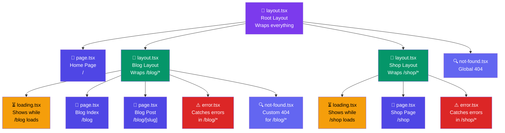

# Special Files in App Router

## Simple Analogy 🏗️

Think of your `app/` folder like a shopping mall. Each floor (folder) has:
- A **floor plan** (`layout.tsx`) — the walls, escalators, bathrooms (shared structure)
- The **stores** (`page.tsx`) — the actual shops you visit
- A **"coming soon" sign** (`loading.tsx`) — shown while a store is being built
- A **"closed" sign** (`error.tsx`) — shown if something went wrong
- A **lost & found** (`not-found.tsx`) — shown when someone can't find a store

---

## File Conventions Overview

Every special file in the App Router has a unique purpose. Here's how they nest:



---

## The Special Files

### 1. `page.tsx` — The Page UI

The **page** is what users actually see at a route. Every route MUST have a `page.tsx` (or `route.ts` for APIs).

```tsx
// app/about/page.tsx
export default function AboutPage() {
  return <h1>About Us</h1>;
}
// → Renders at /about
```

### 2. `layout.tsx` — Shared UI Wrapper

A **layout** wraps its child pages and **persists across navigations** (it doesn't re-render when the user navigates between pages inside it).

```tsx
// app/dashboard/layout.tsx
export default function DashboardLayout({ children }: { children: React.ReactNode }) {
  return (
    <div className="dashboard-layout">
      <Sidebar />        {/* Stays mounted during navigation */}
      <main>{children}</main>  {/* The page changes here */}
    </div>
  );
}
```

**Key:** Layouts are **nested** — a blog layout wraps blog pages, a root layout wraps everything.

### 3. `loading.tsx` — Loading UI

Shown **instantly** while the page content is being fetched. Uses React Suspense under the hood.

```tsx
// app/dashboard/loading.tsx
export default function DashboardLoading() {
  return (
    <div className="animate-pulse">
      <div className="h-8 bg-gray-200 rounded w-1/4 mb-4" />
      <div className="grid grid-cols-3 gap-4">
        <div className="h-24 bg-gray-200 rounded" />
        <div className="h-24 bg-gray-200 rounded" />
        <div className="h-24 bg-gray-200 rounded" />
      </div>
    </div>
  );
}
```

### 4. `error.tsx` — Error Boundary

Catches **unexpected errors** in the route segment and shows a fallback UI. Must be a **Client Component** (has `"use client"`).

```tsx
// app/dashboard/error.tsx
"use client";

export default function Error({
  error,
  reset,
}: {
  error: Error & { digest?: string };
  reset: () => void;
}) {
  return (
    <div className="error-state">
      <h2>Something went wrong!</h2>
      <p>{error.message}</p>
      <button onClick={reset}>Try Again</button>
    </div>
  );
}
```

### 5. `not-found.tsx` — 404 Page

Shown when a route **is not found** (either no matching route, or `notFound()` was called).

```tsx
// app/not-found.tsx — Global 404
import Link from "next/link";

export default function NotFound() {
  return (
    <div>
      <h2>Page Not Found</h2>
      <p>Could not find the requested page.</p>
      <Link href="/">Go Home</Link>
    </div>
  );
}
```

### 6. `route.ts` — API Route Handler

Creates an API endpoint (not a page). Used for GET/POST/PUT/DELETE handlers.

```tsx
// app/api/hello/route.ts
import { NextResponse } from "next/server";

export async function GET() {
  return NextResponse.json({ message: "Hello World" });
}
```

### 7. `template.tsx` — Fresh Layout

Like `layout.tsx`, but **re-renders on every navigation** (doesn't persist state).

```tsx
// app/(marketing)/template.tsx
export default function MarketingTemplate({ children }: { children: React.ReactNode }) {
  return (
    <div className="page-transition">
      {children}
    </div>
  );
  // Re-renders every time user navigates — good for page transitions
}
```

### 8. `default.tsx` — Parallel Routes Fallback

Used with **parallel routes** (`@slot`). Shows content when no matching page exists for a slot.

```tsx
// app/@analytics/default.tsx
export default function DefaultAnalytics() {
  return <div>No analytics data available</div>;
}
```

---

## Nesting Behavior

When Next.js renders a route like `/dashboard/settings`, it **nests** the files from top to bottom:

```
layout.tsx (root)          ← Mounted first
  layout.tsx (dashboard)   ← Wraps dashboard section
    loading.tsx            ← Shown while page loads
    error.tsx              ← Catches errors
    page.tsx               ← The actual page UI
```


---

## Quick Reference

| File | Purpose | Re-renders on nav? | Persists state? |
|------|---------|-------------------|-----------------|
| `page.tsx` | Page content | ✅ Yes | ❌ No |
| `layout.tsx` | Shared wrapper | ❌ No | ✅ Yes |
| `template.tsx` | Fresh wrapper | ✅ Yes | ❌ No |
| `loading.tsx` | Loading skeleton | N/A | N/A |
| `error.tsx` | Error fallback | N/A | N/A |
| `not-found.tsx` | 404 page | N/A | N/A |
| `route.ts` | API endpoint | N/A | N/A |
| `default.tsx` | Parallel route fallback | ✅ Yes | ❌ No |

---

## 🧠 In Simple Words

- **`page.tsx`** = what users see at a URL (required for every route)
- **`layout.tsx`** = shared wrapper that stays mounted during navigation (sidebar, nav)
- **`loading.tsx`** = instant skeleton shown while data loads (uses Suspense)
- **`error.tsx`** = catches errors, shows a retry button (must be a Client Component)
- **`not-found.tsx`** = custom 404 page for missing routes
- **`route.ts`** = makes an API endpoint instead of a page
- Files **nest** — root layout wraps child layout, which wraps page, with loading/error in between
