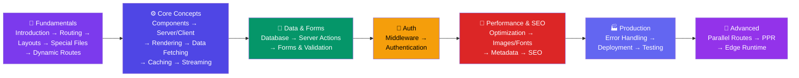

# Next.js

Complete Next.js guide covering the App Router, Server Components, data fetching, caching, Server Actions, streaming, middleware, authentication, performance, and production deployment.

## Learning Path

---

## 📘 Fundamentals

- [Introduction to Next.js](/DSA-Notes-Problems/nextjs/fundamentals/introduction)
- [Installing Next.js](/DSA-Notes-Problems/nextjs/fundamentals/installing-nextjs)
- [Next.js Folder Structure](/DSA-Notes-Problems/nextjs/fundamentals/folder-structure)
- [Special Files in App Router](/DSA-Notes-Problems/nextjs/fundamentals/special-files) — `layout`, `page`, `loading`, `error`, `not-found`, `route`
- [Routing in Next.js](/DSA-Notes-Problems/nextjs/fundamentals/routing)
- [Dynamic Routes](/DSA-Notes-Problems/nextjs/fundamentals/dynamic-routes) — `[slug]`, `[...catchAll]`, `[[...optional]]`, `generateStaticParams`
- [Layouts and Templates](/DSA-Notes-Problems/nextjs/fundamentals/layouts-and-templates)
- [Review, Practice & Interview Prep](/DSA-Notes-Problems/nextjs/fundamentals/review-practice-interview)

## ⚙️ Core Concepts

- [Components in Next.js](/DSA-Notes-Problems/nextjs/core-concepts/components)
- [Server & Client Components](/DSA-Notes-Problems/nextjs/core-concepts/server-and-client-components) — Where each runs, what each can do, `"use client"`, nesting rules
- [Styling in Next.js](/DSA-Notes-Problems/nextjs/core-concepts/styling)
- [Rendering Methods](/DSA-Notes-Problems/nextjs/core-concepts/rendering-methods) — SSG, SSR, ISR, CSR compared
- [Streaming & Suspense](/DSA-Notes-Problems/nextjs/core-concepts/streaming-and-suspense) — Progressive HTML streaming, loading skeletons
- [Data Fetching](/DSA-Notes-Problems/nextjs/core-concepts/data-fetching) — `fetch()`, caching options, error handling
- [Caching & Revalidation](/DSA-Notes-Problems/nextjs/core-concepts/caching-and-revalidation) — 4 caching layers, ISR, `revalidatePath`, `revalidateTag`
- [Route Handlers](/DSA-Notes-Problems/nextjs/core-concepts/route-handlers) — `route.ts`, GET/POST/PUT/DELETE, API endpoints
- [API Routes and Backend](/DSA-Notes-Problems/nextjs/core-concepts/api-routes-backend) — MongoDB, MySQL, file uploads, Zod validation
- [Review, Practice & Interview Prep](/DSA-Notes-Problems/nextjs/core-concepts/review-practice-interview)

## 📝 Data & Forms

- [Database Integration](/DSA-Notes-Problems/nextjs/data-and-forms/database-integration)
- [Server Actions](/DSA-Notes-Problems/nextjs/data-and-forms/server-actions) — `"use server"`, form mutations, `useActionState`, `useFormStatus`
- [Forms and Validation](/DSA-Notes-Problems/nextjs/data-and-forms/forms-and-validation) — React Hook Form, Zod, Server Actions validation
- [State Management](/DSA-Notes-Problems/nextjs/data-and-forms/state-management)
- [Review, Practice & Interview Prep](/DSA-Notes-Problems/nextjs/data-and-forms/review-practice-interview)

## 🔐 Auth

- [Middleware](/DSA-Notes-Problems/nextjs/auth/middleware) — Edge runtime, auth checks, redirects, geo-detection
- [Authentication](/DSA-Notes-Problems/nextjs/auth/authentication)
- [Review, Practice & Interview Prep](/DSA-Notes-Problems/nextjs/auth/review-practice-interview)

## 🚀 Performance & SEO

- [Performance Optimization](/DSA-Notes-Problems/nextjs/performance-seo/performance-optimization)
- [Image, Font & Script Optimization](/DSA-Notes-Problems/nextjs/performance-seo/image-font-script-optimization) — `next/image`, `next/font`, `next/script`
- [Metadata & SEO](/DSA-Notes-Problems/nextjs/performance-seo/metadata-and-seo) — `generateMetadata`, Open Graph, sitemaps, robots
- [SEO in Next.js](/DSA-Notes-Problems/nextjs/performance-seo/seo)
- [Review, Practice & Interview Prep](/DSA-Notes-Problems/nextjs/performance-seo/review-practice-interview)

## 🏭 Production

- [Error Handling](/DSA-Notes-Problems/nextjs/production/error-handling)
- [Deployment](/DSA-Notes-Problems/nextjs/production/deployment)
- [Testing](/DSA-Notes-Problems/nextjs/production/testing)
- [Review, Practice & Interview Prep](/DSA-Notes-Problems/nextjs/production/review-practice-interview)

## 🔬 Advanced

- [Security Best Practices](/DSA-Notes-Problems/nextjs/advanced/security-best-practices)
- [Parallel & Intercepting Routes](/DSA-Notes-Problems/nextjs/advanced/parallel-and-intercepting-routes) — `@slots`, `(.)` interception, modal pattern
- [Edge & Node.js Runtimes](/DSA-Notes-Problems/nextjs/advanced/edge-and-runtimes) — Edge vs Node.js, when to use which
- [Partial Prerendering (PPR)](/DSA-Notes-Problems/nextjs/advanced/partial-prerendering) — Static shell + streamed dynamic holes
- [Advanced Next.js Concepts](/DSA-Notes-Problems/nextjs/advanced/advanced-concepts)
- [Review, Practice & Interview Prep](/DSA-Notes-Problems/nextjs/advanced/review-practice-interview)
