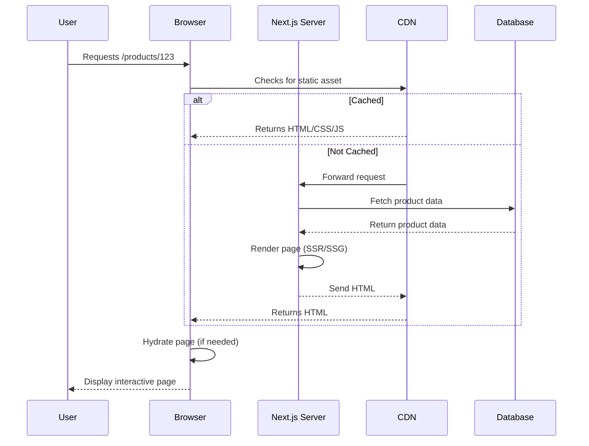
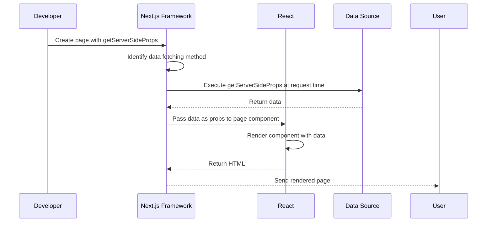
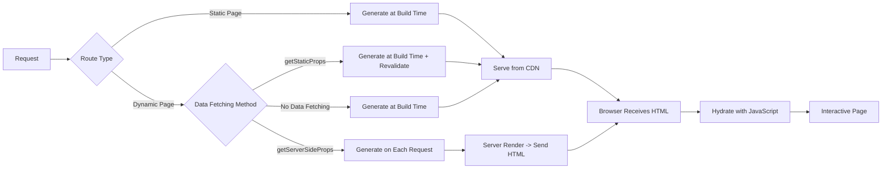

# Overview of Next.js

## Introduction
Next.js is a React framework that enables developers to build high-performance, scalable web applications with ease. It provides a robust set of features for server-side rendering, static site generation, and client-side rendering, making it a top choice for modern web development.

## Why do we need this?
In the modern web landscape, users demand fast, interactive, and SEO-friendly websites. Traditional client-side rendering (CSR) approaches often lead to slow initial loads and poor SEO. Next.js addresses these challenges by offering hybrid rendering capabilities, allowing developers to choose the optimal rendering strategy for each page, resulting in improved performance, better SEO, and enhanced user experience.

## Problem Statement
Developers struggle with balancing performance, SEO, and developer experience when building React applications. Configuring server-side rendering, static generation, and client-side hydration manually is complex and error-prone. There is a need for a framework that abstracts these complexities while providing flexibility and excellent performance out of the box.

## Real World Story
Netflix faced challenges with their React-based web application, where initial load times were slow due to client-side rendering, impacting user engagement and SEO. After adopting Next.js, they implemented server-side rendering for their landing pages, reducing time-to-interactive by 50% and significantly improving search engine rankings. This allowed them to deliver a faster, more engaging experience to millions of users worldwide.

## Real World Analogy
Think of Next.js as a smart restaurant kitchen. In a traditional restaurant (client-side React), customers wait while chefs prepare each dish from scratch after ordering (slow initial load). In a fast-food restaurant with pre-made items (static generation), common dishes are ready instantly but customization is limited. Next.js is like a hybrid kitchen: popular items are prepped ahead (static generation), while special orders are cooked fresh when ordered (server-side rendering), optimizing both speed and customization.

## Visual Explanation
Next.js simplifies web development by providing a unified framework that handles routing, rendering, and data fetching automatically. Developers focus on building components while Next.js optimizes performance behind the scenes.

## Mermaid Diagram 1: Request Lifecycle in Pages Router


## Internal Working
Next.js operates through a sophisticated pipeline that combines file-system routing, intelligent rendering strategies, and automatic code splitting. When a request arrives, Next.js first checks if the page can be served as a static asset from the CDN (ISR/SSG). If not, it dynamically renders the page on the server (SSR) or client (CSR) based on the page's configuration. During rendering, React components are executed, data is fetched, and the resulting HTML is sent to the browser. For interactive pages, JavaScript bundles are sent for hydration, making the page interactive after initial load.

## Mermaid Diagram 2: Data Fetching Flow


## Architecture
A typical Next.js application follows a modular architecture that separates concerns between routing, components, styling, and data layers. The file-system based routing in the `pages` or `app` directory automatically creates routes. Components are organized by feature or route, with shared components in a `components` directory. Styling can be implemented via CSS Modules, Styled Components, or Tailwind. Data fetching occurs either at build time (getStaticProps), request time (getServerSideProps), or on the client (SWR, React Query). API routes or server actions handle backend logic, enabling full-stack capabilities within the same project.

## Mermaid Diagram 3: Application Component Structure
```mermaid
graph TD
    A[Root Layout] --> B[Global CSS]
    A --> C[Navigation]
    A --> D[Main Content]
    D --> E[Home Page]
    D --> F[Product Page]
    D --> G[Blog Page]
    E --> H[Product Card]
    E --> I[Newsletter Signup]
    F --> J[Product Details]
    F --> K[Add to Cart]
    G --> L[Blog Post]
    G --> M[Comment System]
    style A fill:#f9f,stroke:#333
    D fill:#bbf,stroke:#333
```

## Step-by-Step Flow
1. **Create a file** in the `pages` directory (e.g., `pages/about.js`)
2. **Export a React component** as the default export
3. **Add content** using JSX and Tailwind/CSS classes
4. **Optional**: Export `getStaticProps` or `getServerSideProps` for data fetching
5. **Optional**: Export `getStaticPaths` for dynamic routes
6. **Next.js automatically** creates a route at `/about`
7. **During build**: Pre-render as HTML if using SSG/ISR
8. **During request**: Serve from cache (ISR/SSG) or render on-demand (SSR)
9. **Browser**: Receives HTML + JavaScript for hydration
10. **User**: Sees fast-loading, interactive page

## Mermaid Diagram 4: Rendering Strategies Comparison


## Syntax
### Basic Page Creation
```jsx
// pages/index.js
export default function HomePage() {
  return (
    <div>
      <h1>Welcome to My Next.js App</h1>
      <p>This is the home page.</p>
    </div>
  );
}
```

### Page with Data Fetching (SSR)
```jsx
// pages/products/[id].js
export async function getServerSideProps({ params }) {
  const product = await fetch(`https://api.example.com/products/${params.id}`)
    .then(res => res.json());
  
  return {
    props: { product }
  };
}

export default function ProductPage({ product }) {
  return (
    <div>
      <h1>{product.title}</h1>
      <p>{product.description}</p>
    </div>
  );
}
```

### Page with Static Generation (SSG)
```jsx
// pages/blog/[slug].js
export async function getStaticPaths() {
  // Fetch all blog post slugs from CMS
  const posts = await fetch('https://api.example.com/posts')
    .then(res => res.json());
  
  return {
    paths: posts.map(post => ({ params: { slug: post.slug } })),
    fallback: 'blocking' // or 'false' or true
  };
}

export async function getStaticProps({ params }) {
  const post = await fetch(`https://api.example.com/posts/${params.slug}`)
    .then(res => res.json());
  
  return {
    props: { post },
    // Revalidate every 60 seconds
    revalidate: 60
  };
}

export default function BlogPost({ post }) {
  return (
    <article>
      <h1>{post.title}</h1>
      <time>{new Date(post.date).toLocaleDateString()}</time>
      <div dangerouslySetInnerHTML={{ __html: post.content }} />
    </article>
  );
}
```

### API Route
```jsx
// pages/api/hello.js
export default function handler(req, res) {
  res.status(200).json({ message: 'Hello from Next.js API!' });
}
```

## Basic Example
Let's create a basic "About Us" page:
1. Create `pages/about.js`
2. Add a functional component returning JSX
3. Start the development server with `npm run dev`
4. Visit `http://localhost:3000/about` to see the page

```jsx
// pages/about.js
import Link from 'next/link';

export default function AboutPage() {
  return (
    <section className="container mx-auto py-12">
      <h1 className="text-3xl font-bold mb-6">About Us</h1>
      <p className="mb-4">
        We are a team of passionate developers building amazing web applications 
        with Next.js and React.
      </p>
      <Link href="/" className="text-blue-500 hover:underline">
        ← Back to Home
      </Link>
    </section>
  );
}
```
**Explanation:**
- We import `Link` from `next/link` for client-side navigation
- The `AboutPage` function returns JSX for our page content
- We use Tailwind CSS classes for styling (assuming Tailwind is configured)
- The link provides navigation back to the home page
- When exported as default, Next.js automatically creates the `/about` route

## Intermediate Example
Let's create a user profile page that fetches data on each request:
1. Create `pages/profile/[id].js`
2. Implement `getServerSideProps` to fetch user data
3. Create the profile component to display the data
4. Visit `http://localhost:3000/profile/1` to see the profile

```jsx
// pages/profile/[id].js
import { useRouter } from 'next/router';

export async function getServerSideProps({ params }) {
  try {
    const res = await fetch(`https://jsonplaceholder.typicode.com/users/${params.id}`);
    if (!res.ok) {
      return { notFound: true };
    }
    const user = await res.json();
    return { props: { user }, };
  } catch (error) {
    return { notFound: true };
  }
}

export default function ProfilePage({ user }) {
  const router = useRouter();
  
  if (router.isFallback) {
    return <div>Loading...</div>;
  }
  
  return (
    <section className="container mx-auto py-8">
      <h1 className="text-2xl font-bold mb-4">{user.name}</h1>
      <div className="grid gap-4">
        <div><span className="font-medium">Email:</span> {user.email}</div>
        <div><span className="font-medium">Phone:</span> {user.phone}</div>
        <div><span className="font-medium">Website:</span> <a href={user.website} className="text-blue-500">{user.website}</a></div>
        <div><span className="font-medium">Company:</span> {user.company.name}</div>
      </div>
      <Link href="/" className="mt-6 inline-block text-blue-500 hover:underline">
        ← Back to Home
      </Link>
    </section>
  );
}
```
**Explanation:**
- `getServerSideProps` runs on each request, fetching user data from an external API
- We handle 404 cases by returning `{ notFound: true }` if the user isn't found
- The component receives the user data as a prop and displays it
- We use `useRouter` to handle loading states during static generation fallback
- The page is server-rendered on each request, ensuring fresh data

## Advanced Example
Let's create a blog that uses ISR to update content without rebuilding:
1. Create `pages/blog/[slug].js`
2. Implement `getStaticPaths` to define possible routes
3. Implement `getStaticProps` with `revalidate` option
4. Create the blog post component
5. Visit `http://localhost:3000/blog/first-post` to see the post

```jsx
// pages/blog/[slug].js
import Link from 'next/link';

export async function getStaticPaths() {
  // In a real app, fetch from your CMS
  const posts = [
    { slug: 'first-post', title: 'My First Post' },
    { slug: 'nextjs-tutorial', title: 'Next.js Tutorial' }
  ];
  
  return {
    paths: posts.map(post => ({ params: { slug: post.slug } })),
    fallback: 'blocking' // Show fallback until page is generated
  };
}

export async function getStaticProps({ params }) {
  // In a real app, fetch from your CMS
  const post = {
    slug: params.slug,
    title: 'Understanding ISR in Next.js',
    .
```

But the that the 
We need to with the replacement. Let's assume the exact string exactly do that.