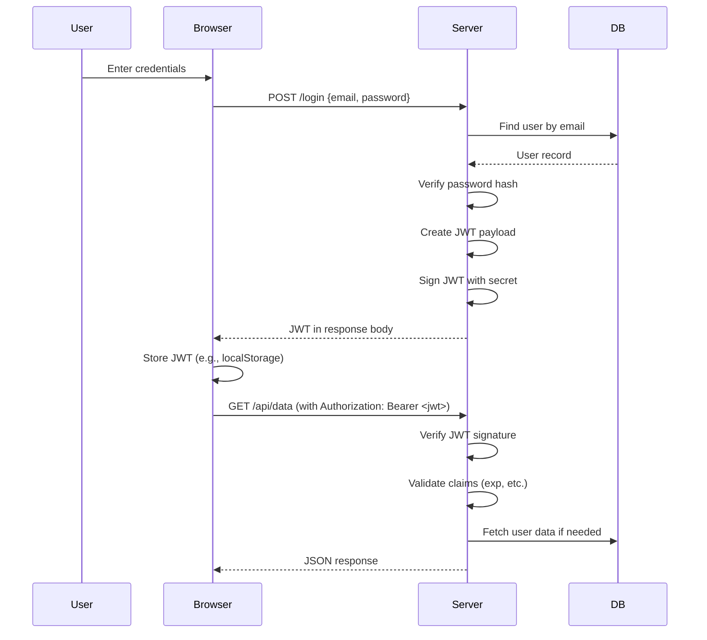

# JSON Web Tokens (JWT)

## Introduction
JSON Web Tokens (JWT) are an open standard (RFC 7519) for creating tokens that assert claims between parties. They are commonly used for authentication and information exchange in web applications.

## Why we need JWT
JWT provides a compact, URL-safe way to transmit claims between parties. It enables stateless authentication where the server doesn't need to store session data—trust is established through cryptographic signature verification.

## Problem statement
How can we securely transmit identity information between client and server in a distributed system without server-side session storage, while preventing tampering and unauthorized access?

## Real-world story
A hotel gives you an electronic key card encoded with your room number and checkout date. The lock verifies the card's cryptographic signature to grant access—no need to check with front desk each time. If you try to modify the card, the signature invalidates.

## Real-world analogy
**JWT**: Like a sealed, tamper-evident envelope containing a passport copy and permissions list. Anyone can see the contents (if not encrypted), but only someone with the private seal could have created it. Altering contents breaks the seal.

## Visual explanation
```
Header: {"alg":"HS256","typ":"JWT"}
Payload: {"sub":"1234567890","name":"John Doe","iat":1516239022}
Signature: HMACSHA256(base64UrlEncode(header) + "." + base64UrlEncode(payload), secret)
```

## Mermaid Diagram 1: JWT Structure
```mermaid
graph LR
    A[Base64Url Header] -->|.| B[Base64Url Payload]
    B -->|.| C[Signature]
    A --> D[{"alg":"HS256","typ":"JWT"}]
    B --> E[{"sub":"123","name":"Alice","iat":12345}]
    C --> F[HMACSHA256(secret, base64Url(header)+"."+base64Url(payload))]
```

## Internal working
**Creation**:
1. Header: JSON with `alg` (algorithm) and `typ` (JWT)
2. Payload: JSON with claims (registered, public, private)
3. Signature: Hash of base64URL(header) + "." + base64URL(payload) with secret/key

**Validation**:
1. Split token on `.` into three parts
2. Decode header and payload (base64URL)
3. Verify signature matches expected algorithm and secret/key
4. Validate registered claims (exp, nbf, iat, aud, iss)
5. Application validates custom claims

## Step-by-step flow
1. User logs in with credentials
2. Server validates credentials against database
3. Server creates JWT with user ID, roles, issue time, expiry
4. Server signs JWT with secret key (HMAC) or private key (RSA)
5. Server returns JWT to client (in response body, cookie, or header)
6. Client stores JWT (localStorage, cookie, memory)
7. For subsequent requests, client sends JWT (usually in `Authorization: Bearer <token>` header)
8. Server extracts token, verifies signature, checks claims, grants/denies access

## Mermaid Diagram 2: JWT Authentication Flow


## Architecture
**Stateless auth with JWT**:
- **Auth server**: Issues tokens after credential validation
- **Resource server**: Validates tokens on each request (no session lookup)
- **Client**: Stores and transmits token with requests
- **Secret management**: Shared secret (HMAC) or key pair (RSA/ECDSA)

## Merchant Diagram 3: Token Validation Process
```mermaid
flowchart TD
    A[Received Token] --> B[Split by '.']
    B --> C[Decode Header (base64url)]
    B --> D[Decode Payload (base64url)]
    B --> E[Get Signature Part]
    C --> F{Alg: HS256?}
    F -->|Yes| G[HMAC-SHA256]
    F -->|No| H[RSA/ECDSA Verify]
    G --> I[Recreate Signature]
    H --> I
    I --> J{Signature Match?}
    J -->|Yes| K[Validate Claims]
    J -->|No| L[Reject: Invalid Signature]
    K --> M{Exp? Not before?}
    M -->|Yes| N[Valid Token]
    M -->|No| O[Reject: Expired/Not Active]
    N --> P[Extract Claims]
    P --> Q[Application Logic]
```

## Implementation
### Library choice
- Use `jsonwebtoken` (Node.js) or equivalent
- Never attempt to implement JWT signing/validation manually

### Basic example
```javascript
// lib/jwt.js
import jwt from 'jsonwebtoken'

const JWT_SECRET = process.env.JWT_SECRET
const JWT_EXPIRES_IN = '15m'

export function signJwt(payload) {
  return jwt.sign(payload, JWT_SECRET, { expiresIn: JWT_EXPIRES_IN })
}

export function verifyJwt(token) {
  try {
    return jwt.verify(token, JWT_SECRET)
  } catch (err) {
    throw new Error('Invalid token')
  }
}

// Usage in login route
export async function login(req, res) {
  const { email, password } = req.body
  const user = await getUserByEmail(email)
  
  if (!user || !(await compare(password, user.password_hash))) {
    return res.status(401).json({ error: 'Invalid credentials' })
  }
  
  const token = signJwt({
    userId: user.id,
    email: user.email,
    role: user.role
  })
  
  res.json({ token })
}

// Usage in middleware
export function authenticate(req, res, next) {
  const authHeader = req.headers.authorization
  if (!authHeader?.startsWith('Bearer ')) {
    return res.status(401).json({ error: 'Missing token' })
  }
  
  const token = authHeader.substring(7)
  try {
    const payload = verifyJwt(token)
    req.user = payload
    next()
  } catch (err) {
    res.status(401).json({ error: 'Invalid token' })
  }
}
```

### Production example (Next.js with cookies)
```typescript
// lib/auth.ts
import { SignJWT, jwtVerify } from 'jose'
import { cookies } from 'next/headers'

const secret = new TextEncoder().process.env.JWT_SECRET
const exp = '15m'

export async function createSessionToken(payload: object) {
  return await new SignJWT(payload)
    .setProtectedHeader({ alg: 'HS256' })
    .setExpirationTime(Date.now() + 15 * 60 * 1000)
    .sign(secret)
}

export async function verifySessionToken(token: string) {
  const { payload } = await jwtVerify(token, secret)
  return payload
}

// Middleware
export async function authMiddleware(request: Request) {
  const cookieStore = cookies()
  const token = cookieStore.get('token')?.value
  
  if (!token) {
    return new Response(JSON.stringify({ error: 'Unauthorized' }), {
      status: 401
    })
  }
  
  try {
    const payload = await verifySessionToken(token)
    // Attach to request (via headers or request cloning)
    const headers = new Headers(request.headers)
    headers.set('user', JSON.stringify(payload))
    return {
      // In real middleware, you'd modify request; here we show concept
      valid: true,
      payload
    }
  } catch {
    return new Response(JSON.stringify({ error: 'Invalid token' }), {
      status: 401
    })
  }
}
```

## Folder structure
```
src/
├── lib/
│   ├── auth.ts
│   ├── jwt.ts
│   └── session.ts
├── middleware/
│   └── auth.ts
├── pages/
│   └── api/
│       ├── login.ts
│       └── protected.ts
└── types/
    └── token.ts
```

## Best practices
- Use strong secrets (minimum 32 characters for HS256)
- Prefer RS256/ECDSA for asymmetric keys (private key to sign, public to verify)
- Keep tokens small: only include necessary claims
- Set short expiration (15-30 min) for access tokens
- Use refresh tokens for long-lived sessions
- Always validate issuer (iss), audience (aud), expiration (exp)
- Use HTTPS exclusively to prevent token interception
- Consider token binding to client (e.g., via TLS channel ID)
- Store tokens securely: HttpOnly cookies, secure storage (not localStorage for XSS risk)
- Implement token revocation strategy (blocklist or short expiry + rotation)
- Use established libraries; never roll your own crypto
- Include `jti` (JWT ID) claim for revocation tracking
- Consider audience validation for microservices

## Common mistakes
- Using weak or predictable secrets
- Accepting `none` algorithm (algorithm confusion attack)
- Storing sensitive data in payload (it's base64 encoded, not encrypted)
- Missing expiration check (creates permanent tokens)
- Not validating audience/issuer (token replay across services)
- Using same secret across different environments (dev/prod)
- Long expiration times increasing theft impact
- Storing tokens in localStorage/vulnerable to XSS
- Not implementing proper error handling (leaking validation details)
- Forgetting to check token format (three parts)
- Using outdated/unmaintained libraries

## Security considerations
**Confidentiality**:
- JWT payload is visible to anyone (base64 encoded)
- Do not store secrets, PII, or sensitive data in payload
- Use JWE (JSON Web Encryption) if confidentiality needed
- Transmit only over HTTPS

**Integrity**:
- Signature prevents tampering
- Use strong algorithms (HS256 with sufficient key length, RS256/ES256)
- Rotate keys periodically with key ID (kid) header

**Replay attacks**:
- Short expiration limits replay window
- Use nonce/jti claim with server-side tracking for high-security
- Consider one-time use tokens for sensitive operations

**Token theft**:
- Bind token to client properties (IP, User-Agent) - cautiously
- Implement refresh token rotation to detect theft
- Treat stolen token as compromised until expiration

## Performance notes
- Signature verification adds CPU overhead (minimal with modern hardware)
- No database lookup for sessions reduces latency
- Token size impacts request header size (keep claims minimal)
- Consider caching public keys for asymmetric verification
- Stateless nature improves horizontal scalability
- Revocation checking (if implemented) adds overhead; balance with security needs

## Interview questions
1. What are the three parts of a JWT?
2. Why should you never store sensitive data in a JWT payload?
3. What is the difference between JWS and JWE?
4. How do you prevent algorithm confusion attacks?
5. When would you use a refresh token pattern?

## MCQs
1. Which part of a JWT is guaranteed to be encrypted?
   a) Header
   b) Payload
   c) Signature
   d) None (payload is only base64 encoded)
   Answer: d

2. What does the `alg` field in JWT header specify?
   a) Encryption algorithm
   b) Compression algorithm
   c) Signing algorithm
   d) Hashing algorithm
   Answer: c

3. Which claim is NOT a registered claim in RFC 7519?
   a) iss (issuer)
   b) exp (expiration time)
   c) role (user role)
   d) iat (issued at)
   Answer: c

4. How do you prevent "none" algorithm attacks?
   a) Reject tokens with alg:none
   b) Use strong secret key
   c) Always verify signature with known algorithm
   d) Both A and C
   Answer: d

5. What is the purpose of the `aud` (audience) claim?
   a) Identifies token intended recipient
   b) Specifies who issued the token
   c) Indicates when token expires
   d) Lists permitted IP addresses
   Answer: a

## Practice exercise
Create a JWT-based auth system:
1. Login endpoint returns signed JWT
2. Protected route middleware verifies token
3. Token includes user ID, role, and expiry
4. Handle token expiration gracefully
5. Implement logout via client-side token removal

## Debugging exercise
Users get "Invalid token" after logging in.
Check:
1. Secret key consistency between sign and verify
2. Token transmission (Authorization header format)
3. Expiration time set too short
4. Clock skew between servers
5. Token corruption (extra spaces, line breaks)

## Real-world scenario
Design JWT auth for:
- Microservices: Services validate tokens with shared public key
- SPA: Auth0-style short-lived access token + refresh token
- Mobile app: Secure storage with biometric protection
- B2B API: Customer-specific secrets or public keys
- SSO: Identity provider signs tokens, service providers verify

## Mini project
Build token utilities:
- Token generator with configurable expiry
- Token verifier with error handling
- Middleware for route protection
- Refresh token endpoint (rotate tokens)
- Token inspection tool (decode without verifying)
- Revocation list simulator

## Interview coding question
Implement JWT validation from scratch (without libraries):
```javascript
function verifyJWT(token, secretOrPublicKey) {
  // 1. Split token into three parts
  // 2. Base64Url decode header and payload
  // 3. Recreate signature
  // 4. Compare with provided signature
  // 5. Validate standard claims (exp, nbf, iat)
  // 6. Return payload if valid, throw if invalid
}
```

## Summary
JWT enables stateless authentication by encapsulating claims in a signed token. Ideal for APIs and distributed systems, but requires careful handling of expiration, secret management, and token security. Never store sensitive data in payload; always validate signatures and claims; use short-lived tokens with refresh patterns for security.

## Cheat sheet
- **Format**: `header.payload.signature`
- **Header**: `{"alg":"HS256","typ":"JWT"}`
- **Payload**: Claims (sub, iat, exp, aud, iss, plus custom)
- **Signature**: HMACSHA256(secret, base64url(header)+"."+base64url(payload))
- **Expiry**: Access token 15m, refresh token 7d
- **Secret**: 32+ random bytes for HS256; 2048+ bit RSA for RS256
- **Headers**: `Authorization: Bearer <token>`
- **Storage**: HttpOnly cookie or secure memory (avoid localStorage)

## Related topics
- Session authentication
- OAuth 2.0 and OpenID Connect
- Refresh token patterns
- API key authentication
- Cryptographic signing (HMAC, RSA, ECDSA)
- Token revocation strategies
- Security best practices for tokens