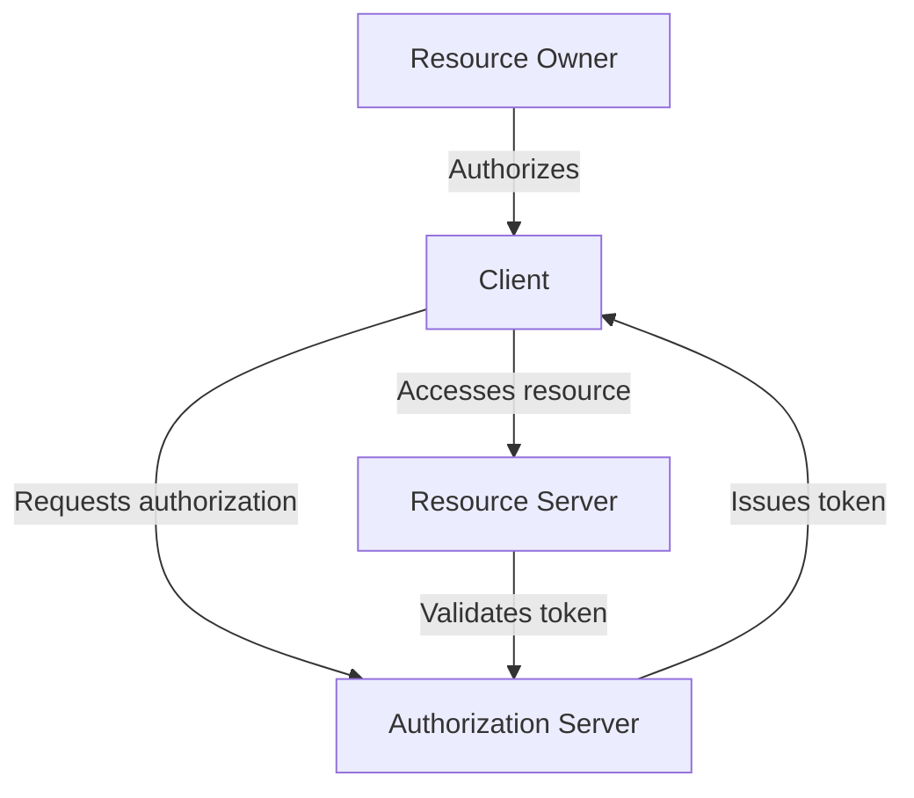
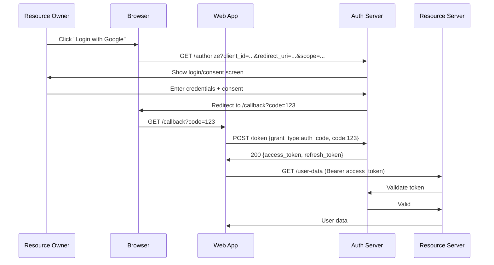

# OAuth 2.0

## Introduction
OAuth 2.0 is an authorization framework that enables applications to obtain limited access to user accounts on HTTP services. It works by delegating user authentication to the service that hosts the account and authorizing third-party applications to access that account.

## Why we need OAuth
Traditional credential sharing (giving username/password to third-party apps) is insecure. OAuth solves this by providing tokens with limited scope and lifetime, eliminating the need for third parties to store user credentials.

## Problem statement
How can a user grant a third-party application access to their resources on another service without sharing their credentials?

## Real-world story
You want to print photos from your Google Photos account at a pharmacy kiosk. Instead of giving the kiosk your Google password, you log in to Google directly and grant the kiosk permission to access only your photos for printing.

## Real-world analogy
**OAuth**: Like a valet key for your car. The valet can start the car and drive it a short distance (to park), but cannot open the trunk or glove box. You give the valet key (limited access token) instead of your master key (username/password).

## Visual explanation
```
Resource Owner (User) 
    |
    | Authorizes
    v
Client (3rd-party App) 
    |
    | Requests token
    v
Authorization Server (Auth Provider)
    |
    | Issues token
    v
Resource Server (API)
```

## Mermaid Diagram 1: OAuth 2.0 Roles


## Internal working
**Authorization Code Flow (most common for web apps)**:
1. User initiates login via client app
2. Client redirects user to authorization server with client_id, redirect_uri, scope, state
3. User authenticates and consents to requested scopes
4. Authorization server redirects back to client with authorization code
5. Client exchanges code for access token (and refresh token) via backend request
6. Client uses access token to call resource server APIs
7. When access token expires, client uses refresh token to get new access token

## Step-by-step flow (Authorization Code)
1. User clicks "Sign in with Google" on example.com
2. browser redirects to accounts.google.com/o/oauth2/v2/auth?client_id=...&redirect_uri=...&scope=...&state=...
3. User logs into Google and consents to requested permissions
4. Google redirects back to example.com/callback?code=AUTH_CODE&state=...
5. example.com backend exchanges code for tokens via POST to oauth2.googleapis.com/token
6. Google responds with access_token, refresh_token, expires_in
7. example.com stores tokens securely, uses access_token to call Google APIs
8. When access_token expires, use refresh_token to get new access_token

## Alternate flows
- **Implicit**: Returns token directly in fragment (less secure, not recommended)
- **Resource Owner Password Credentials**: Collects username/password (legacy)
- **Client Credentials**: For machine-to-machine communication

## Architecture
**OAuth 2.0 components**:
- **Resource Owner**: User who owns the data
- **Client**: Application requesting access (your web app)
- **Authorization Server**: Authenticates user and issues tokens (Google, GitHub)
- **Resource Server**: Hosts protected resources (APIs)
- **Tokens**: 
  - Access token: Used to access resources (short-lived)
  - Refresh token: Used to obtain new access tokens (longer-lived)
- **Endpoints**:
  - Authorization endpoint: `GET /authorize`
  - Token endpoint: `POST /token`
  - UserInfo endpoint (OIDC): `GET /userinfo`

## Mermaid Diagram 2: Token Exchange


## Implementation
### Using Next.js with NextAuth.js (simplified)
```javascript
// pages/api/auth/[...nextauth].js
import NextAuth from 'next-auth'
import GoogleProvider from 'next-auth/providers/google'

export default NextAuth({
  providers: [
    GoogleProvider({
      clientId: process.env.GOOGLE_CLIENT_ID,
      clientSecret: process.env.GOOGLE_CLIENT_SECRET,
      authorization: {
        params: {
          scope: 'openid email profile https://www.googleapis.com/auth/calendar.readonly'
        }
      }
    })
  ],
  callbacks: {
    async session({ session, token }) {
      session.user.id = token.sub
      return session
    }
  }
})
```

### Manual implementation (express)
```javascript
// routes/auth.js
const express = require('express')
const router = express.Router()
const { OAuth2Client } = require('google-auth-library')

const client = new OAuth2Client(process.env.GOOGLE_CLIENT_ID)

// Step 1: Redirect to Google
router.get('/login/google', (req, res) => {
  const authUrl = new URL('https://accounts.google.com/o/oauth2/v2/auth')
  authUrl.searchParams.set('client_id', process.env.GOOGLE_CLIENT_ID)
  authUrl.searchParams.set('redirect_uri', `${process.env.BASE_URL}/auth/google/callback`)
  authUrl.searchParams.set('response_type', 'code')
  authUrl.searchParams.set('scope', 'openid email profile')
  authUrl.searchParams.set('state', generateRandomString())
  res.redirect(authUrl.toString())
})

// Step 2: Handle callback
router.get('/google/callback', async (req, res) => {
  const { code, state } = req.query
  
  // Verify state to prevent CSRF
  if (state !== req.session.oauthState) {
    return res.status(400).send('Invalid state')
  }
  
  try {
    const { tokens } = await client.getToken(code)
    client.setCredentials(tokens)
    
    // Get user info
    const ticket = await client.verifyIdToken({
      idToken: tokens.id_token,
      audience: process.env.GOOGLE_CLIENT_ID
    })
    const payload = ticket.getPayload()
    
    // Store user session
    req.session.user = {
      id: payload.sub,
      email: payload.email,
      name: payload.name,
      picture: payload.picture,
      accessToken: tokens.access_token,
      refreshToken: tokens.refresh_token
    }
    
    res.redirect('/dashboard')
  } catch (err) {
    console.error('OAuth error:', err)
    res.status(500).send('Authentication failed')
  }
})
```

## Folder structure
```
src/
├── lib/
│   ├── oauth.ts
│   └── auth.ts
├── pages/
│   └── api/
│       └── auth/
│           ├── google.ts
│           └── [...nextauth].ts
├── components/
│   └── LoginButton.tsx
└── utils/
    └── csrf.ts
```

## Best practices
- Use `state` parameter to prevent CSRF
- Use PKCE for public clients (SPAs, mobile apps)
- Store tokens securely (HttpOnly cookies, secure storage)
- Request minimum necessary scopes
- Implement proper error handling for token expiry/refresh
- Validate ID tokens (if using OpenID Connect)
- Use HTTPS for all redirects and token exchanges
- Redirect URIs must be exactly registered (no wildcards in production)
- Implement token revocation/logout functionality
- Consider using established libraries (Auth.js, Ory Hydra, etc.)
- Rotate client secrets periodically
- Log authorization events for audit
- Set appropriate token expiration times

## Common mistakes
- Missing or predictable `state` parameter (CSRF vulnerability)
- Using implicit flow for sensitive applications
- Storing access tokens in localStorage (XSS vulnerability)
- Not validating token audience (allows token reuse across services)
- Hardcoding client secrets in client-side code
- Missing error handling for network failures during token exchange
- Using HTTP instead of HTTPS for redirect URIs
- Requesting excessive scopes ("scope creep")
- Not implementing proper logout (token revocation)
- Forgetting to update redirect URIs when deploying to new domains
- Using authorization code in URL logs (server logs may leak codes)

## Security considerations
**Authorization Code Interception**:
- Mitigated by PKCE for public clients
- Use short-lived authorization codes (single-use, short expiry)

**Token Theft**:
- Access tokens: Short-lived, HTTPS-only, consider token binding
- Refresh tokens: Store securely, rotate on use, detect replay

**Confused Deputy**:
- Validate audience claim in access tokens
- Ensure token is intended for your resource server

**Redirect URI Manipulation**:
- Exact match validation (no substring matching)
- Don't allow open redirects in redirect_uri parameter

**Code Injection**:
- Sanitize state parameter to prevent XSS
- Validate redirect_uri against registered list

## Performance notes
- Additional network roundtrips for auth flow
- Token validation requires signature verification (similar to JWT)
- Consider caching public keys for JWKS validation
- Stateless verification scales well
- Token introspection endpoint (if supported) adds latency but enables instant revocation

## Interview questions
1. What are the four roles in OAuth 2.0?
2. When would you use the authorization code flow vs client credentials flow?
3. How does PKCE improve security for public clients?
4. What is the purpose of the state parameter?
5. What's the difference between access token and refresh token?

## MCQs
1. Which OAuth 2.0 flow is recommended for web applications?
   a) Implicit
   b) Resource Owner Password Credentials
   c) Authorization Code
   d) Device Code
   Answer: c

2. What problem does the `state` parameter solve?
   a) Prevents token theft
   b) Prevents CSRF during OAuth flow
   c) Ensures token uniqueness
   d) Specifies requested scopes
   Answer: b

3. Which grant type is suitable for server-to-server communication?
   a) Authorization Code
   b) Implicit
   c) Client Credentials
   d) Refresh Token
   Answer: c

4. What is PKCE primarily designed to protect against?
   a) Redirect URI manipulation
   b) Authorization code interception
   c) Token replay attacks
   d) Client secret leakage
   Answer: b

5. In OpenID Connect, which endpoint returns user profile information?
   a) /token
   b) /authorize
   c) /userinfo
   d) /certs
   Answer: c

## Practice exercise
Implement GitHub OAuth login:
1. Create OAuth app in GitHub developer settings
2. Add login button linking to GitHub authorization URL
3. Handle callback to exchange code for token
4. Fetch user profile using token
5. Display user info in dashboard

## Debugging exercise
"Invalid_grant" error during token exchange.
Check:
1. Authorization code already used (single-use)
2. Code expired (typically 10 minutes)
3. Incorrect redirect_uri in request
4. Missing or incorrect client credentials
5. Code modified or tampered with after issuance

## Real-world scenario
Implement social login for a blog platform:
- Allow sign-in with Google, GitHub, Twitter
- Request only necessary permissions (email, profile)
- Link social accounts to existing email-based accounts
- Handle account conflicts (same email from different providers)
- Provide disconnect/revoke access functionality

## Mini project
Build auth dashboard with:
- Multiple OAuth providers (Google, GitHub)
- Account linking/unlinking
- Session management
- Token refresh handling
- Login/logout UI
- Protected route examples
- Error states (network failure, invalid credentials)

## Interview coding question
Write a function that generates the OAuth 2.0 authorization URL:
```javascript
function buildAuthUrl(config) {
  // config: { clientId, redirectUri, scope, state, responseType, apiUrl }
  // Returns: URL string for authorization endpoint
  // Must properly encode parameters
}
```

## Summary
OAuth 2.0 enables secure delegated authorization by replacing credential sharing with token-based access. The authorization code flow (especially with PKCE) is the most secure for web applications. Proper implementation requires attention to state management, token storage, scope limitation, and endpoint security.

## Cheat sheet
- **Endpoints**: 
  - Authorization: `GET /authorize?response_type=code&client_id=X&redirect_uri=Y&scope=Z&state=S`
  - Token: `POST /token` (grant_type=authorization_code, code=C, redirect_uri=R)
- **Parameters**:
  - `state`: Random string for CSRF protection
  - `code_verifier`/`code_challenge`: PKCE for public clients
  - `scope`: Space-separated list of permissions
- **Tokens**: 
  - Access token: Bearer token for API calls
  - Refresh token: For obtaining new access tokens
- **Security**: Always use HTTPS, validate state, implement PKCE for SPAs
- **Storage**: HttpOnly secure cookies for tokens (backend), encrypted storage (mobile)

## Related topics
- OpenID Connect (OAuth 2.0 extension for identity)
- PKCE (Proof Key for Code Exchange)
- JWT vs opaque tokens
- Token introspection and revocation
- Social login providers (Google, GitHub, Facebook, Apple)
- Account linking and migration
- Consent screens and privacy considerations