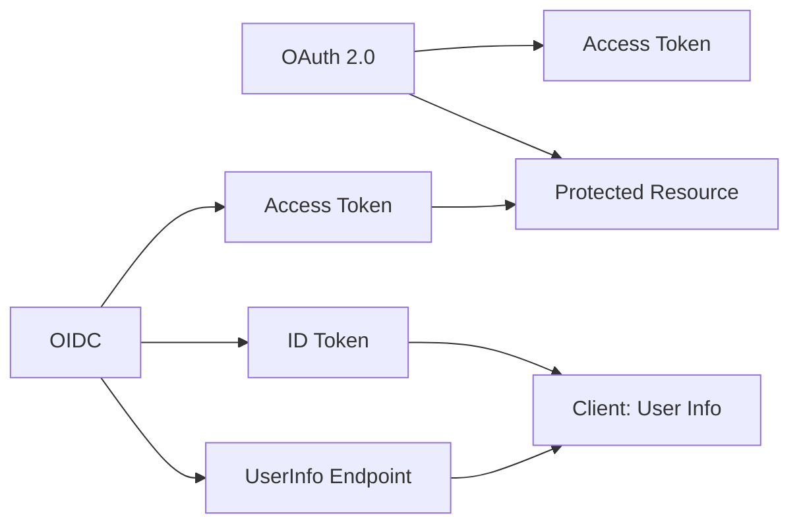
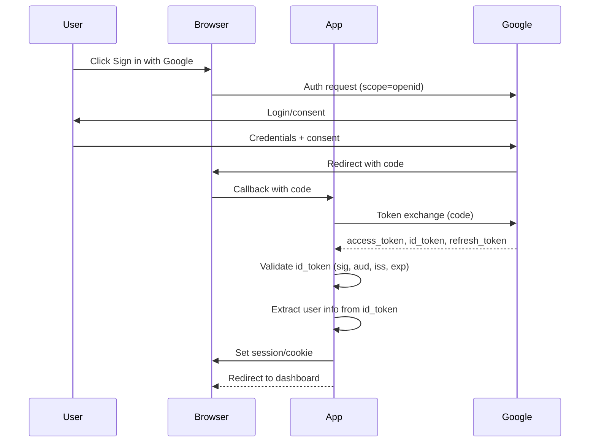

# OpenID Connect (OIDC)

## Introduction
OpenID Connect (OIDC) is an identity layer on top of the OAuth 2.0 protocol. It allows clients to verify the identity of the end-user based on the authentication performed by an authorization server, as well as to obtain basic profile information about the user.

## Why we need OIDC
OAuth 2.0 is for authorization (granting access to resources). OIDC adds authentication (verifying who the user is) and provides user information (like name, email) in a standardized way.

## Problem statement
How can we not only authorize a client to access resources but also authenticate the user and get their identity information in a standardized, interoperable way?

## Real-world story
You use your Google account to sign in to a new app. Instead of the app seeing just an access token, it also receives an ID token that confirms you are really you and gives your name and email—so the app can personalize your experience.

## Real-world analogy
**OIDC**: Like showing your driver's license at a bar. The bouncer checks your photo and details (authentication) and also sees your age and address (user info) to decide if you can enter and what services you can order.

## Visual explanation
```
OAuth 2.0: Client gets access token to access API
OIDC: Client gets access token AND ID token (with user info)
```

## Mermaid Diagram 1: OIDC vs OAuth 2.0


## Internal working
**OIDC builds on OAuth 2.0 by adding**:
1. **ID Token**: A JWT that contains user identity information (sub, name, email, etc.) and is signed by the authorization server.
2. **UserInfo Endpoint**: An endpoint that returns user claims (requires access token).
3. **Standardized scopes**: `openid` (required), `profile`, `email`, `address`, `phone`.
4. **Discovery**: Well-known configuration endpoint for automatic setup.

**Flow (Authorization Code with OIDC)**:
1. Client requests scope `openid` (and optionally `profile`, `email`)
2. Authorization server authenticates user and obtains consent
3. Server redirects back with authorization code
4. Client exchanges code for tokens: access_token, refresh_token, and **id_token**
5. Client validates ID token (signature, expiration, audience, issuer)
6. Client can optionally call UserInfo endpoint with access_token for more info

## Step-by-step flow
1. User clicks "Sign in with Google" (OIDC provider)
2. Browser redirected to: `https://accounts.google.com/o/oauth2/v2/auth?scope=openid%20profile%20email&...`
3. User logs in and consents
4. Google redirects to: `https://yourapp.com/callback?code=AUTH_CODE&state=...`
5. Your app exchanges code for tokens at Google's token endpoint
6. Google returns: 
   - access_token (for API calls)
   - id_token (JWT with user identity)
   - refresh_token (optional)
7. Your app validates the id_token:
   - Checks signature with Google's public key
   - Verifies `aud` matches your client ID
   - Verifies `iss` is `https://accounts.google.com`
   - Checks `exp` is in the future
8. Extracts user info from id_token (sub, email, name, picture)
9. Optionally calls Google's UserInfo endpoint with access_token for additional data

## Mermaid Diagram 2: ID Token Validation


## Architecture
**OIDC components**:
- **Authorization Server**: Implements OAuth 2.0 + OIDC (e.g., Google, Auth0, Azure AD)
- **Client**: Your application (requires OIDC library)
- **Resources**: APIs protected by access tokens
- **Endpoints**:
  - Authorization endpoint
  - Token endpoint
  - UserInfo endpoint
  - JWKS endpoint (for public keys to validate ID tokens)
  - Discovery endpoint (`.well-known/openid-configuration`)

## Mermaid Diagram 3: Token Endpoint Response
```mermaid
json
{
  "access_token": "ya29.a0AfH6SMB...",
  "expires_in": 3599,
  "id_token": "eyJhbGciOiJSUzI1NiIsImtpZCI6Ij...",
  "refresh_token": "1//0gCeLPS...",
  "scope": "openid profile email https://www.googleapis.com/auth/userinfo.profile",
  "token_type": "Bearer"
}
```

## Implementation
### Using NextAuth.js (simplified OIDC)
```javascript
// pages/api/auth/[...nextauth].js
import NextAuth from 'next-auth'
import GoogleProvider from 'next-auth/providers/google'

export default NextAuth({
  providers: [
    GoogleProvider({
      clientId: process.env.GOOGLE_CLIENT_ID,
      clientSecret: process.env.GOOGLE_CLIENT_SECRET,
      authorization: {
        params: {
          scope: 'openid email profile'
        }
      }
    })
  ],
  // Optional: Customize JWT session token
  jwt: {
    secret: process.env.JWT_SECRET,
    maxAge: 15 * 24 * 30 * 60 // 30 days
  },
  callbacks: {
    async jwt({ token, account, profile }) {
      // Persist OAuth access_token and user info to token
      if (account) {
        token.accessToken = account.access_token
        token.idToken = account.id_token
        // Extract from profile (Google)
        token.userId = profile.sub
        token.email = profile.email
        token.name = profile.name
        token.picture = profile.picture
      }
      return token
    },
    async session({ session, token }) {
      session.user.accessToken = token.accessToken
      session.user.id = token.userId
      session.user.email = token.email
      session.user.name = token.name
      session.user.picture = token.picture
      return session
    }
  }
})
```

### Manual OIDC validation (simplified)
```javascript
// lib/oidc.js
import jwt from 'jsonwebtoken'
import { JWKS_CLIENT } from 'jwks-rsa'
import fetch from 'node-fetch'

// Initialize JWKS client for Google
const jwksClient = new JWKS_CLIENT({
  jwksUri: 'https://www.googleapis.com/oauth2/v3/certs'
})

export function validateIdToken(idToken, nonce) {
  return new Promise((resolve, reject) => {
    // Get the key ID from the token header
    const decodedHeader = jwt.decode(idToken, { complete: true })
    if (!decodedHeader || !decodedHeader.header.kid) {
      return reject(new Error('Invalid token header'))
    }

    // Get the signing key from JWKS
    jwksClient.getSigningKey(decodedHeader.header.kid, (err, key) => {
      if (err) return reject(err)
      const signingKey = key.publicKey || key.rsaPublicKey

      // Verify the token
      jwt.verify(idToken, signingKey, { 
        issuer: 'https://accounts.google.com',
        audience: process.env.GOOGLE_CLIENT_ID,
        nonce: nonce // if used in auth request
      }, (err, payload) => {
        if (err) return reject(err)
        resolve(payload)
      })
    })
  })
}

// Get user info from UserInfo endpoint
export async function getUserInfo(accessToken) {
  const response = await fetch('https://openidconnect.googleapis.com/v1/userinfo', {
    headers: { Authorization: `Bearer ${accessToken}` }
  })
  if (!response.ok) throw new Error('Failed to fetch user info')
  return response.json()
}
```

## Folder structure
```
src/
├── lib/
│   ├── oidc.ts
│   ├── auth.ts
│   └── providers/
│       └── google.ts
├── middleware/
│   └── auth.ts
├── pages/
│   └── api/
│       └── auth/
│           └── [...nextauth].ts
└── types/
    └── oidc.ts
```

## Best practices
- Always use the `openid` scope to request ID token
- Validate the ID token: signature, issuer, audience, expiration
- Use HTTPS for all OIDC endpoints
- Use state and nonce to prevent CSRF and replay attacks
- Prefer using established libraries (OpenID Client, Ory Hydra, Auth.js)
- Cache JWKS keys to avoid fetching on every token validation
- Validate that the ID token's `azep` (authorized party) matches client ID if present
- Consider using the UserInfo endpoint for additional claims not in ID token
- Implement proper logout: clear session and redirect to provider's end_session_endpoint
- Use PKCE for public clients (SPAs, mobile apps) to prevent authorization code interception

## Common mistakes
- Skipping ID token validation (trusting the token without verification)
- Using the same secret for ID token validation as for your own JWTs
- Not checking the issuer (`iss`) claim (allows tokens from wrong provider)
- Not checking the audience (`aud`) claim (allows token reuse across clients)
- Forgetting to validate expiration (`exp`) and not-before (`nbf`) claims
- Storing ID token in localStorage (vulnerable to XSS)
- Not using nonce in implicit/hybrid flows (replay vulnerability)
- Mixing up access token and ID token purposes
- Not handling token refresh properly
- Ignoring the `auth_time` claim for step-up authentication

## Security considerations
**ID Token Validation**:
- Must validate: signature, issuer, audience, expiration, not-before
- Must use the correct signing key (from JWKS endpoint)
- Must check token is not replayed (use nonce if applicable)
- Must validate that the token is intended for your client (audience)

**Transport Security**:
- All OIDC endpoints must be accessed via HTTPS
- Authorization code and tokens must not leak in logs or referrers

**Privacy**:
- Only request scopes you need (data minimization)
- Handle user info securely (PII)
- Provide clear privacy policy and consent

## Performance notes
- JWKS fetching: Cache keys (they rotate infrequently)
- ID token validation: Public key verification (slower than HMAC but still fast)
- Consider asynchronous validation to avoid blocking event loop
- UserInfo endpoint adds latency; cache if appropriate and privacy allows
- Discovery endpoint: Cache `.well-known` configuration
- Use connection pooling for HTTP clients

## Interview questions
1. What is the difference between OAuth 2.0 and OpenID Connect?
2. What is an ID token and what does it contain?
3. Why is it important to validate the ID token?
4. What is the UserInfo endpoint used for?
5. What is the purpose of the nonce parameter in OIDC?

## MCQs
1. Which scope is required for OpenID Connect?
   a) profile
   b) email
   c) openid
   d) offline_access
   Answer: c

2. What is the ID token in OIDC?
   a) A random string used for CSRF protection
   b) A JWT containing user identity information
   c) An encrypted version of the access token
   d) A reference token stored on the server
   Answer: b

3. Which endpoint returns the server's public keys for token validation?
   a) /token
   b) /userinfo
   c) /jwks
   d) /authorization
   Answer: c

4. What claim in the ID token identifies the user?
   a) sub
   b) aud
   c) iss
   d) exp
   Answer: a

5. Which of the following is NOT a standard OIDC scope?
   a) openid
   b) profile
   c) email
   d) admin
   Answer: d

## Practice exercise
Implement OIDC login with Google:
1. Set up Google OAuth credentials
2. Create login button pointing to Google's authorization endpoint with scope=openid
3. Handle callback to exchange code for tokens
4. Validate the ID token (signature, aud, iss, exp)
5. Extract user info and create session

## Debugging exercise
"invalid_id_token" error during validation.
Check:
1. Incorrect client ID in audience check
2. Wrong issuer (using accounts.google.com vs https://accounts.google.com)
3. Token expired (check exp claim)
4. Missing or incorrect nonce (if used in auth request)
5. Using wrong key from JWKS (kid mismatch)

## Real-world scenario
Build a multi-tenant application where:
- Each tenant uses a different OIDC provider (Azure AD, Google, Okta)
- Users can link multiple OIDC accounts to their profile
- System maps OIDC subject (sub) to internal user ID
- Admin console shows which OIDC provider each user uses
- Support for OIDC discovery via domain-based configuration

## Mini project
Create an OIDC playground:
- Login with multiple providers (Google, GitHub, Apple)
- Display decoded ID token (without validation for demo)
- Show user info from UserInfo endpoint
- Validate ID token with proper error handling
- Implement logout by clearing session and redirecting to provider's end_session_endpoint
- Include a JWT debugger to show header, payload, and signature

## Interview coding question
Write a function that validates an OIDC ID token:
```javascript
function validateIdToken(token, clientId, issuer, jwksUri, nonce) {
  // 1. Extract header and get key ID
  // 2. Fetch signing key from JWKS URI
  // 3. Verify token signature with key
  // 4. Validate standard claims: iss, aud, exp, nbf, iat
  // 5. If nonce provided, validate nonce claim
  // 6. Return payload if valid, throw error with reason if invalid
}
```

## Summary
OIDC extends OAuth 2.0 with identity verification and user information. It provides a standardized way to authenticate users and get their profile data. Critical security steps include validating the ID token's signature, issuer, audience, and expiration. Use libraries to handle complexity, but understand the validation requirements.

## Cheat sheet
- **Required scope**: `openid`
- **ID token**: JWT with claims (sub, iss, aud, exp, iat, auth_time, nonce, etc.)
- **Validation**: 
  - Signature (using JWKS)
  - Issuer (iss) matches provider
  - Audience (aud) matches client ID
  - Expiration (exp) > now
  - Not-before (nbf) < now
- **Endpoints**: 
  - Authorization: `.../auth?response_type=code&scope=openid...`
  - Token: `.../token` (grant_type=authorization_code)
  - UserInfo: `.../userinfo` (Bearer access_token)
  - JWKS: `.../certs` (for validation)
  - Discovery: `.../.well-known/openid-configuration`

## Related topics
- OAuth 2.0
- JSON Web Tokens (JWT)
- Session management
- JWT validation best practices
- Social login providers
- Account linking and federation
- Single Sign-On (SSO)