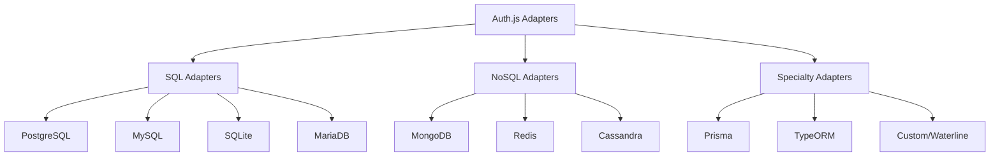

# Adapters

## Introduction
Adapters in Auth.js provide a way to integrate with different databases for storing users, accounts, sessions, and verification tokens. They abstract the database layer, allowing Auth.js to work with various storage systems while maintaining a consistent API.

## Why we need adapters
Auth.js needs to store persistent data (users, their linked accounts, sessions, etc.) but shouldn't be tied to a specific database. Adapters provide this abstraction, enabling developers to use their preferred database (PostgreSQL, MongoDB, MySQL, etc.) or even custom storage solutions while benefiting from Auth.js's authentication features.

## Problem statement
How do we integrate Auth.js with different database systems to store authentication-related data, choosing the right adapter for our storage needs, implementing schema migrations, and handling database-specific considerations?

## Real-world story
A startup initially used MongoDB for rapid prototyping but later migrated to PostgreSQL for better transactional guarantees and analytics capabilities. By using Auth.js's adapter pattern, they switched storage systems with minimal code changes, only replacing the adapter initialization.

## Real-world analogy
**Adapters**: Like universal database drivers - you keep the same application code (Auth.js) but swap out the connector (adapter) to talk to different database systems (PostgreSQL, MySQL, MongoDB, etc.) without changing your queries.

## Visual explanation
```
Auth.js Core
        ↓
    Adapter Interface
        ↓
+----------------+     +------------------+     +----------------+
| PostgreSQL     |     | MongoDB          |     | MySQL          |
| Users Table    |     | Users Collection |     | Users Table    |
| Accounts Table |     | Accounts Collection| | Accounts Table |
| Sessions Table |     | Sessions Collection| | Sessions Table |
| VerificationTokens Table| | VerificationTokens Collection| | VerificationTokens Table |
+----------------+     +------------------+     +----------------+
```

## Mermaid Diagram 1: Adapter Types


## Internal working
**Adapter contract**:
An adapter must implement methods for managing four core entities:
1. **User**: Represents a person in the system
2. **Account**: Represents a linked OAuth account or credentials
3. **Session**: Represents an active authenticated session
4. **VerificationToken**: Represents email verification or password reset tokens

**Required methods** (similar for each entity type):
- `create(entity)`: Create new record
- `get(id)`: Retrieve record by ID
- `getByEmail(email)`: Get user by email (User only)
- `getByAccount({ providerAccountId, provider })`: Get user by linked account
- `update(user)`: Update existing record
- `delete(id)`: Delete record by ID
- `linkAccount(user, account)`: Link OAuth account to user
- `unlinkAccount(user, account)`: Unlink OAuth account from user
- `getSessionAndUser(sessionToken)`: Get session and associated user
- `createSession(user)`: Create new session
- `updateSession(session)`: Update session (extend expiry, etc.)
- `deleteSession(sessionToken)`: Delete/invalidate session
- `getUser(id)`: Get user by ID (alternative to get)
- `getVerificationToken(params)`: Get token by identifier/token
- `createVerificationToken(token)`: Create verification token
- `useVerificationToken(params)`: Mark verification token as used

**How Auth.js uses adapters**:
1. On sign-in: Check if user exists via `getByEmail` or `getByAccount`
2. If new user: Create user via `create`, then link account via `linkAccount`
3. If existing user: Update via `update`, ensure account linked via `linkAccount`
4. Create session via `createSession` and store session token in cookie
5. On request: Validate session via `getSessionAndUser`
6. On sign-out: Delete session via `deleteSession`

## Step-by-step flow (database operations)
1. **Sign-in attempt**:
   - User submits credentials or completes OAuth flow
   - Auth.js calls adapter.getByEmail(email) or adapter.getByAccount({provider, providerAccountId})
2. **User exists?**
   - **No**: 
     - Call adapter.create(user) to create new user record
     - Call adapter.linkAccount(user, account) to link OAuth account
   - **Yes**:
     - Call adapter.update(user) to update user info (optional)
     - Call adapter.linkAccount(user, account) to ensure account linked
3. **Session creation**:
   - Call adapter.createSession(user) to create session record
   - Auth.js returns session token to be stored in cookie
4. **Request validation**:
   - On subsequent request, Auth.js extracts session token from cookie
   - Calls adapter.getSessionAndUser(sessionToken) to get { session, user }
   - Validates session not expired
   - Returns user data to application
5. **Sign-out**:
   - Auth.js calls adapter.deleteSession(sessionToken) to invalidate session

## Implementation
### Using Prisma Adapter (recommended for SQL)
```typescript
// app/api/auth/[...nextauth]/route.ts
import NextAuth from "next-auth"
import GoogleProvider from "next-auth/providers/google"
import { PrismaAdapter } from "@next-auth/prisma-adapter"
import prisma from "@/lib/prisma"

export const { GET, POST } = NextAuth({
  adapter: PrismaAdapter(prisma),
  providers: [
    GoogleProvider({
      clientId: process.env.GOOGLE_ID,
      clientSecret: process.env.GOOGLE_SECRET,
    })
  ],
  // Optional: customize session strategy
  session: {
    strategy: "database" // or "jwt"
  }
})
```

### Using MongoDB Adapter
```typescript
// app/api/auth/[...nextauth]/route.ts
import NextAuth from "next-auth"
import GoogleProvider from "next-auth/providers/google"
import { MongoDBAdapter } from "@next-auth/mongodb-adapter"
import { MongoClient } from "mongodb"

export const { GET, POST } = NextAuth({
  adapter: MongoDBAdapter(MongoClient(process.env.MONGODB_URI)),
  providers: [
    GoogleProvider({
      clientId: process.env.GOOGLE_ID,
      clientSecret: process.env.GOOGLE_SECRET,
    })
  ]
})
```

### Using Custom Adapter (template)
```typescript
// lib/adapters/custom-adapter.ts
export function CustomAdapter(): Adapter {
  return {
    // User methods
    async createUser(user) {
      // Insert user into database
      const inserted = await db.collection('users').insertOne(user)
      return { ...user, id: inserted.insertedId.toString() }
    },
    
    async getUser(id) {
      // Find user by ID
      const user = await db.collection('users').findOne({ _id: new ObjectId(id) })
      return user ?? null
    },
    
    async getUserByEmail(email) {
      // Find user by email
      const user = await db.collection('users').findOne({ email })
      return user ?? null
    },
    
    async getUserByAccount({ providerAccountId, provider }) {
      // Find user by linked account
      const account = await db.collection('accounts').findOne({
        providerAccountId,
        provider
      })
      if (!account) return null
      return await db.collection('users').findOne({ _id: account.userId })
    },
    
    async updateUser(user) {
      // Update user
      const { id, ...updateData } = user
      await db.collection('users').updateOne(
        { _id: new ObjectId(id) },
        { $set: updateData }
      )
      return user
    },
    
    async deleteUser(userId: // Mark user
 设置  (‘users’).deleteOne({ _id: new (userId) })
    return null
  }
  
  // Account methods
  async linkAccount(account) {
    // Insert account
    const inserted = await db.collection('accounts').insertOne(account)
    return { ...account, id: inserted.insertedId.toString() }
  }
  
  async updateAccount(account) {
    // Update account
    const { id, ...updateData } = account
    await db.collection('accounts').updateOne(
      { _id: new ObjectId(id) },
      { $set: updateData }
    )
    return account
  }
  
  async getAccountAndUser({ providerAccountId, provider }) {
    // Find account and associated user
    const account = await db.collection('accounts').findOne({
      providerAccountId,
      provider
    })
    if (!account) return null
    
    const user = await db.collection('users').findOne({ _id: account.userId })
    if (!user) return null
    
    return { user, account }
  }
  
  async deleteAccount({ providerAccountId, provider }) {
    // Delete account link
    await db.collection('accounts').deleteOne({
      providerAccountId,
      provider
    })
    return null
  }
  
  // Session methods
  async createSession(session) {
    // Insert session
    const inserted = await db.collection('sessions').insertOne(session)
    return { ...session, id: inserted.insertedId.toString() }
  }
  
  async getSessionAndUser(sessionToken) {
    // Find session and associated user
    const session = await db.collection('sessions').findOne({ sessionToken })
    if (!session) return null
    
    const user = await db.collection('users').findOne({ _id: session.userId })
    if (!user) return null
    
    return { session, user }
  }
  
  async updateSession(session) {
    // Update session
    const { sessionToken, ...updateData } = session
    await db.collection('sessions').updateOne(
      { sessionToken },
      { $set: updateData }
    )
    return session
  }
  
  async deleteSession(sessionToken) {
    // Delete session
    await db.collection('sessions').deleteOne({ sessionToken })
    return null
  }
  
  // Verification token methods
  async createVerificationToken(token) {
    // Insert verification token
    const inserted = await db.collection('verificationTokens').insertOne(token)
    return { ...token, id: inserted.insertedId.toString() }
  }
  
  async useVerificationToken({ token, identifier }) {
    // Mark token as used
    await db.collection('verificationTokens').deleteOne({
      token,
      identifier
    })
    return null
  }
  
  async getVerificationToken({ token, identifier }) {
    // Find verification token
    const vt = await db.collection('verificationTokens').findOne({
      token,
      identifier
    })
    return vt ?? null
  }
}
```

## Folder structure
```
src/
├── app/
│   └── api/
│       └── [...nextauth]/
│           └── route.ts
├── lib/
│   ├── prisma.ts
│   ├── mongodb.ts
│   └── adapters/
│       ├── index.ts
│       ├── custom-adapter.ts
│       └── prisma-extension.ts
├── prisma/
│   ├── schema.prisma
│   └── migrations/
├── types/
│   └── next-auth.d.ts
└── migrations/
    ├── 001_create_tables.sql
    └── 002_add_indexes.sql
```

## Best practices
**Adapter selection**:
- Use Prisma Adapter for TypeScript projects with relational databases
- Consider MongoDB Adapter for document-based storage needs
- Evaluate community adapters for specialty storage (DynamoDB, FaunaDB, etc.)
- Build custom adapter only when existing solutions don't meet requirements
- Consider migration path when choosing adapter technology

**Schema design**:
- Follow Auth.js's expected schema exactly for compatibility
- Use appropriate data types (UUID/string for IDs, timestamps for dates)
- Implement proper indexing on lookup fields (email, providerAccountId, sessionToken)
- Consider soft deletes vs hard deletes based on compliance requirements
- Add application-specific fields to user/account tables as needed
- Use database-specific features (JSONB in PostgreSQL for flexible attributes)

**Migration management**:
- Use database migration tools (Prisma Migrate, Flyway, Liquibase)
- Version control your database schema
- Test migrations on staging before production
- Implement backward compatible schema changes
- Have rollback plan for production migrations
- Consider blue/green deployment for zero-downtime migrations

**Security considerations**:
- Use connection pooling with appropriate limits
- Encrypt sensitive data at rest (email, tokens)
- Implement row-level security if needed (multi-tenant applications)
- Regularly backup authentication data
- Monitor database performance for authentication queries
- Use prepared statements/ORM to prevent SQL injection
- Considerusing database-managed encryption for sensitive fields

**Performance optimization**:
- Index frequently queried fields: email, providerAccountId, sessionToken
- Consider covering indexes for common query patterns
- Use connection pooling appropriate to your traffic patterns
- Implement read replicas for read-heavy authentication workloads
- Monitor query execution plans for slow operations
- Cache frequently accessed non-sensitive data (user roles, preferences)
- Consider partitioning large tables by date or hash
- Implement archiving strategy for old sessions and verification tokens

**Error handling**:
- Handle database connection errors gracefully
- Implement retry logic for transient errors
- Log database errors without exposing sensitive information
- Consider circuit breaker pattern for database access
- Provide meaningful error messages to users (without leaking DB details)
- Implement dead letter queue for failed authentication events

## Common mistakes
- Using incompatible adapter version with Auth.js version
- Forgetting to run database migrations after schema changes
- Not indexing critical lookup columns (email, providerAccountId)
- Storing plaintext passwords or tokens in database
- Using auto-increment integers for IDs in distributed systems
- Forgetting to handle null/missing values from database queries
- Overlooking case sensitivity in email lookups (depends on DB collation)
- Not handling duplicate key errors when creating users/accounts
- Missing required fields in adapter implementation
- Not returning correct data types (e.g., string ID vs number)
- Forgetting to implement all required adapter methods
- Using transactions incorrectly (missing rollback/commit)
- Not setting appropriate time zones for timestamp columns
- Overlooking database-specific behavior (NULL handling, string comparison)
- Forgetting to close database connections (resource leak)
- Using inconsistent date formats (ISO strings vs timestamps)
- Not handling database timeout scenarios gracefully

## Security considerations
**Data protection**:
- Encrypt sensitive fields (email, tokens) at rest
- Use database-level encryption or application-level encryption
- Implement proper access controls (least privilege principle)
- Regularly audit authentication tables for unauthorized access
- Consider using database schemas to separate auth data from app data
- Implement data retention policies for old sessions and tokens
- Use prepared statements or ORM to prevent SQL injection

**Integrity**:
- Use foreign key constraints to maintain referential integrity
- Implement unique constraints on email and provider+providerAccountId
- Use constraints to prevent invalid state (e.g., session without user)
- Consider using triggers for audit logging or data validation
- Implement soft delete patterns to prevent accidental data loss
- Validate data before storage (email format, token format, etc.)

**Availability**:
- Implement database replication for high availability
- Use connection pooling to prevent exhausting database connections
- Monitor database performance and set up alerts for slow queries
- Consider read replicas for distributing authentication load
- Implement circuit breaker pattern to prevent cascading failures
- Have failover strategy for database outages
- Consider using managed database services (AWS RDS, Google Cloud SQL)

**Privacy compliance**:
- Implement data subject request handling (access, deletion, portability)
- Consider pseudonymization for analytics data
- Implement data minimization principles (store only what's needed)
- Regularly purge old data according to retention policies
- Implement consent tracking for data usage
- Consider data partitioning by jurisdiction for compliance

## Performance notes
**Read optimization**:
- Index email column for O(log n) user lookup by email
- Index provider+providerAccountId for O(log n) account lookup
- Index sessionToken column for O(log n) session validation
- Consider covering indexes for frequent query patterns
- Use read replicas for distributing authentication load
- Implement query caching for frequent, non-changing data
- Monitor buffer cache hit ratio for database performance

**Write optimization**:
- Use appropriate isolation levels for authentication workloads
- Consider batch operations for bulk user imports
- Implement indexing strategy that balances read/write performance
- Monitor transaction log growth and implement appropriate cleanup
- Consider using write-optimized storage engines for high-write scenarios
- Use connection pooling with appropriate min/max settings

**Scaling considerations**:
- Vertical scaling: Increase database instance size
- Horizontal scaling: Sharding, read replicas, partitioning
- Consider database-per-tenant pattern for multi-tenant applications
- Implement caching layer (Redis) for frequent lookups
- Use database connection pooling with appropriate settings
- Monitor replication lag in master-slave setups
- Consider using cloud-native databases with auto-scaling

**Monitoring metrics**:
- Query response times (avg, p95, p99)
- Connection pool utilization
- Slow query count and duration
- Lock wait times and deadlocks
- Replication lag (if applicable)
- Cache hit ratio (if using caching layer)
- Storage utilization and growth rate
- Backup success rate and duration

## Interview questions
1. What are the four main entities that Auth.js adapters need to manage?
2. What's the difference between using an adapter and the default JWT strategy?
3. How do you handle database migrations with Auth.js adapters?
4. What security considerations are important for authentication databases?
5. How would you optimize database performance for authentication workloads?
6. What's the difference between Prisma Adapter pattern and using raw database queries in callbacks?
7. How do you handle soft deletes vs hard deletes in authentication data?
8. How do you implement multi-tenancy with Auth.js adapters?
9. What are the trade-offs between using a relational database vs NoSQL for auth data?
10. How would you handle database connection errors in an adapter?

## MCQs
1. Which entities must an Auth.js adapter manage? (Select all that apply)
   a) Users
   b) Accounts
   c) Sessions
   d) Verification Tokens
   e) Permissions
   f) Roles
   Answer: a, b, c, d

2. What method does Auth.js use to find a user by their email address?
   a) getUserById
   b) getUserByEmail
   c) findUser
   d) lookupUser
   Answer: b

3. Which adapter method is responsible for linking an OAuth account to a user?
   a) createUser
   b) updateUser
   c) linkAccount
   d) associateAccount
   Answer: c

4. What is the purpose of the `getSessionAndUser` method in an adapter?
   a) To create a new session
   b) To validate a session and return associated user data
   c) To delete an expired session
   c) To update session expiration time
   Answer: b

5. Which of the following is NOT a required method in an Auth.js adapter?
   a) createUser
   b) deleteUser
   c) getUserByEmail
   d) hashPassword
   Answer: d

## Practice exercise
Set up Auth.js with:
1. PostgreSQL database using Prisma Adapter
2. Proper schema with users, accounts, sessions, verification tokens tables
3. Indexes on email, providerAccountId, sessionToken columns
4. Connection pooling configuration
5. Migration script for initial schema setup
6. Seed data for initial users and roles
7. Integration testing for adapter methods
8. Performance testing with simulated login load
9. Backup and recovery procedure for authentication data
10. Documentation for database schema and relationships

## Debugging experience
"Adapter method not found" error.
Check:
1. Adapter import path is correct
2. Adapter version matches Auth.js version
3. All required methods are implemented in adapter
4. Method names match exactly what Auth.js expects
5. Return types match expected formats (Promise resolving to correct type)
6. Asynchronous methods properly return Promises
7. Not mixing and matching different adapter types
8. Database connection is properly established
9. Not using deprecated adapter methods from older Auth.js versions
10. Checking adapter documentation for required interface

## Real-world scenario
Financial services authentication system:
- PostgreSQL database with row-level security for multi-tenancy
- Transparent data encryption for sensitive fields (SSN, account numbers)
- Geographic replication for disaster recovery
- Real-time replication to data warehouse for analytics
- Audit table recording every authentication attempt (success/fail)
- Integration with identity proofing service for KYC compliance
- Hardware security module (HSM) for key management
- Immutable audit logs using write-once-read-many (WORM) storage
- Separate database for session storage with TTL indexes
- Regular penetration testing on authentication database
- Compliance reporting automation for SOX, GLB, PCI-DSS

## Mini project
Create an adapter compatibility checker that:
- Lists all available Auth.js adapters (official and community)
- Shows required dependencies for each adapter
- Displays the schema/tables each adapter expects
- Indicates which databases each adapter supports
- Provides sample connection strings for each adapter
- Includes migration scripts for popular databases
- Highlights adapters that support transactions
- Shows adapters with built-in caching capabilities
- Provides performance benchmarks for common operations
- Generates adapter boilerplate code for custom implementations